# Diagrama de clases · Backend · Librería Mi Sueño

## Introducción

Este documento presenta el diseño del backend del sistema de e-commerce para Librería Mi Sueño a través de sus diagramas de clases, organizados por módulo y por capa. Además de las clases, se detallan las reglas de negocio, los flujos principales, los endpoints de la API y las decisiones técnicas que dan forma a la solución.

El backend está desarrollado con NestJS y TypeScript, utiliza Drizzle ORM para el acceso a datos y PostgreSQL (alojado en Supabase) como base de datos, dentro del schema `libreria`. Su estructura sigue los principios de Clean Architecture, con cuatro capas —dominio, aplicación, infraestructura y presentación— y una regla de dependencias única: las capas externas dependen de las internas, nunca al revés. De esta forma, las reglas de negocio quedan aisladas del framework, de la base de datos y de los servicios externos.

El sistema se divide en dos módulos principales:

- **`identity`**: gestiona los usuarios del panel, la autenticación, las sesiones y las contraseñas.
- **`catalog`**: gestiona las categorías, los productos, sus imágenes y las búsquedas del catálogo público.

Ambos módulos comparten un núcleo común (_shared kernel_) con las abstracciones básicas utilizadas en todo el sistema, como entidades base, manejo de errores, transacciones y eventos.

---

## 1. Capas y regla de dependencias

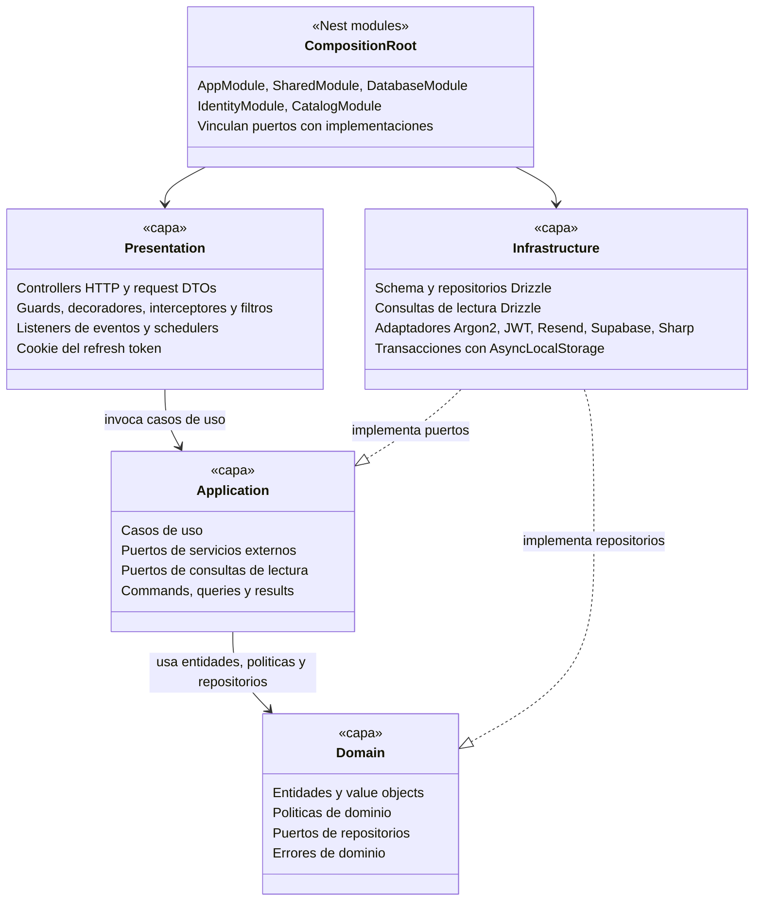

### Descripción de las capas

El diagrama representa la organización general del backend en capas. Cada elemento agrupa un conjunto de responsabilidades bien delimitadas:

- **Presentation (Presentación)**: es el punto de entrada al sistema. Recibe las solicitudes HTTP a través de los controladores, valida los datos de entrada mediante DTOs, lee los formularios con archivos mediante interceptores y controla el acceso con guards y decoradores. También incluye los listeners de eventos, las tareas programadas (schedulers) y el manejo de la cookie del refresh token. Su función es traducir las solicitudes externas en invocaciones a los casos de uso.

- **Application (Aplicación)**: contiene los casos de uso del sistema, es decir, las operaciones que puede realizar cada actor (dar de alta un producto, iniciar sesión, reordenar imágenes, entre otras). Orquesta la lógica de cada operación utilizando las entidades del dominio y define los puertos (interfaces) de los servicios externos y de las consultas de lectura que necesita, sin depender de su implementación concreta.

- **Domain (Dominio)**: es el núcleo del sistema. Contiene las entidades, los value objects, las políticas de negocio, los contratos de los repositorios y los errores propios del dominio. Aquí residen las reglas que definen el comportamiento del negocio, independientes de cualquier tecnología.

- **Infrastructure (Infraestructura)**: implementa los contratos definidos por las capas internas. Incluye el schema y los repositorios de Drizzle, las consultas de lectura, los adaptadores de servicios externos (Argon2 para contraseñas, JWT para tokens, Resend para mails, Supabase Storage para archivos y Sharp para el procesamiento de imágenes) y el manejo de transacciones.

- **CompositionRoot (Raíz de composición)**: corresponde a los módulos de NestJS (`AppModule`, `SharedModule`, `DatabaseModule`, `IdentityModule` y `CatalogModule`). Es el único componente que conoce tanto los contratos como sus implementaciones, y se encarga de vincularlos al iniciar la aplicación.

### Relaciones entre capas

- **Presentation → Application**: la capa de presentación invoca los casos de uso; no contiene lógica de negocio.
- **Application → Domain**: los casos de uso operan sobre las entidades, políticas y repositorios definidos en el dominio.
- **Infrastructure implementa Domain y Application**: la infraestructura provee las implementaciones concretas de los repositorios (definidos en el dominio) y de los puertos de servicios externos y consultas (definidos en la aplicación).
- **CompositionRoot → Presentation e Infrastructure**: los módulos de NestJS registran los controladores y vinculan cada contrato con su implementación.

### Reglas de arquitectura

1. **Dirección única de dependencias.** Las dependencias apuntan siempre hacia el núcleo del sistema. La capa de dominio no depende de ninguna otra capa; la capa de aplicación depende únicamente del dominio; y las capas de infraestructura y presentación dependen de las capas internas, sin depender entre sí.

2. **Independencia del framework en el núcleo.** Las capas de dominio y aplicación no utilizan NestJS, Drizzle, Express ni ninguna otra librería de infraestructura. Los casos de uso se implementan como clases TypeScript sin dependencias externas, lo que facilita su prueba y su mantenimiento.

3. **Contratos definidos como clases abstractas.** Los repositorios y servicios externos se declaran como clases abstractas. Esto permite que NestJS las utilice directamente como identificadores para la inyección de dependencias, y que TypeScript verifique en tiempo de compilación que cada implementación cumpla el contrato.

4. **Composición centralizada en los módulos.** Cada módulo de NestJS registra sus casos de uso e inyecta las implementaciones concretas correspondientes. Es el único punto del sistema donde se conocen simultáneamente los contratos y sus implementaciones.

5. **Separación entre operaciones de escritura y de lectura.** Las operaciones de escritura obtienen las entidades a través de los repositorios y validan las reglas de negocio antes de persistir los cambios. Las operaciones de lectura (listados y búsquedas) utilizan puertos de consulta específicos que devuelven los datos con el formato requerido por la respuesta, sin reconstruir entidades, lo que mejora el rendimiento.

6. **Control automático de dependencias.** Se incorpora la herramienta de análisis estático `eslint-plugin-boundaries` para que el proceso de integración continua rechace cualquier importación que viole la dirección de dependencias entre capas. Las reglas se verifican junto con el resto del análisis de código y prohíben todo lo que no está permitido explícitamente: además de la dirección entre capas, el núcleo compartido no puede depender de los módulos, un módulo solo accede a la capa de presentación de otro y las capas de dominio y aplicación no pueden importar librerías externas ni módulos de Node. Todo archivo del código fuente debe pertenecer a una capa, de modo que una carpeta nueva no quede fuera del control sin que se advierta.

Estructura de carpetas:

```text
src/
├── main.ts
├── app.module.ts
├── app.setup.ts                              # prefijo, versionado, validación, cookies
├── config/                                   # validación de variables de entorno (Zod)
├── cli/                                      # migraciones, seed del admin, buckets, prueba de la base
├── health/                                   # /health y /health/ready
├── shared/
│   ├── domain/          entity.ts errors/ value-objects/          # Entity, errores, Money, Slug
│   ├── application/                          # TransactionManager, Clock, IdGenerator, BackgroundTasks,
│   │                                         # EventPublisher, FileStorage, Page, UniqueSlugGenerator
│   ├── infrastructure/
│   │   ├── database/                         # DrizzleClient, DrizzleExecutor, DrizzleTransactionManager,
│   │   │   │                                 # DatabaseModule, bloqueos, patrones de búsqueda
│   │   │   └── schema/                       # una tabla por archivo, enums, secuencias y relaciones
│   │   ├── events/                           # NestEventPublisher
│   │   ├── storage/                          # SupabaseFileStorage y buckets
│   │   └── shared.module.ts                  # Clock, IdGenerator, BackgroundTasks, EventPublisher, FileStorage
│   └── presentation/    filters/ guards/ http/                    # filtro de errores, RateLimitGuard, DTO de paginación
└── modules/
    ├── identity/
    │   ├── domain/          entities/ value-objects/ services/ repositories/ errors/
    │   ├── application/     ports/ services/ use-cases/ dto/ errors/
    │   ├── infrastructure/  persistence/ security/ mail/ logging/
    │   ├── presentation/    http/ guards/ decorators/ errors/ schedulers/
    │   └── identity.module.ts
    └── catalog/
        ├── domain/          entities/ value-objects/ services/ repositories/ errors/
        ├── application/     ports/ services/ settings/ events/ use-cases/ dto/ errors/
        ├── infrastructure/  persistence/ images/
        ├── presentation/    http/ listeners/ schedulers/
        └── catalog.module.ts
drizzle/                                      # migraciones de drizzle-kit y SQL manual (funciones y triggers)
```

---

## 2. Shared kernel

El _shared kernel_ (núcleo compartido) reúne las clases y abstracciones que utilizan todos los módulos del sistema, tanto `identity` como `catalog`. Su objetivo es evitar la duplicación de código y garantizar que aspectos comunes —como el manejo de errores, las transacciones o la paginación— se resuelvan de la misma forma en todo el backend.

Al igual que el resto del sistema, el núcleo compartido respeta la división en capas:

- **Dominio**: la entidad base de la que heredan todas las entidades, la jerarquía de errores de negocio y los value objects de uso general, como `Money` (montos monetarios) y `Slug` (identificadores legibles para las URL).
- **Aplicación**: la interfaz común de los casos de uso y los contratos de servicios transversales, como el manejo de transacciones, la obtención de la fecha y hora actual, la generación de identificadores, el trabajo en segundo plano, la publicación de eventos, el almacenamiento de archivos, la generación de slugs únicos y las estructuras de paginación.
- **Infraestructura**: las implementaciones concretas de esos contratos, basadas en Drizzle ORM para las transacciones, en el sistema de eventos de NestJS y en Supabase Storage para los archivos.
- **Presentación**: el guard de límite de solicitudes, el filtro que convierte los errores internos en respuestas HTTP y las piezas comunes de los DTOs de entrada, como la paginación. Los guards de autenticación y autorización se ubican en la presentación de `identity`, porque dependen de sus roles, y se registran en `AppModule` junto con el de límite de solicitudes.

```mermaid
classDiagram
    class Entity {
        <<abstract domain>>
        #id: string
        +getId() string
        +equals(other: Entity) boolean
    }

    class DomainError {
        <<abstract domain>>
        +code: string
        +message: string
        +publicDetails?: ErrorDetails
    }
    class EntityNotFoundError { <<domain>> }
    class ConflictError { <<domain>> }
    class BusinessRuleViolationError { <<domain>> }
    class InvalidValueError { <<domain>> }
    class AuthenticationError { <<domain>> }
    class ForbiddenActionError { <<domain>> }
    class ExternalServiceError { <<domain>> }

    class Money {
        <<value object domain>>
        -cents: number
        +fromDecimal(value: string)$ Money
        +fromCents(cents: number)$ Money
        +toCents() number
        +toDecimalString() string
        +toNumber() number
        +isPositive() boolean
        +isLessThan(other: Money) boolean
        +equals(other: Money) boolean
    }
    class Slug {
        <<value object domain>>
        +MAX_LENGTH$: number
        -value: string
        +fromText(text: string, maxLength?: number)$ Slug
        +fromValue(value: string)$ Slug
        +length: number
        +withSuffix(n: number, maxLength?: number) Slug
        +equals(other: Slug) boolean
        +toString() string
    }

    class UseCase {
        <<interface application>>
        +execute(input: TInput) Promise~TOutput~
    }
    class TransactionManager {
        <<abstract application>>
        +run(work: Function) Promise~T~
    }
    class Clock {
        <<abstract application>>
        +now() Date
    }
    class IdGenerator {
        <<abstract application>>
        +next() string
    }
    class BackgroundTasks {
        <<abstract application>>
        +run(name: string, work: Function) void
    }
    class EventPublisher {
        <<abstract application>>
        +publish(event: ApplicationEvent) Promise~void~
    }
    class ApplicationEvent {
        <<interface application>>
        +name: string
    }
    class FileStorage {
        <<abstract application>>
        +upload(bucket: StorageBucket, key: string, body: Uint8Array, contentType: string) Promise~void~
        +download(bucket: StorageBucket, key: string) Promise~Uint8Array~
        +remove(bucket: StorageBucket, keys: string[]) Promise~void~
        +signedUrls(keys: string[], expiresInSeconds: number) Promise~string[]~
        +publicUrl(key: string) string
    }
    class StorageBucket {
        <<enumeration>>
        PRIVATE
        PUBLIC
    }
    class DatabaseHealthCheck {
        <<abstract application>>
        +isReachable() Promise~boolean~
    }
    class UniqueSlugGenerator {
        <<service application>>
        +generate(text: string, store: SlugStore, maxLength: number) Promise~Slug~
    }
    class SlugStore {
        <<interface application>>
        +exists(slug: Slug) Promise~boolean~
        +lock(slug: Slug) Promise~void~
    }
    class PageRequest {
        <<interface application>>
        +page: number
        +limit: number
    }
    class Page~T~ {
        <<interface application>>
        +items: T[]
        +page: number
        +limit: number
        +totalItems: number
        +totalPages: number
    }
    class SortDirection {
        <<enumeration>>
        ASC
        DESC
    }
    class RecordStatusFilter {
        <<enumeration>>
        ACTIVE
        INACTIVE
        DELETED
        ALL
    }

    class DrizzleClient {
        <<infrastructure>>
        +pool: Pool
        +db: Database
        +onApplicationShutdown() Promise~void~
    }
    class DrizzleExecutor {
        <<infrastructure>>
        -storage: AsyncLocalStorage~Transaction~
        -client: DrizzleClient
        +current() DbExecutor
        +hasActiveTransaction() boolean
        +runInContext(tx: Transaction, work: Function) Promise~T~
    }
    class DrizzleTransactionManager {
        <<infrastructure>>
        -client: DrizzleClient
        -executor: DrizzleExecutor
        +run(work: Function) Promise~T~
    }
    class DrizzleDatabaseHealthCheck {
        <<infrastructure>>
        -client: DrizzleClient
        +isReachable() Promise~boolean~
    }
    class SystemClock {
        <<infrastructure>>
        +now() Date
    }
    class CryptoIdGenerator {
        <<infrastructure>>
        +next() string
    }
    class LoggingBackgroundTasks {
        <<infrastructure>>
        +run(name: string, work: Function) void
        +beforeApplicationShutdown() Promise~void~
        +idle() Promise~void~
    }
    class NestEventPublisher {
        <<infrastructure>>
        -emitter: EventEmitter2
        +publish(event: ApplicationEvent) Promise~void~
    }
    class SupabaseFileStorage {
        <<infrastructure>>
        -client: StorageClient
        +upload(bucket: StorageBucket, key: string, body: Uint8Array, contentType: string) Promise~void~
        +download(bucket: StorageBucket, key: string) Promise~Uint8Array~
        +remove(bucket: StorageBucket, keys: string[]) Promise~void~
        +signedUrls(keys: string[], expiresInSeconds: number) Promise~string[]~
        +publicUrl(key: string) string
    }
    class BucketSettings {
        <<infrastructure>>
        +name: string
        +isPublic: boolean
        +fileSizeLimitBytes: number
        +allowedMimeTypes: string[]
    }
    class SharedModule { <<module infrastructure>> }
    class DatabaseModule { <<module infrastructure>> }
    class AppModule { <<module>> }
    class HealthController {
        <<controller>>
        -databaseHealthCheck: DatabaseHealthCheck
        +check() status
        +ready() Promise~status~
    }
    class InvalidMoneyError { <<InvalidValueError>> }
    class InvalidSlugError {
        <<InvalidValueError>>
        +reason: InvalidSlugReason
    }

    class RateLimitGuard {
        <<guard presentation>>
        #throwThrottlingException(context: ExecutionContext, detail: ThrottlerLimitDetail) Promise~void~
    }
    class StrictRateLimit { <<decorator presentation>> }
    class RateLimit {
        <<interface presentation>>
        +limit: number
        +ttl: number
    }
    class PageRequestDto {
        <<presentation>>
        +page: number
        +limit: number
    }
    class IsQueryBoolean { <<decorator presentation>> }
    class ErrorResponseFilter {
        <<filter presentation>>
        -httpAdapterHost: HttpAdapterHost
        +catch(exception: unknown, host: ArgumentsHost) void
        -fromDomainError(error: DomainError, mapping: DomainErrorMapping) ErrorBody
        -fromDatabaseError(sqlState: string) ErrorBody
        -fromHttpException(exception: HttpException) ErrorBody
        -fromUnknown() ErrorBody
    }
    class ErrorResponse {
        <<interface presentation>>
        +statusCode: number
        +code: string
        +message: string
        +details?: ValidationErrorDetail[]
        +path: string
        +timestamp: string
    }
    class ValidationErrorDetail {
        <<interface presentation>>
        +field: string
        +messages: string[]
    }
    class RequestValidationError {
        <<presentation>>
        +details: ValidationErrorDetail[]
    }
    class NotImplementedYetError { <<presentation>> }

    DomainError <|-- EntityNotFoundError
    DomainError <|-- ConflictError
    DomainError <|-- BusinessRuleViolationError
    DomainError <|-- InvalidValueError
    DomainError <|-- AuthenticationError
    DomainError <|-- ForbiddenActionError
    DomainError <|-- ExternalServiceError
    InvalidValueError <|-- RequestValidationError
    DomainError <|-- NotImplementedYetError
    DrizzleTransactionManager ..|> TransactionManager
    DrizzleTransactionManager --> DrizzleExecutor
    DrizzleExecutor --> DrizzleClient
    DrizzleDatabaseHealthCheck ..|> DatabaseHealthCheck
    SystemClock ..|> Clock
    CryptoIdGenerator ..|> IdGenerator
    LoggingBackgroundTasks ..|> BackgroundTasks
    NestEventPublisher ..|> EventPublisher
    SupabaseFileStorage ..|> FileStorage
    SupabaseFileStorage ..> BucketSettings
    Money ..> InvalidMoneyError : lanza
    Slug ..> InvalidSlugError : lanza
    HealthController --> DatabaseHealthCheck
    AppModule ..> SharedModule
    AppModule ..> DatabaseModule
    StrictRateLimit ..> RateLimit
    ErrorResponse ..> ValidationErrorDetail
    FileStorage ..> StorageBucket
    EventPublisher ..> ApplicationEvent
    UniqueSlugGenerator ..> SlugStore
    UniqueSlugGenerator ..> Slug
    Page~T~ ..> PageRequest
    PageRequestDto ..|> PageRequest
    SharedModule ..> SystemClock
    SharedModule ..> CryptoIdGenerator
    SharedModule ..> LoggingBackgroundTasks
    SharedModule ..> NestEventPublisher
    SharedModule ..> SupabaseFileStorage
    DatabaseModule ..> DrizzleTransactionManager
    DatabaseModule ..> DrizzleDatabaseHealthCheck
    RateLimitGuard ..> StrictRateLimit
    ErrorResponseFilter ..> DomainError
    ErrorResponseFilter ..> ErrorResponse
```

### Clases principales

#### Dominio

- **`Entity`**: clase base abstracta de la que heredan todas las entidades del sistema (usuarios, sesiones, productos, categorías, imágenes). Define el identificador único y el criterio de igualdad entre entidades: dos entidades son iguales si tienen el mismo identificador, aunque el resto de sus datos difiera.

- **`DomainError`**: clase base de todos los errores del sistema. Cada error tiene un código estable, un mensaje y, opcionalmente, datos públicos para el cliente (`publicDetails`), como la cantidad de elementos que impiden una baja; puede conservar la causa original. Se especializa según su naturaleza:
  - `EntityNotFoundError`: el recurso solicitado no existe.
  - `ConflictError`: la operación entra en conflicto con datos existentes (por ejemplo, un email ya registrado).
  - `BusinessRuleViolationError`: la operación viola una regla de negocio (por ejemplo, eliminar la última imagen de un producto).
  - `InvalidValueError`: un dato no cumple el formato o rango esperado.
  - `AuthenticationError`: credenciales o sesión inválidas.
  - `ForbiddenActionError`: acción no permitida para el usuario.
  - `ExternalServiceError`: un servicio del que depende la operación, como el proveedor de mails o el almacenamiento de archivos, falló o no respondió.

  Las siete especializaciones son abstractas y se ubican junto a `DomainError`, de modo que los casos de uso puedan lanzarlas sin depender de la capa de presentación; cada error concreto define su propio código. Los errores concretos de cada módulo se describen en su sección.

- **`Money`**: value object que representa montos en pesos. Internamente trabaja con centavos enteros para evitar los errores de redondeo propios de los números decimales, y ofrece operaciones de comparación, como verificar que el precio de oferta sea menor al precio regular. Admite montos de 0 a 9.999.999.999,99, el rango de la columna de la base de datos, y se construye a partir de un texto con hasta dos decimales separados por un punto; un monto inválido se rechaza con `InvalidMoneyError`.

- **`Slug`**: value object que representa el identificador legible de un producto o categoría en la URL (por ejemplo, `cuaderno-rayado-a4`). Se genera a partir de un texto y garantiza un formato válido: minúsculas, sin tildes ni espacios, con las palabras separadas por un único guion. Un texto que no contiene ninguna letra ni número se rechaza con `InvalidSlugError`, y uno que supera el largo máximo (220 caracteres, o 120 en categorías) se recorta después de la última palabra que entra (o justo en el límite, si así se perdería más de la mitad del texto), de modo que un título válido nunca falla por su slug.

#### Aplicación

- **`UseCase`**: interfaz común que implementan todos los casos de uso del sistema, con un único método `execute`. Esto le da una estructura uniforme a todas las operaciones.

- **`TransactionManager`**: contrato para ejecutar un conjunto de operaciones dentro de una misma transacción de base de datos. Si alguna falla, se revierten todas. Los casos de uso lo utilizan sin conocer cómo se implementa.

- **`Clock`**: contrato para obtener la fecha y hora actual. Permite controlar el tiempo en las pruebas automatizadas, por ejemplo, para verificar el vencimiento de una clave temporal o de una oferta. Ningún caso de uso toma la hora de otro lugar.

- **`IdGenerator`**: contrato para generar el identificador de una entidad nueva antes de guardarla. Las entidades se crean siempre con su identificador, lo que permite compararlas y relacionarlas sin depender de la base de datos, y su implementación genera identificadores UUID con el módulo de criptografía de Node.

- **`BackgroundTasks`**: contrato para ejecutar un trabajo después de responder la solicitud que lo originó, de modo que el tiempo de respuesta no dependa de lo que ese trabajo encuentre. Lo utilizan la recuperación de contraseña, para no revelar qué cuentas existen, la publicación de los eventos de imágenes, la limpieza de archivos subidos que no llegaron a guardarse y el reprocesamiento de imágenes demoradas.

- **`EventPublisher`**: contrato para publicar eventos del sistema (`ApplicationEvent`). Permite desacoplar acciones secundarias de la operación principal; por ejemplo, al subir una imagen se publica un evento y su procesamiento se realiza de forma asincrónica.

- **`FileStorage`**: contrato para operar con el almacenamiento de archivos, organizado en un espacio privado para los originales y uno público para las versiones que muestra la tienda (`StorageBucket`). Permite subir, descargar y eliminar archivos, generar en una sola llamada direcciones firmadas de acceso temporal (o `null` para un archivo que no puede firmarse) y construir la dirección pública de un archivo sin consultar al almacenamiento.

- **`DatabaseHealthCheck`**: contrato que indica si la base de datos responde; lo utiliza el endpoint de disponibilidad (`/health/ready`).

- **`UniqueSlugGenerator`**: servicio que genera un slug único; si ya existe uno igual, le agrega un sufijo numérico (`cuaderno-rayado-a4-2`), recortando el slug para que el sufijo entre. Consulta y bloquea los candidatos a través de un `SlugStore` que le provee cada repositorio. Corre dentro de la transacción del alta y bloquea cada candidato antes de consultarlo, con un bloqueo de la base que dura hasta la confirmación: si dos altas simultáneas buscan el mismo slug, la segunda espera, ve el de la primera y toma el siguiente sufijo, sin que ninguna falle.

- **`Page` y `PageRequest`**: estructuras de paginación. `PageRequest` indica la página y la cantidad de elementos solicitados, y `Page` devuelve los resultados junto con el total de elementos y de páginas. `SortDirection` y `RecordStatusFilter` (activos, inactivos, dados de baja o todos; sin filtro, los vigentes) son comunes a los listados del panel.

#### Infraestructura

- **`DrizzleClient`**: crea el pool de conexiones a PostgreSQL con la configuración validada (SSL, tiempos de espera y tamaño) y lo cierra al apagar la aplicación.

- **`DrizzleTransactionManager`**: implementación de `TransactionManager` con Drizzle ORM. Abre la transacción y la almacena en un contexto de ejecución (`AsyncLocalStorage`), de modo que todos los repositorios involucrados en la operación la utilicen automáticamente sin necesidad de recibirla como parámetro.

- **`DrizzleExecutor`**: provee a los repositorios la conexión que deben usar: la transacción activa, si existe, o la conexión normal en caso contrario. También indica si hay una transacción activa, para las operaciones que solo pueden correr dentro de una.

- **`SystemClock`**, **`CryptoIdGenerator`**, **`NestEventPublisher`** y **`DrizzleDatabaseHealthCheck`**: implementaciones concretas de `Clock`, `IdGenerator`, `EventPublisher` y `DatabaseHealthCheck`, basadas en el reloj del sistema, en el módulo de criptografía de Node, en el módulo de eventos de NestJS (que espera a los listeners) y en una consulta simple a la base.

- **`LoggingBackgroundTasks`**: implementación de `BackgroundTasks` que ejecuta cada trabajo en el mismo proceso, una vez respondida la solicitud, y registra en el log cualquier falla. Al cerrar la aplicación deja de aceptar trabajos nuevos, que se descartan con una advertencia en el log, y espera los pendientes (también los que se agregan mientras espera) antes de cerrar la conexión con la base de datos. Las pruebas automatizadas pueden esperar a que termine lo pendiente sin cerrar la aplicación (`idle`).

- **`SupabaseFileStorage`**: implementación de `FileStorage` sobre Supabase Storage (ver la sección 10).

- **`SharedModule`** y **`DatabaseModule`**: módulos globales que registran estas implementaciones para que cualquier módulo las inyecte a través de su contrato. `AppModule` los importa junto con los módulos `identity` y `catalog`, registra los guards globales y el filtro de errores, y expone `HealthController` (`/health` y `/health/ready`).
- **`BucketSettings`**: configuración de cada bucket de Supabase Storage (visibilidad, tamaño máximo y formatos), definida una sola vez (`STORAGE_BUCKET_SETTINGS`).

#### Presentación

- **`RateLimitGuard`**: guard global que limita la cantidad de solicitudes por IP para prevenir abusos. Extiende el guard de la librería de límites de NestJS para agregar el encabezado estándar `Retry-After` en cada rechazo. Además del límite general, el decorador `@StrictRateLimit` agrega un límite más estricto por ruta en las operaciones sensibles (ver la sección 13).

- **`PageRequestDto`**: DTO base de los listados del panel, con la página y la cantidad de elementos y sus mensajes de validación. Junto con él se definen transformaciones comunes de los parámetros de consulta, como `@IsQueryBoolean`, que acepta únicamente `true` o `false`.

- **`ErrorResponseFilter`**: intercepta todos los errores y los convierte en respuestas HTTP con el formato común (`ErrorResponse`) y el código correspondiente, sin exponer detalles internos del sistema. Los errores de validación de los DTOs llegan como `RequestValidationError`, con un detalle por campo, y una ruta prevista que todavía no tiene caso de uso responde `NotImplementedYetError` (501).

### Relación con el resto del sistema

Los módulos `identity` y `catalog` se construyen sobre este núcleo compartido: todas sus entidades heredan de `Entity`, todos sus errores de `DomainError`, y todos sus casos de uso implementan `UseCase` y utilizan `TransactionManager`, `Clock` y el resto de los contratos sin depender de su implementación concreta. A continuación se detallan los tres mecanismos transversales que el núcleo aplica sobre todo el sistema.

#### Manejo de transacciones

Cuando un caso de uso necesita ejecutar varias operaciones de forma atómica, utiliza `TransactionManager`. Su implementación abre una transacción en la base de datos y la almacena en un contexto de ejecución (`AsyncLocalStorage`). Cada repositorio obtiene, a través de `DrizzleExecutor`, la transacción activa si existe, o la conexión habitual en caso contrario.

Este mecanismo tiene dos ventajas: los casos de uso no necesitan transmitir la transacción como parámetro entre los distintos repositorios, y la capa de dominio permanece completamente ajena a la existencia de transacciones.

Los archivos almacenados en Supabase Storage no forman parte de la transacción de base de datos. Por ese motivo se aplica una estrategia de **compensación**: los archivos se suben antes de iniciar la transacción y, si esta falla, el caso de uso los elimina para no dejar archivos huérfanos. En sentido inverso, la eliminación de archivos se realiza únicamente después de que la transacción se confirma correctamente.

#### Mapeo de errores

`ErrorResponseFilter` intercepta todos los errores del sistema y los convierte en respuestas HTTP con el código correspondiente. Además de los errores propios de la aplicación, traduce las violaciones de restricciones detectadas por PostgreSQL, de modo que las reglas aplicadas en la base de datos también lleguen al cliente con un mensaje genérico, sin revelar tablas, restricciones ni consultas. También normaliza las excepciones HTTP propias del framework (por ejemplo, una ruta inexistente), conservando su estado.

Todas las respuestas de error comparten el mismo formato:

```json
{
  "statusCode": 409,
  "code": "EMAIL_ALREADY_IN_USE",
  "message": "…",
  "details": [{ "field": "email", "messages": ["…"] }],
  "path": "/api/v1/admin/users",
  "timestamp": "2026-10-15T12:00:00.000Z"
}
```

Toda respuesta de error se envía con `Cache-Control: no-store`, aunque la ruta declare una caché para sus respuestas exitosas, de modo que ningún navegador ni proxy reutilice un error. El campo `code` es estable y permite al frontend distinguir los errores: es el código del error de dominio o, para las violaciones de PostgreSQL y las excepciones HTTP, un código genérico (`UNIQUE_VIOLATION`, `FOREIGN_KEY_VIOLATION`, `CHECK_VIOLATION`, `NOT_FOUND`, etc.). El campo `details` aparece en los errores de validación de datos de entrada, con un elemento por campo inválido (`code` `VALIDATION_FAILED`), y en los errores de dominio que declaran datos para el cliente, como la cantidad de elementos que impiden una baja (`{ "count": 2 }`) o el campo que debe marcarse (`{ "field": "maxPrice" }`); ninguna otra propiedad de un error se envía.

Los mensajes que el frontend muestra al usuario, incluidos los de las violaciones de PostgreSQL, están en español y pensados para alguien no técnico; el código, los logs y los mensajes internos están en inglés.

| Error                                                                                                                                                                    | Código HTTP                        |
| :----------------------------------------------------------------------------------------------------------------------------------------------------------------------- | :--------------------------------- |
| `InvalidValueError` y errores de validación de datos de entrada                                                                                                          | 400                                |
| `AuthenticationError`                                                                                                                                                    | 401                                |
| `ForbiddenActionError`                                                                                                                                                   | 403                                |
| `EntityNotFoundError`                                                                                                                                                    | 404                                |
| `ConflictError` y errores de PostgreSQL `23505` (valor duplicado) y `23503` (referencia inválida)                                                                        | 409                                |
| `BusinessRuleViolationError` y error de PostgreSQL `23514` (restricción `CHECK` o trigger de validación, incluidos los diferidos que fallan al confirmar la transacción) | 422                                |
| `NotImplementedYetError` (ruta prevista sin caso de uso)                                                                                                                 | 501                                |
| `ExternalServiceError` (se registra en el log junto con la falla que lo causó)                                                                                           | 502                                |
| Excepción HTTP del framework (por ejemplo, ruta inexistente o límite de solicitudes)                                                                                     | El estado de la excepción          |
| Cualquier otro error                                                                                                                                                     | 500, sin exponer detalles internos |

Un error 500 o un `ExternalServiceError` se registran en el log como un único texto, con la cadena completa de causas; cada error de dominio se nombra por su clase y su código, nunca por su mensaje para el usuario.

#### Orden de ejecución de los guards

Los guards globales se ejecutan en el siguiente orden antes de cada solicitud:

1. `RateLimitGuard`: limita la cantidad de solicitudes para prevenir abusos.
2. `JwtAuthGuard`: verifica que el usuario esté autenticado, salvo en los endpoints marcados como públicos.
3. `MustChangePasswordGuard`: bloquea el acceso si el usuario tiene pendiente el cambio de su contraseña temporal.
4. `RolesGuard`: verifica que el rol del usuario (`ADMIN` o `SELLER`) tenga permiso para la operación.

`OriginGuard` no es global: se aplica únicamente en los endpoints que leen la cookie del refresh token, para verificar que la solicitud provenga del dominio del frontend.

`JwtAuthGuard`, `MustChangePasswordGuard`, `RolesGuard`, `OriginGuard` y los decoradores que los configuran (`@Public`, `@Roles`, `@AnyPanelRole`, `@AllowPendingPasswordChange`, `@CurrentUser`) se ubican en la capa de presentación del módulo `identity`, ya que dependen de los roles definidos en su dominio (sección 5). Los cuatro guards globales se registran en `AppModule` para que el orden de ejecución quede declarado en un único lugar. `RolesGuard` niega el acceso por defecto: un endpoint que no es público y no declara `@Roles` responde con un error `403`, de modo que ningún endpoint queda abierto por omisión.

---

## 3. Identity · Dominio

El módulo `identity` es el responsable de la gestión de los usuarios del panel de administración, su autenticación y el control de sus sesiones. Esta sección presenta su capa de dominio, donde se definen las entidades, los value objects y las reglas de negocio que gobiernan el ciclo de vida de un usuario.

El elemento central es la entidad **`User`**, que concentra toda la lógica relacionada con los datos del usuario, su rol, su estado, sus contraseñas —tanto la definitiva como las temporales— y su baja lógica y reactivación. Se complementa con la entidad **`Session`**, que representa cada sesión iniciada a partir de un refresh token y permite revocarla cuando corresponde.

Las reglas que involucran a más de un usuario, como impedir que un administrador se modifique a sí mismo o garantizar que el sistema nunca quede sin un administrador activo, se resuelven en servicios de dominio específicos. De esta forma, las restricciones más sensibles del sistema en materia de seguridad y acceso quedan protegidas en el núcleo de la aplicación, con independencia de cómo se invoquen.

```mermaid
classDiagram
    class UserRole {
        <<enumeration>>
        ADMIN
        SELLER
    }

    class Email {
        <<value object>>
        -value: string
        +create(value: string)$ Email
        +fromPersisted(value: string)$ Email
        +equals(other: Email) boolean
        +toString() string
    }

    class UserName {
        <<value object>>
        -value: string
        +MAX_LENGTH: number$
        +create(value: string)$ UserName
        +fromPersisted(value: string)$ UserName
        +equals(other: UserName) boolean
        +toString() string
    }

    class TemporaryPassword {
        <<value object>>
        +hash: string
        +expiresAt: Date
        +issue(hash: string, now: Date, ttlMinutes: number)$ TemporaryPassword
        +isExpired(now: Date) boolean
        +isInCooldown(now: Date, ttlMinutes: number, cooldownMinutes: number) boolean
    }

    class Password {
        <<value object>>
        -value: string
        +MIN_LENGTH: number$
        +MAX_LENGTH: number$
        +create(plain: string)$ Password
        +reveal() string
        +toString() string
        +toJSON() string
    }

    class User {
        <<aggregate root>>
        -email: Email
        -name: UserName
        -passwordHash: string
        -role: UserRole
        -active: boolean
        -mustChangePassword: boolean
        -temporaryPassword?: TemporaryPassword
        -passwordChangedAt?: Date
        -lastLoginAt?: Date
        -createdBy?: string
        -updatedBy?: string
        -deletedBy?: string
        -createdAt: Date
        -updatedAt: Date
        -deletedAt?: Date
        +create(input: NewUserProps)$ User
        +reconstitute(props: UserProps)$ User
        +isAdmin() boolean
        +isDeleted() boolean
        +isActiveAdmin() boolean
        +canLogin() boolean
        +rename(name: UserName, actorId: string, now: Date) void
        +changeEmail(email: Email, actorId: string, now: Date) void
        +changeRole(role: UserRole, actorId: string, now: Date) void
        +activate(actorId: string, now: Date) void
        +deactivate(actorId: string, now: Date) void
        +assignTemporaryPassword(passwordHash: string, actorId: string, now: Date) void
        +issueTemporaryPassword(temporary: TemporaryPassword, now: Date) void
        +hasUsableTemporaryPassword(now: Date) boolean
        +consumeTemporaryPassword(now: Date) void
        +discardTemporaryPassword(now: Date) void
        +changePassword(newPasswordHash: string, now: Date) void
        +recordLogin(now: Date) void
        +softDelete(actorId: string, now: Date) void
        +restore(actorId: string, now: Date) void
    }

    class Session {
        <<entity>>
        -userId: string
        -refreshTokenHash: string
        -familyId: string
        -expiresAt: Date
        -revokedAt?: Date
        -rotatedAt?: Date
        -userAgent?: string
        -createdAt: Date
        +start(input: NewSessionProps)$ Session
        +reconstitute(props: SessionProps)$ Session
        +isActive(now: Date) boolean
        +isExpired(now: Date) boolean
        +isRevoked() boolean
        +isRotated() boolean
        +revoke(now: Date) void
        +rotate(now: Date) void
    }

    class UserAdministrationPolicy {
        <<domain service>>
        +assertCanChangeRole(actorId: string, target: User, newRole: UserRole, otherActiveAdmins: number) void
        +assertCanDeactivate(actorId: string, target: User, otherActiveAdmins: number) void
        +assertCanDelete(actorId: string, target: User, otherActiveAdmins: number) void
        +assertCanResetPassword(actorId: string, target: User) void
    }

    class UserRepository {
        <<abstract repository>>
        +findById(id: string) Promise~User~
        +findByEmail(email: Email) Promise~User~
        +existsByEmail(email: Email, excludeId?: string) Promise~boolean~
        +countOtherActiveAdmins(excludeId: string) Promise~number~
        +save(user: User) Promise~void~
    }

    class SessionRepository {
        <<abstract repository>>
        +findByTokenHash(tokenHash: string) Promise~Session~
        +findByTokenHashForUpdate(tokenHash: string) Promise~Session~
        +save(session: Session) Promise~void~
        +revokeFamily(familyId: string, now: Date) Promise~void~
        +revokeAllForUser(userId: string, now: Date) Promise~void~
        +deleteExpired(now: Date) Promise~number~
    }

    class SelfAdministrationError { <<BusinessRuleViolationError>> }
    class LastActiveAdminError { <<BusinessRuleViolationError>> }
    class DeletedUserError { <<BusinessRuleViolationError>> }
    class UserNotDeletedError { <<BusinessRuleViolationError>> }
    class TemporaryPasswordUnavailableError { <<BusinessRuleViolationError>> }
    class EmailAlreadyInUseError { <<ConflictError>> }
    class InvalidEmailError { <<InvalidValueError>> }
    class InvalidUserNameError { <<InvalidValueError>> }
    class InvalidPasswordError { <<InvalidValueError>> }

    Entity <|-- User
    Entity <|-- Session
    User --> Email
    User --> UserName
    User --> UserRole
    User --> TemporaryPassword
    User ..> Password
    UserAdministrationPolicy ..> User
    UserAdministrationPolicy ..> SelfAdministrationError : lanza
    UserAdministrationPolicy ..> LastActiveAdminError : lanza
    User ..> DeletedUserError : lanza
    Email ..> InvalidEmailError : lanza
    UserName ..> InvalidUserNameError : lanza
    Password ..> InvalidPasswordError : lanza
    UserRepository ..> User
    SessionRepository ..> Session
```

### Clases principales

#### Entidades

- **`User`**: entidad principal del módulo y raíz de agregado, es decir, el único punto de acceso para modificar los datos de un usuario. Contiene su email, nombre, rol, estado, contraseña (almacenada siempre como hash), clave temporal pendiente y datos de auditoría (quién lo creó, modificó o dio de baja, y cuándo). Todas las modificaciones se realizan a través de sus métodos, que validan las reglas de negocio antes de aplicar cualquier cambio.

- **`Session`**: representa una sesión iniciada por un usuario. Almacena el hash del refresh token, su fecha de vencimiento, el dispositivo desde el que se inició y, si corresponde, la fecha en que fue revocada y la fecha en que fue rotada, es decir, reemplazada por una renovación. Una sesión es válida mientras no haya vencido ni haya sido revocada.

#### Value objects y enumeraciones

- **`Email`**: garantiza que todo email del sistema tenga un formato válido y esté normalizado en minúsculas, lo que evita registros duplicados por diferencias de mayúsculas. Un email leído de la base se reconstruye sin volver a validarlo (`fromPersisted`), igual que el nombre.

- **`TemporaryPassword`**: representa la clave temporal generada por el flujo de "olvidé mi contraseña", compuesta por su hash y su fecha de vencimiento, que se calcula al emitirla (`issue`). Permite verificar si la clave está vencida y si se encuentra dentro del período de espera que impide solicitar una nueva clave de forma reiterada.

- **`Password`**: representa una contraseña en texto plano que cumple la política del sistema: entre 8 y 128 caracteres. Los caracteres se cuentan como puntos de código Unicode: un emoji simple o una letra con tilde precompuesta valen uno, mientras que una letra escrita como base más tilde o un emoji compuesto (por ejemplo, una familia) valen varios. El texto se conserva tal como se escribió, sin recortar espacios ni normalizarlo, y se rechaza si no es Unicode válido, ya que al generar el hash dos contraseñas distintas podrían producir el mismo resultado. Solo puede crearse a través de su validación, por lo que toda contraseña que llega a generar un hash ya cumple las reglas. El texto únicamente se obtiene de forma explícita al generar el hash; si el objeto se registra o se serializa por error, se muestra un valor fijo en lugar de la contraseña.

- **`UserName`**: representa el nombre del usuario. Se guarda sin espacios al principio ni al final, no puede quedar vacío y admite hasta 120 caracteres, las mismas reglas que aplica la base de datos.

- **`UserRole`**: enumeración con los dos roles del sistema: `ADMIN` y `SELLER`.

#### Servicios de dominio

- **`UserAdministrationPolicy`**: concentra las reglas que involucran a más de un usuario, como las acciones que un administrador no puede realizar sobre sí mismo o la obligación de que siempre exista al menos un administrador activo.

#### Repositorios

- **`UserRepository`** y **`SessionRepository`**: contratos que definen cómo se obtienen y almacenan usuarios y sesiones. Incluyen operaciones específicas del negocio, como contar los administradores activos, verificar si un email ya está en uso, revocar todas las sesiones de un usuario o eliminar las sesiones vencidas. Su implementación concreta se encuentra en la capa de infraestructura.

#### Errores de dominio

- **`EmailAlreadyInUseError`**: el email ya pertenece a otro usuario vigente (error de conflicto).
- **`SelfAdministrationError`**: un administrador intenta cambiar su propio rol, desactivarse, darse de baja o resetear su propia contraseña desde la gestión de usuarios, con un mensaje distinto para cada acción y el mismo código (violación de regla de negocio).
- **`LastActiveAdminError`**: la operación dejaría al sistema sin administradores activos (violación de regla de negocio).
- **`DeletedUserError`**: se intenta modificar un usuario dado de baja, que antes debe reactivarse (violación de regla de negocio).
- **`UserNotDeletedError`**: se intenta reactivar un usuario que no está dado de baja (violación de regla de negocio).
- **`TemporaryPasswordUnavailableError`**: se intenta usar una clave temporal vencida o inexistente (violación de regla de negocio).
- **`InvalidUserNameError`**: el nombre está vacío o supera los 120 caracteres (valor inválido).
- **`InvalidEmailError`**: el email no tiene un formato válido (valor inválido).
- **`InvalidPasswordError`**: la contraseña no tiene entre 8 y 128 caracteres o no es Unicode válido (valor inválido).

Cada error tiene un código estable para el frontend y un mensaje en español pensado para mostrarse al usuario.

### Reglas de negocio protegidas por el dominio

#### Datos del usuario

- El email debe tener un formato válido y se almacena normalizado en minúsculas.
- Toda contraseña debe tener entre 8 y 128 caracteres. Esta validación se aplica antes de generar el hash, tanto para las contraseñas definitivas como para las claves temporales asignadas por un administrador.

#### Gestión de contraseñas

El sistema distingue tres situaciones:

- **Alta o reseteo por parte de un administrador** (`assignTemporaryPassword`): la nueva clave reemplaza a la contraseña actual, se marca la obligación de cambiarla en el próximo ingreso y se descarta cualquier clave temporal pendiente por olvido.

- **Olvido de contraseña** (`issueTemporaryPassword`): se genera una clave temporal que convive con la contraseña actual, sin reemplazarla. De esta forma, si el usuario recuerda su contraseña o la solicitud no fue realizada por él, puede seguir ingresando normalmente.

- **Uso de la clave temporal** (`consumeTemporaryPassword`): al ingresar con la clave temporal, esta pasa a ser la contraseña del usuario, se marca la obligación de cambiarla y se elimina, ya que es de un solo uso. La operación se rechaza si la clave está vencida.

Cuando el usuario define su nueva contraseña (`changePassword`), se elimina la obligación de cambio, se descarta cualquier clave temporal pendiente y se registra la fecha del cambio.

#### Baja y reactivación

- **Baja** (`softDelete`): se registra la fecha y el usuario que realizó la baja, la cuenta queda desactivada y se descarta la clave temporal pendiente, para que no sirva tras una reactivación. El sistema no contempla la eliminación definitiva de usuarios.
- **Reactivación** (`restore`): se eliminan los datos de la baja, se vuelve a activar la cuenta (siempre activa, ya que el estado anterior a la baja no se guarda) y se registra quién realizó la modificación. Conserva la contraseña y la obligación de cambiarla. La operación se rechaza si el usuario no estaba dado de baja.
- Mientras está dado de baja, el usuario no puede modificarse: sus datos, su rol, su estado y sus contraseñas quedan como estaban hasta que se lo reactiva.

Las operaciones que no cambian nada, como activar un usuario que ya está activo, renombrarlo con el mismo nombre o revocar una sesión ya revocada, no generan un error ni modifican los datos de auditoría. De esta forma, repetir una acción por un doble clic o un reintento nunca falla.

#### Reglas de administración

- Un administrador no puede cambiar su propio rol, desactivarse, darse de baja ni resetear su propia contraseña desde la gestión de usuarios.
- Ninguna operación puede dejar al sistema sin al menos un administrador activo.

Estas reglas se validan en el dominio y, de forma complementaria, en la base de datos mediante triggers, lo que garantiza su cumplimiento aun ante un error en la aplicación.

### Relación con el resto del sistema

El dominio de `identity` es la base sobre la que se construyen la autenticación y el control de acceso de todo el backend. Se vincula con los demás componentes de la siguiente manera:

- **Con el núcleo compartido**: `User` y `Session` heredan de `Entity`, y los errores del módulo especializan los errores base del sistema. Gracias a esto, `ErrorResponseFilter` los convierte automáticamente en la respuesta HTTP correspondiente: `EmailAlreadyInUseError` se devuelve como `409` y los errores de reglas de administración como `422`.

- **Con la capa de aplicación**: los casos de uso del módulo —como el inicio de sesión, la renovación de la sesión, el alta, edición, baja y reactivación de usuarios, o el reseteo de contraseñas— obtienen las entidades a través de los repositorios, ejecutan sus métodos y aplican las políticas de dominio antes de guardar los cambios. El dominio define qué operaciones son válidas; la aplicación decide cuándo y en qué orden se ejecutan.

- **Con la capa de infraestructura**: los repositorios se implementan con Drizzle ORM sobre las tablas `users` y `sessions`. Las contraseñas se validan con `Password` y luego se transforman en hash mediante Argon2id; como `PasswordHasher` solo acepta un `Password`, no es posible generar el hash de una contraseña sin validarla, de modo que el dominio nunca maneja ni almacena contraseñas en texto plano.

- **Con la capa de presentación**: los datos del usuario autenticado —su rol y la obligación de cambiar la contraseña— son los que utilizan los guards globales para autorizar o bloquear cada solicitud. Además, el identificador del usuario que realiza cada acción se obtiene siempre de la sesión autenticada y nunca de los datos enviados por el cliente, lo que impide suplantar al autor de una operación.

- **Con el módulo `catalog`**: los productos registran qué usuario los creó y quién realizó la última modificación, a partir del identificador del usuario autenticado. De esta forma, `identity` aporta la trazabilidad de las operaciones realizadas sobre el catálogo.

- **Con la base de datos**: las reglas más críticas del dominio se refuerzan mediante triggers, que impiden dejar al sistema sin un administrador activo y revocan automáticamente las sesiones de un usuario cuando cambia su contraseña, su rol o su estado, o cuando es dado de baja. La fecha del último cambio de contraseña la registra la aplicación con el mismo reloj con el que emite los access tokens, para que un token emitido inmediatamente después del cambio no resulte anterior a él; un trigger la completa solo cuando la contraseña se modifica por fuera de la aplicación.

## 4. Identity · Aplicación

Esta sección presenta la capa de aplicación del módulo `identity`, donde se definen los casos de uso que permiten a los usuarios autenticarse y a los administradores gestionar las cuentas del panel. Cada caso de uso representa una operación concreta del sistema y se encarga de coordinar las entidades y reglas del dominio con los servicios externos necesarios para llevarla a cabo.

Los casos de uso se agrupan en dos conjuntos:

- **Autenticación y sesiones**: inicio y cierre de sesión, renovación de la sesión mediante el refresh token, recuperación de contraseña olvidada, cambio de contraseña y validación del usuario autenticado en cada solicitud.
- **Administración de usuarios** (exclusivos del rol `ADMIN`): listado, consulta, alta, edición, baja, reactivación y envío de una contraseña temporal a otro usuario.

Para comunicarse con servicios externos —como la generación de hashes de contraseñas, la emisión de tokens o el envío de mails—, la capa de aplicación define contratos propios (puertos) cuya implementación concreta se resuelve en la capa de infraestructura. Esto permite que la lógica de cada operación sea independiente de la tecnología utilizada y que pueda probarse de forma aislada.

Además del diagrama de clases, la sección describe paso a paso los flujos principales del módulo, con especial atención a las medidas de seguridad aplicadas en cada uno.

```mermaid
classDiagram
    class PasswordHasher {
        <<abstract port>>
        +hash(password: Password) Promise~string~
        +verify(hash: string, plain: string) Promise~boolean~
        +verifyAgainstNothing(plain: string) Promise~false~
    }
    class TemporaryPasswordGenerator {
        <<abstract port>>
        +generate() string
    }
    class AccessTokenService {
        <<abstract port>>
        +issue(user: User) AccessToken
        +verify(token: string) AccessTokenClaims
    }
    class RefreshTokenService {
        <<abstract port>>
        +generate() string
        +hash(token: string) string
    }
    class SecurityEventLog {
        <<abstract port>>
        +refreshTokenReused(userId: string) void
    }
    class PasswordResetNotifier {
        <<abstract port>>
        +sendTemporaryPassword(to: string, name: string, temporaryPassword: string, expiresAt: Date) Promise~void~
        +sendAssignedPassword(to: string, name: string, temporaryPassword: string) Promise~void~
    }
    class UserQueries {
        <<abstract port>>
        +findPage(query: ListUsersQuery) Promise~Page~UserResult~~
        +findById(id: string) Promise~UserResult | null~
    }
    class AuthSettings {
        <<settings>>
        +refreshTokenTtlDays: number
        +temporaryPasswordTtlMinutes: number
        +passwordResetCooldownMinutes: number
    }
    class AccessToken {
        +token: string
        +expiresInSeconds: number
    }
    class AccessTokenClaims {
        +userId: string
        +issuedAt: Date
    }

    class SessionIssuer {
        <<application service>>
        -sessions: SessionRepository
        -accessTokens: AccessTokenService
        -refreshTokens: RefreshTokenService
        -ids: IdGenerator
        -clock: Clock
        -settings: AuthSettings
        +issue(user: User, userAgent?: string, familyId?: string) Promise~AuthSessionResult~
    }
    class TemporaryPasswordFactory {
        <<application service>>
        -generator: TemporaryPasswordGenerator
        -hasher: PasswordHasher
        +create() Promise~GeneratedTemporaryPassword~
    }
    class GeneratedTemporaryPassword {
        +plain: string
        +hash: string
    }

    class LoginUseCase {
        -users: UserRepository
        -hasher: PasswordHasher
        -sessionIssuer: SessionIssuer
        -transaction: TransactionManager
        -clock: Clock
        +execute(command: LoginCommand) Promise~AuthSessionResult~
    }
    class RefreshSessionUseCase {
        -users: UserRepository
        -sessions: SessionRepository
        -refreshTokens: RefreshTokenService
        -sessionIssuer: SessionIssuer
        -transaction: TransactionManager
        -clock: Clock
        -securityLog: SecurityEventLog
        +execute(command: RefreshSessionCommand) Promise~AuthSessionResult~
    }
    class LogoutUseCase {
        -sessions: SessionRepository
        -users: UserRepository
        -refreshTokens: RefreshTokenService
        -transaction: TransactionManager
        -clock: Clock
        +execute(command: LogoutCommand) Promise~void~
    }
    class RequestPasswordResetUseCase {
        -users: UserRepository
        -temporaryPasswords: TemporaryPasswordFactory
        -notifier: PasswordResetNotifier
        -transaction: TransactionManager
        -clock: Clock
        -settings: AuthSettings
        +execute(command: RequestPasswordResetCommand) Promise~void~
    }
    class ChangePasswordUseCase {
        -users: UserRepository
        -hasher: PasswordHasher
        -sessionIssuer: SessionIssuer
        -transaction: TransactionManager
        -clock: Clock
        +execute(command: ChangePasswordCommand) Promise~AuthSessionResult~
    }
    class ResolveAuthenticatedUserUseCase {
        -users: UserRepository
        +execute(query: ResolveAuthenticatedUserQuery) Promise~AuthenticatedUserResult~
    }
    class PurgeExpiredSessionsUseCase {
        -sessions: SessionRepository
        -clock: Clock
        +execute() Promise~PurgedSessionsResult~
    }

    class ListUsersUseCase {
        -queries: UserQueries
        +execute(query: ListUsersQuery) Promise~Page~UserResult~~
    }
    class GetUserUseCase {
        -queries: UserQueries
        +execute(userId: string) Promise~UserResult~
    }
    class CreateUserUseCase {
        -users: UserRepository
        -hasher: PasswordHasher
        -ids: IdGenerator
        -queries: UserQueries
        -clock: Clock
        +execute(command: CreateUserCommand) Promise~UserResult~
    }
    class UpdateUserUseCase {
        -users: UserRepository
        -policy: UserAdministrationPolicy
        -queries: UserQueries
        -transaction: TransactionManager
        -clock: Clock
        +execute(command: UpdateUserCommand) Promise~UserResult~
    }
    class ResetUserPasswordUseCase {
        -users: UserRepository
        -temporaryPasswords: TemporaryPasswordFactory
        -notifier: PasswordResetNotifier
        -policy: UserAdministrationPolicy
        -transaction: TransactionManager
        -clock: Clock
        +execute(command: ResetUserPasswordCommand) Promise~void~
    }
    class DeleteUserUseCase {
        -users: UserRepository
        -policy: UserAdministrationPolicy
        -transaction: TransactionManager
        -clock: Clock
        +execute(command: DeleteUserCommand) Promise~void~
    }
    class RestoreUserUseCase {
        -users: UserRepository
        -queries: UserQueries
        -transaction: TransactionManager
        -clock: Clock
        +execute(command: RestoreUserCommand) Promise~UserResult~
    }

    class LoginCommand {
        +email: string
        +password: string
        +userAgent?: string
    }
    class RefreshSessionCommand {
        +refreshToken?: string
        +userAgent?: string
    }
    class LogoutCommand {
        +refreshToken?: string
    }
    class RequestPasswordResetCommand {
        +email: string
    }
    class ChangePasswordCommand {
        +userId: string
        +currentPassword: string
        +newPassword: string
        +userAgent?: string
    }
    class ResolveAuthenticatedUserQuery {
        +userId: string
        +tokenIssuedAt: Date
    }
    class CreateUserCommand {
        +actorId: string
        +email: string
        +name: string
        +role: UserRole
        +temporaryPassword: string
    }
    class UpdateUserCommand {
        +actorId: string
        +userId: string
        +email?: string
        +name?: string
        +role?: UserRole
        +isActive?: boolean
    }
    class ResetUserPasswordCommand {
        +actorId: string
        +userId: string
    }
    class DeleteUserCommand {
        +actorId: string
        +userId: string
    }
    class RestoreUserCommand {
        +actorId: string
        +userId: string
    }
    class ListUsersQuery {
        +q?: string
        +role?: UserRole
        +status?: RecordStatusFilter
        +sortDir: SortDirection
        +page: number
        +limit: number
    }

    class AuthSessionResult {
        +accessToken: string
        +accessTokenExpiresIn: number
        +refreshToken: string
        +refreshTokenExpiresAt: Date
        +user: AuthenticatedUserResult
    }
    class AuthenticatedUserResult {
        +id: string
        +email: string
        +name: string
        +role: UserRole
        +mustChangePassword: boolean
    }
    class UserResult {
        +id: string
        +email: string
        +name: string
        +role: UserRole
        +isActive: boolean
        +mustChangePassword: boolean
        +lastLoginAt: Date | null
        +createdAt: Date
        +updatedAt: Date
        +deletedAt: Date | null
    }
    class PurgedSessionsResult {
        +deleted: number
    }

    class InvalidCredentialsError { <<AuthenticationError>> }
    class InvalidSessionError { <<AuthenticationError>> }
    class InvalidAccessTokenError { <<AuthenticationError>> }
    class InvalidCurrentPasswordError { <<InvalidValueError>> }
    class PasswordUnchangedError { <<BusinessRuleViolationError>> }
    class UserNotFoundError { <<EntityNotFoundError>> }
    class MailDeliveryError { <<ExternalServiceError>> }

    SessionIssuer --> AccessTokenService
    SessionIssuer --> RefreshTokenService
    SessionIssuer ..> AuthSessionResult
    LoginUseCase --> SessionIssuer
    LoginUseCase --> PasswordHasher
    RefreshSessionUseCase --> SessionIssuer
    RefreshSessionUseCase --> RefreshTokenService
    RefreshSessionUseCase --> SecurityEventLog
    LogoutUseCase --> RefreshTokenService
    ChangePasswordUseCase --> SessionIssuer
    ChangePasswordUseCase --> PasswordHasher
    RequestPasswordResetUseCase --> TemporaryPasswordFactory
    RequestPasswordResetUseCase --> PasswordResetNotifier
    RequestPasswordResetUseCase --> AuthSettings
    SessionIssuer --> AuthSettings
    AccessTokenService ..> AccessToken
    AccessTokenService ..> AccessTokenClaims
    TemporaryPasswordFactory --> TemporaryPasswordGenerator
    TemporaryPasswordFactory --> PasswordHasher
    TemporaryPasswordFactory ..> GeneratedTemporaryPassword
    PurgeExpiredSessionsUseCase ..> PurgedSessionsResult
    ListUsersUseCase --> UserQueries
    GetUserUseCase --> UserQueries
    CreateUserUseCase --> PasswordHasher
    ResetUserPasswordUseCase --> TemporaryPasswordFactory
    ResetUserPasswordUseCase --> PasswordResetNotifier
    RestoreUserUseCase --> UserQueries
    AuthSessionResult --> AuthenticatedUserResult
```

### Clases principales

#### Puertos (contratos con servicios externos)

- **`PasswordHasher`**: genera el hash de una contraseña y verifica si una contraseña coincide con un hash almacenado. Cuando no hay un hash contra el cual comparar, porque el email no corresponde a ninguna cuenta, realiza una verificación equivalente que nunca resulta exitosa, de modo que el tiempo de respuesta sea el mismo.
- **`TemporaryPasswordGenerator`**: genera claves temporales aleatorias.
- **`AccessTokenService`**: emite el access token (JWT) que el usuario utiliza para autenticarse en cada solicitud y lo valida cuando llega, devolviendo el identificador del usuario y el momento de emisión. Toda validación del token pasa por este contrato.
- **`RefreshTokenService`**: genera los refresh tokens y calcula su hash, ya que en la base de datos nunca se almacena el token real.
- **`SecurityEventLog`**: registra los eventos de seguridad que conviene investigar, como la reutilización de un refresh token. Solo recibe identificadores, nunca tokens ni sus hashes.
- **`PasswordResetNotifier`**: envía por mail las claves temporales: la que el usuario pide al olvidar su contraseña, que convive con la actual hasta vencer, y la que genera un administrador al restablecerla, que la reemplaza. Si el mail no puede entregarse, la implementación lanza `MailDeliveryError` (502, `MAIL_DELIVERY_FAILED`), con la falla del proveedor como causa.
- **`UserQueries`**: resuelve las consultas de lectura de usuarios (listados paginados y consulta individual) sin reconstruir entidades. El listado se ordena por nombre, sin distinguir mayúsculas, en el sentido indicado por `sortDir` y con el email como desempate, de modo que las páginas nunca se superpongan; si no se indica un estado, muestra los usuarios vigentes, activos o no, y los dados de baja solo aparecen al pedirlos (`DELETED` o `ALL`). La búsqueda compara el texto ingresado con el nombre y el email, sin distinguir mayúsculas y tratando los comodines como caracteres comunes. La paginación empieza en la página 1, con 20 usuarios por defecto y hasta 100.

#### Servicios y configuración

- **`SessionIssuer`**: servicio de aplicación que centraliza la creación de una sesión: genera el access token y el refresh token, y registra la sesión en la base de datos. Lo utilizan el inicio de sesión, la renovación de sesión y el cambio de contraseña, lo que evita duplicar esta lógica.
- **`TemporaryPasswordFactory`**: genera una clave temporal y su hash en un solo paso. Lo utilizan la recuperación de contraseña y el envío de una contraseña temporal por parte de un administrador.
- **`AuthSettings`**: agrupa los parámetros de la autenticación: la duración del refresh token, que se toma de la variable de entorno `REFRESH_TOKEN_TTL_DAYS`, y los valores fijos del vencimiento de la clave temporal (30 minutos) y del período de espera entre solicitudes de recuperación de contraseña (5 minutos). La duración del access token la toma su implementación de la variable `JWT_ACCESS_TTL_SECONDS`.

#### Casos de uso

Cada operación del módulo se implementa como un caso de uso independiente:

| Grupo                      | Casos de uso                                                                                                                                                                       |
| :------------------------- | :--------------------------------------------------------------------------------------------------------------------------------------------------------------------------------- |
| Autenticación y sesiones   | `LoginUseCase`, `RefreshSessionUseCase`, `LogoutUseCase`, `RequestPasswordResetUseCase`, `ChangePasswordUseCase`, `ResolveAuthenticatedUserUseCase`, `PurgeExpiredSessionsUseCase` |
| Administración de usuarios | `ListUsersUseCase`, `GetUserUseCase`, `CreateUserUseCase`, `UpdateUserUseCase`, `ResetUserPasswordUseCase`, `DeleteUserUseCase`, `RestoreUserUseCase`                              |

#### Estructuras de datos

- **Commands y queries**: representan los datos de entrada de cada caso de uso (por ejemplo, `LoginCommand` o `ListUsersQuery`). Las operaciones administrativas incluyen el identificador del usuario que las realiza (`actorId`), utilizado para la auditoría.
- **Results**: representan los datos de salida. `AuthSessionResult` contiene los tokens de la sesión y los datos del usuario autenticado; `UserResult` contiene los datos de un usuario para su visualización en el panel; `PurgedSessionsResult` informa cuántas sesiones vencidas se eliminaron. Ninguno incluye información sensible, como hashes de contraseñas.

#### Errores de aplicación

- **`InvalidCredentialsError`** (401): toda falla del inicio de sesión, sin indicar la causa.
- **`InvalidSessionError`** (401): toda falla de la renovación de sesión.
- **`InvalidAccessTokenError`** (401): access token ausente, inválido, vencido, anterior a un cambio de contraseña o de un usuario que ya no puede ingresar.
- **`InvalidCurrentPasswordError`** (400): la contraseña actual no es correcta al cambiarla.
- **`PasswordUnchangedError`** (422): la nueva contraseña es igual a la actual.
- **`UserNotFoundError`** (404): el usuario solicitado en la gestión de usuarios no existe.
- **`MailDeliveryError`** (502): el mail no pudo enviarse; indica además si pudo haber llegado.

### Flujos principales

#### Inicio de sesión

Se ejecuta en los siguientes pasos:

1. Se busca el usuario por email, excluyendo a los dados de baja, y se compara la contraseña ingresada con la contraseña actual y con la clave temporal vigente. Estas verificaciones, que son lentas por diseño, se realizan fuera de la transacción, para no mantener una conexión ni la fila del usuario bloqueadas mientras se calculan.
2. Dentro de una transacción, se vuelve a leer el usuario bloqueando su fila y se confirma que sigue siendo el mismo y que conserva la contraseña o la clave temporal que coincidió, por si cambió entre tanto.
3. Si coincidió la contraseña actual y existe una clave temporal pendiente, esta se descarta, ya que el usuario recordó su contraseña. Si coincidió la clave temporal, pasa a ser la contraseña del usuario, con la obligación de cambiarla.
4. Se verifica que el usuario esté habilitado para ingresar, se registra la fecha del inicio de sesión, se guardan los cambios y, por último, se crea la sesión.

El orden del último paso es deliberado: la base de datos revoca automáticamente las sesiones de un usuario cuando cambia su contraseña, por lo que la nueva sesión debe crearse después de guardar el usuario para no ser revocada.

Por seguridad, ante un email inexistente o con formato inválido, una contraseña incorrecta, una clave temporal vencida o un usuario inactivo, el sistema devuelve siempre el mismo error, `InvalidCredentialsError`, sin indicar cuál fue la causa. Además, en todos los casos se ejecutan exactamente dos verificaciones de hash —contra `PasswordHasher.verifyAgainstNothing` cuando no hay un hash con el cual comparar, por ejemplo ante un email inexistente o sin clave temporal vigente—, de modo que el tiempo de respuesta sea similar y no permita deducir qué cuentas existen ni cuáles tienen una clave temporal pendiente. Un hash almacenado que no puede interpretarse también se trata como una contraseña incorrecta.

#### Renovación de sesión (rotación del refresh token)

1. Se busca la sesión a partir del hash del refresh token recibido. Si no existe o está vencida, se rechaza la solicitud.
2. Dentro de una transacción, se bloquea primero al usuario y después la sesión, que se vuelve a leer por si cambió entre tanto. Es el mismo orden en que la base de datos revoca las sesiones al cambiar la contraseña, de modo que ambas operaciones no se bloqueen mutuamente.
3. Si la sesión ya había sido rotada por una renovación anterior, se interpreta como un posible robo del token: se revocan todas las sesiones del usuario, se registra el evento mediante `SecurityEventLog` y se rechaza la solicitud. La revocación se confirma antes de responder.
4. Si la sesión fue revocada por otro motivo —un cierre de sesión, o un cambio de contraseña, de rol o de estado del usuario—, solo se rechaza la solicitud. Así, un dispositivo que quedó con un token viejo no cierra las sesiones que el usuario inició después.
5. Si la sesión es válida, se marca como rotada (lo que también la revoca), se verifica que el usuario siga habilitado y se emite una sesión nueva con un nuevo refresh token, con la duración completa desde ese momento. La sesión nueva pertenece a la misma familia que la anterior: todas las sesiones que nacen de un mismo inicio de sesión comparten una familia.

De esta forma, cada refresh token puede utilizarse una única vez, y cualquier intento de reutilización cierra todas las sesiones del usuario. Dos renovaciones simultáneas con el mismo token se resuelven de a una: la segunda encuentra la sesión revocada y se trata como una reutilización, por lo que el frontend debe realizar una única renovación compartida entre pestañas.

Ante cualquier falla —sin cookie, token desconocido, vencido, revocado o reutilizado, o usuario deshabilitado— el sistema devuelve siempre el mismo error, `InvalidSessionError`, y elimina la cookie para que el navegador deje de enviarla.

#### Cierre de sesión

Se revocan la sesión asociada al refresh token recibido y todas las de su familia, y se elimina la cookie. Así, aunque el token ya haya sido rotado —por una renovación simultánea al cierre de sesión o por alguien que lo robó—, también se cierra la sesión que lo reemplazó. Las sesiones iniciadas desde otros inicios de sesión, por ejemplo en otros dispositivos, no se modifican, y no se registra ningún evento de seguridad.

La revocación se realiza dentro de una transacción que bloquea primero al usuario, igual que la renovación. De este modo, si hay una renovación en curso, el cierre de sesión espera a que termine y revoca también la sesión que esta haya creado; si el cierre de sesión llega primero, la renovación encuentra la sesión revocada y se rechaza.

La operación es idempotente: si no llega la cookie, si el token no existe o si la familia ya fue revocada, finaliza sin error y también elimina la cookie. Si la revocación falla, la cookie se conserva, de modo que el frontend pueda reintentar el cierre de sesión.

#### Recuperación de contraseña olvidada

1. La operación finaliza siempre sin error, con la misma respuesta exista o no el email ingresado, para no revelar qué cuentas están registradas. Como buscar al usuario, generar el hash y enviar el mail solo ocurre cuando la cuenta existe, el pedido se procesa en segundo plano mediante `BackgroundTasks`, después de responder: de lo contrario, el tiempo de respuesta revelaría la cuenta.
2. Se genera una clave temporal y su hash fuera de la transacción. Esto ocurre en todas las solicitudes, aunque no corresponda enviar un mail, de modo que la carga del servidor tampoco revele si la cuenta existe.
3. Si el usuario existe, está habilitado y no realizó otra solicitud en los últimos 5 minutos, dentro de una transacción se vuelve a leer el usuario bloqueando su fila, se confirma que sigue cumpliendo esas condiciones —de modo que dos solicitudes simultáneas envíen un único mail— y se almacena el hash con un vencimiento de 30 minutos.
4. Después de confirmar la transacción se envía el mail, con un tiempo máximo de espera de 10 segundos, para no mantener una conexión ni la fila del usuario bloqueadas mientras responde el proveedor. Si el proveedor rechaza el mail, se descarta la clave —siempre que siga siendo la misma— para no dejar una clave que nadie recibió bloqueando nuevas solicitudes. Ante cualquier otra falla el resultado es incierto —el proveedor no respondió a tiempo, se cortó la conexión o respondió con un error propio—: el mail pudo haber llegado igual, por lo que la clave se conserva. El cliente de Resend informa de la misma forma un pedido que nunca salió y una respuesta que nunca llegó, por lo que en el primer caso el usuario deberá esperar los 5 minutos del período de espera para volver a pedirla; se acepta ese costo antes que descartar una clave que pudo haber recibido. En todos los casos la falla queda registrada en el log.
5. No se revocan las sesiones activas ni se invalida la contraseña actual, ya que la solicitud podría no haber sido realizada por el titular de la cuenta.

El vencimiento y el período de espera son valores fijos de `AuthSettings`, como establece el diseño.

#### Cambio de contraseña

Disponible para cualquier rol, incluso con un cambio de contraseña pendiente; en ese caso, la contraseña actual es la clave temporal con la que el usuario ingresó. Se ejecuta en los siguientes pasos:

1. Se valida que la nueva contraseña cumpla los requisitos de `Password`.
2. Fuera de la transacción, como en el inicio de sesión, se verifica la contraseña actual, se comprueba que la nueva sea distinta de ella y se genera su hash.
3. Dentro de una transacción, se vuelve a leer el usuario bloqueando su fila y se confirma que sigue habilitado y que su contraseña no cambió entre tanto.
4. Se guarda la nueva contraseña, lo que elimina la obligación de cambiarla y descarta cualquier clave temporal pendiente, y por último se crea una sesión nueva.

Como la base de datos revoca todas las sesiones del usuario al cambiar la contraseña, incluida la actual, la sesión nueva se crea después de guardar: el dispositivo que realizó el cambio sigue con la sesión iniciada y los demás deben volver a ingresar. Los access tokens emitidos antes del cambio dejan de ser válidos. Como el `iat` del token se expresa en segundos, uno emitido durante el mismo segundo del cambio, pero antes, sigue siendo válido hasta vencer: es una ventana de menos de un segundo, que se acepta para que el token nuevo, emitido en ese mismo segundo, funcione.

Si la contraseña actual no es correcta, se rechaza con `InvalidCurrentPasswordError` (400), y no con un error de autenticación, para que el frontend no lo confunda con una sesión vencida. Si la nueva coincide con la actual, se rechaza con `PasswordUnchangedError` (422).

#### Validación del usuario autenticado

Se ejecuta en cada solicitud a un endpoint protegido. La solicitud se rechaza si el usuario no existe, fue dado de baja, está inactivo, o si el access token fue emitido antes del último cambio de contraseña. El rol y la obligación de cambio de contraseña se obtienen siempre de la base de datos y no del token, de modo que cualquier cambio sobre el usuario tiene efecto inmediato.

#### Alta de usuario

El administrador define una contraseña inicial, que el frontend solicita confirmar. El caso de uso valida el email, el nombre y la contraseña, verifica que el email no esté en uso por otro usuario vigente (`EmailAlreadyInUseError`) y genera el hash. El usuario se crea activo, con el administrador como autor y con la obligación de cambiar la contraseña en su primer ingreso. No se envía ningún mail: el administrador le comunica la contraseña.

#### Envío de contraseña temporal a otro usuario

El endpoint no recibe datos: el sistema genera la clave temporal y responde sin contenido (204). Un administrador no puede restablecer su propia contraseña por esta vía —para eso está el cambio de contraseña— (`SelfAdministrationError`), y un usuario dado de baja no puede modificarse (`DeletedUserError`); un usuario inactivo sí, y podrá usar la clave cuando lo reactiven. Estos chequeos se hacen antes de generar el hash y se repiten con la fila del usuario bloqueada. Dentro de una transacción, el sistema almacena el hash de la clave temporal reemplazando la contraseña anterior —lo que descarta cualquier clave temporal pendiente y obliga a cambiarla en el próximo ingreso— y la envía por mail. Al cambiar la contraseña, la base de datos revoca las sesiones activas del usuario. Si el envío del mail falla, la transacción se revierte: el usuario conserva su contraseña anterior y el administrador recibe el error `MailDeliveryError` (502, "No se pudo enviar el mail. Probá de nuevo.") para reintentar la operación. De este modo, una falla del proveedor nunca deja al usuario con una contraseña que nadie conoce. Se aceptan dos costos de esta decisión: mientras el proveedor responde, como máximo 10 segundos, la fila del usuario queda bloqueada, lo que demora sus propias operaciones de sesión; y si el mail sale pero la transacción no llega a confirmarse, el usuario recibe una clave que no se guardó, conserva su contraseña anterior y el administrador, que recibe el error, puede repetir el restablecimiento. Al igual que en el cambio de contraseña, el límite de solicitudes de esta ruta se cuenta por dirección IP antes de verificar el access token.

#### Reactivación de usuario

Dentro de una transacción, con la fila del usuario bloqueada, se verifica que esté dado de baja (de lo contrario se rechaza con `UserNotDeletedError`) y que su email no esté siendo utilizado por otro usuario vigente; en ese caso, la operación se rechaza con `EmailAlreadyInUseError`. Si el email está disponible, se eliminan los datos de la baja, la cuenta vuelve a estar activa y se registra al administrador como autor del cambio. La cuenta vuelve siempre activa, aunque hubiera estado desactivada antes de la baja, ya que ese estado previo no se conserva; si corresponde, el administrador puede desactivarla nuevamente. El usuario conserva su contraseña y, si la tenía, la obligación de cambiarla; como sus sesiones se cerraron con la baja, debe volver a iniciar sesión. La respuesta incluye los datos actualizados del usuario.

#### Limpieza de sesiones vencidas

Todos los días a las 03:00 (hora de Argentina) se eliminan las sesiones cuyo vencimiento ya llegó, con la misma regla que usa `Session` para considerarlas vencidas, estén revocadas, rotadas o no. Una sesión vigente nunca se toca, aunque esté revocada: una rotada se necesita para detectar la reutilización de su refresh token, y las revocadas por otro motivo se rechazan igual hasta vencer. La eliminación es una única sentencia que saltea las sesiones que otra operación tiene bloqueadas, como una renovación o una revocación de todas las sesiones de un usuario, y las elimina en la corrida siguiente, de modo que nunca se bloquean mutuamente. Repetirla no tiene efecto.

#### Edición y baja de usuario

Dentro de una transacción, se obtiene el usuario bloqueando su fila, se cuenta la cantidad de otros administradores activos y se consulta `UserAdministrationPolicy` antes de aplicar cualquier cambio, para garantizar que un administrador no cambie su propio rol ni se desactive a sí mismo y que el sistema no quede sin administradores activos. Si dos administradores intentan quitarse mutuamente al mismo tiempo, el trigger de la base de datos frena la segunda operación y el repositorio la informa como `LastActiveAdminError`, con el mismo mensaje. La baja es lógica: se registran la fecha y el administrador que la realizó, la cuenta queda inactiva, se descarta cualquier clave temporal pendiente, la base de datos revoca sus sesiones y el email queda disponible para otro usuario; la respuesta no tiene contenido (204). Dar de baja a un usuario que ya lo está no genera un error ni modifica la fecha ni el autor de la baja original. En la edición solo cambian los campos enviados; un usuario dado de baja no puede editarse, solo reactivarse, y una edición que no cambia nada no modifica los datos de auditoría. Si cambian el rol o el estado, la base de datos revoca las sesiones del usuario.

### Relación con el resto del sistema

- **Con el dominio**: los casos de uso no contienen reglas de negocio propias; obtienen las entidades a través de los repositorios, invocan sus métodos y consultan las políticas de dominio. La capa de aplicación define el orden de las operaciones; el dominio define cuáles son válidas.

- **Con el núcleo compartido**: los casos de uso utilizan `TransactionManager` para garantizar la atomicidad de las operaciones y `Clock` para obtener la fecha actual, lo que permite probar los vencimientos de claves y sesiones de forma controlada.

- **Con la capa de infraestructura**: cada puerto se implementa con una tecnología concreta: Argon2id para el hash de contraseñas, JWT para el access token, SHA-256 para el hash de los refresh tokens y Resend para el envío de mails.

- **Con la capa de presentación**: los controladores reciben las solicitudes, construyen los commands y queries —completando el identificador del usuario autenticado a partir de la sesión y nunca de los datos enviados por el cliente— e invocan el caso de uso correspondiente. `JwtAuthGuard` utiliza `ResolveAuthenticatedUserUseCase` para validar al usuario en cada solicitud, y una tarea programada ejecuta `PurgeExpiredSessionsUseCase` todos los días para eliminar las sesiones vencidas.

- **Con la base de datos**: varios flujos dependen de los triggers que revocan sesiones al cambiar la contraseña, el rol o el estado de un usuario, lo que determina el orden en que se guardan los cambios y se crean las nuevas sesiones.

---

## 5. Identity · Infraestructura y presentación

Esta sección presenta las dos capas externas del módulo `identity`, encargadas de conectar la lógica de negocio con el mundo exterior.

La **capa de infraestructura** contiene las implementaciones concretas de los contratos definidos en el dominio y en la aplicación. Incluye los repositorios y consultas que acceden a la base de datos mediante Drizzle ORM, los mappers que convierten los registros de la base en entidades y viceversa, y los adaptadores de los servicios externos utilizados por el módulo: Argon2id para el hash de contraseñas, JWT para la emisión del access token, SHA-256 para el hash de los refresh tokens, un generador criptográfico de claves temporales y Resend para el envío de mails.

La **capa de presentación** expone el módulo a través de la API REST. Está compuesta por dos controladores —uno para la autenticación y otro para la administración de usuarios, este último restringido al rol `ADMIN`—, los DTOs que validan los datos recibidos en cada solicitud, el manejo de la cookie que almacena el refresh token, los guards y decoradores que autentican y autorizan cada solicitud de toda la API y la tarea programada que elimina las sesiones vencidas.

Por último, el módulo de NestJS `IdentityModule` reúne todos estos componentes y vincula cada contrato con su implementación correspondiente.

```mermaid
classDiagram
    class DrizzleUserRepository {
        <<repository>>
        -executor: DrizzleExecutor
        +findById(id: string) Promise~User~
        +findByEmail(email: Email) Promise~User~
        +existsByEmail(email: Email, excludeId?: string) Promise~boolean~
        +countOtherActiveAdmins(excludeId: string) Promise~number~
        +save(user: User) Promise~void~
    }
    class DrizzleSessionRepository {
        <<repository>>
        -executor: DrizzleExecutor
        +findByTokenHash(tokenHash: string) Promise~Session~
        +findByTokenHashForUpdate(tokenHash: string) Promise~Session~
        +save(session: Session) Promise~void~
        +revokeFamily(familyId: string, now: Date) Promise~void~
        +revokeAllForUser(userId: string, now: Date) Promise~void~
        +deleteExpired(now: Date) Promise~number~
    }
    class DrizzleUserQueries {
        <<queries>>
        -executor: DrizzleExecutor
        +findPage(query: ListUsersQuery) Promise~Page~UserResult~~
        +findById(id: string) Promise~UserResult~
    }
    class UserMapper {
        +toDomain(row: UserRow)$ User
        +toPersistence(user: User)$ NewUserRow
    }
    class SessionMapper {
        +toDomain(row: SessionRow)$ Session
        +toPersistence(session: Session)$ NewSessionRow
    }
    class Argon2PasswordHasher {
        <<adapter>>
        +hash(password: Password) Promise~string~
        +verify(hash: string, plain: string) Promise~boolean~
        +verifyAgainstNothing(plain: string) Promise~false~
    }
    class CryptoTemporaryPasswordGenerator {
        <<adapter>>
        +generate() string
    }
    class JwtAccessTokenService {
        <<adapter>>
        -jwt: JwtService
        -config: ConfigService
        -clock: Clock
        +issue(user: User) AccessToken
        +verify(token: string) AccessTokenClaims
    }
    class Sha256RefreshTokenService {
        <<adapter>>
        +generate() string
        +hash(token: string) string
    }
    class LoggerSecurityEventLog {
        <<adapter>>
        +refreshTokenReused(userId: string) void
    }
    class LoggerPasswordResetNotifier {
        <<adapter>>
        -loginUrl: string
        +sendTemporaryPassword(to: string, name: string, temporaryPassword: string, expiresAt: Date) Promise~void~
        +sendAssignedPassword(to: string, name: string, temporaryPassword: string) Promise~void~
    }
    class Mail {
        +subject: string
        +text: string
        +html: string
    }
    class TemporaryPasswordMailInput {
        +name: string
        +temporaryPassword: string
        +loginUrl: string
        +expiresAt: Date
    }
    class ResendPasswordResetNotifier {
        <<adapter>>
        -emails: ResendEmails
        -from: string
        -loginUrl: string
        -timeoutMs: number
        +sendTemporaryPassword(to: string, name: string, temporaryPassword: string, expiresAt: Date) Promise~void~
        +sendAssignedPassword(to: string, name: string, temporaryPassword: string) Promise~void~
    }

    class AuthController {
        <<controller>>
        -loginUseCase: LoginUseCase
        -refreshSessionUseCase: RefreshSessionUseCase
        -logoutUseCase: LogoutUseCase
        -changePasswordUseCase: ChangePasswordUseCase
        -requestPasswordResetUseCase: RequestPasswordResetUseCase
        -backgroundTasks: BackgroundTasks
        -refreshTokenCookie: RefreshTokenCookie
        +login(body: LoginRequestDto, userAgent?: string, res: Response) Promise~AccessTokenResponseDto~
        +refresh(req: Request, userAgent?: string, res: Response) Promise~AccessTokenResponseDto~
        +logout(req: Request, res: Response) Promise~void~
        +forgotPassword(body: ForgotPasswordRequestDto) void
        +changePassword(user: AuthUser, body: ChangePasswordRequestDto, userAgent?: string, res: Response) Promise~AccessTokenResponseDto~
        +me(user: AuthUser) AuthenticatedUserResponseDto
    }
    class UsersController {
        <<controller>>
        -listUsers: ListUsersUseCase
        -getUser: GetUserUseCase
        -createUser: CreateUserUseCase
        -updateUser: UpdateUserUseCase
        -resetUserPassword: ResetUserPasswordUseCase
        -deleteUser: DeleteUserUseCase
        -restoreUser: RestoreUserUseCase
        +findAll(query: ListUsersRequestDto) Promise~Page~UserResult~~
        +findOne(id: string) Promise~UserResult~
        +create(body: CreateUserRequestDto, actor: AuthUser) Promise~UserResult~
        +update(id: string, body: UpdateUserRequestDto, actor: AuthUser) Promise~UserResult~
        +resetPassword(id: string, actor: AuthUser) Promise~void~
        +remove(id: string, actor: AuthUser) Promise~void~
        +restore(id: string, actor: AuthUser) Promise~UserResult~
    }
    class RefreshTokenCookie {
        <<presentation>>
        +NAME$: string
        +PATH$: string
        -OPTIONS$: CookieOptions
        +write(res: Response, token: string, expiresAt: Date) void
        +read(req: Request) string
        +clear(res: Response) void
    }
    class JwtAuthGuard {
        <<guard>>
        -reflector: Reflector
        -accessTokens: AccessTokenService
        -resolveUser: ResolveAuthenticatedUserUseCase
        +canActivate(context: ExecutionContext) Promise~boolean~
    }
    class MustChangePasswordGuard {
        <<guard>>
        -reflector: Reflector
        +canActivate(context: ExecutionContext) boolean
    }
    class RolesGuard {
        <<guard>>
        -reflector: Reflector
        +canActivate(context: ExecutionContext) boolean
    }
    class OriginGuard {
        <<guard>>
        -allowedOrigin: string
        +canActivate(context: ExecutionContext) boolean
    }
    class AuthUser {
        <<type presentation>>
        +id: string
        +email: string
        +name: string
        +role: UserRole
        +mustChangePassword: boolean
    }
    class Public { <<decorator>> }
    class Roles { <<decorator>> }
    class AnyPanelRole { <<decorator>> }
    class AllowPendingPasswordChange { <<decorator>> }
    class CurrentUser { <<decorator>> }
    class PasswordChangeRequiredError { <<ForbiddenActionError>> }
    class InsufficientRoleError { <<ForbiddenActionError>> }
    class OriginNotAllowedError { <<ForbiddenActionError>> }
    class SessionsCleanupScheduler {
        <<scheduler>>
        -purgeExpiredSessions: PurgeExpiredSessionsUseCase
        -background: BackgroundTasks
        +schedule() void
        +run() Promise~void~
    }
    class AccessTokenResponseDto {
        +accessToken: string
        +expiresIn: number
        +user: AuthenticatedUserResponseDto
        +from(session: AuthSessionResult)$ AccessTokenResponseDto
    }
    class AuthenticatedUserResponseDto {
        +id: string
        +email: string
        +name: string
        +role: UserRole
        +mustChangePassword: boolean
        +from(user: AuthenticatedUserResult)$ AuthenticatedUserResponseDto
    }
    class LoginRequestDto { <<implements LoginCommand sin userAgent>> }
    class ForgotPasswordRequestDto { <<implements RequestPasswordResetCommand>> }
    class ChangePasswordRequestDto { <<implements ChangePasswordCommand sin userId ni userAgent>> }
    class CreateUserRequestDto { <<implements CreateUserCommand sin actorId>> }
    class UpdateUserRequestDto { <<implements UpdateUserCommand sin actorId ni userId>> }
    class ListUsersRequestDto { <<extends PageRequestDto, implements ListUsersQuery>> }
    class IdentityModule { <<Module>> }

    DrizzleUserRepository ..|> UserRepository
    DrizzleSessionRepository ..|> SessionRepository
    DrizzleUserQueries ..|> UserQueries
    DrizzleUserRepository ..> UserMapper
    DrizzleSessionRepository ..> SessionMapper
    Argon2PasswordHasher ..|> PasswordHasher
    CryptoTemporaryPasswordGenerator ..|> TemporaryPasswordGenerator
    JwtAccessTokenService ..|> AccessTokenService
    Sha256RefreshTokenService ..|> RefreshTokenService
    ResendPasswordResetNotifier ..|> PasswordResetNotifier
    ResendPasswordResetNotifier ..> Mail
    LoggerPasswordResetNotifier ..> Mail
    Mail ..> TemporaryPasswordMailInput : temporaryPasswordMail
    LoggerPasswordResetNotifier ..|> PasswordResetNotifier
    LoggerSecurityEventLog ..|> SecurityEventLog
    AuthController --> RefreshTokenCookie
    AuthController ..> OriginGuard : refresh y logout
    JwtAuthGuard ..> Public
    JwtAuthGuard ..> AuthUser
    MustChangePasswordGuard ..> AllowPendingPasswordChange
    MustChangePasswordGuard ..> PasswordChangeRequiredError : lanza
    RolesGuard ..> Roles
    RolesGuard ..> InsufficientRoleError : lanza
    AnyPanelRole ..> Roles
    OriginGuard ..> OriginNotAllowedError : lanza
    CurrentUser ..> AuthUser
    AuthController ..> AccessTokenResponseDto
    AuthController ..> AuthenticatedUserResponseDto
    AuthController ..> LoginRequestDto
    AuthController ..> ForgotPasswordRequestDto
    AuthController ..> ChangePasswordRequestDto
    UsersController ..> CreateUserRequestDto
    UsersController ..> UpdateUserRequestDto
    UsersController ..> ListUsersRequestDto
    IdentityModule --> AuthController
    IdentityModule --> UsersController
    IdentityModule --> SessionsCleanupScheduler
```

### Clases principales

#### Infraestructura: persistencia

- **`DrizzleUserRepository`** y **`DrizzleSessionRepository`**: implementan los contratos `UserRepository` y `SessionRepository` definidos en el dominio. Acceden a las tablas `users` y `sessions` mediante Drizzle ORM y operan siempre sobre la transacción activa, si existe, a través de `DrizzleExecutor`.
- **`DrizzleUserQueries`**: implementa `UserQueries` y resuelve los listados y consultas de usuarios del panel, devolviendo directamente los datos con el formato de la respuesta, sin reconstruir entidades ni pasar por los mappers. Calcula el total con una consulta aparte.
- **`UserMapper`** y **`SessionMapper`**: convierten los registros de la base de datos en entidades del dominio y viceversa. Esto evita que el dominio dependa de la estructura de las tablas y centraliza la traducción en un único lugar.

Dentro de una transacción, `DrizzleUserRepository` lee al usuario bloqueando su fila, traduce la violación del índice único de email a `EmailAlreadyInUseError` y la del trigger que protege al último administrador a `LastActiveAdminError`. `DrizzleSessionRepository` solo bloquea la sesión cuando se lo pide explícitamente (`findByTokenHashForUpdate`), nunca deshace una revocación al guardar y elimina las sesiones vencidas salteando las que otra operación tiene bloqueadas.

#### Infraestructura: adaptadores de servicios externos

- **`Argon2PasswordHasher`**: implementa `PasswordHasher` con el algoritmo Argon2id, recomendado actualmente para el almacenamiento de contraseñas por su resistencia a ataques de fuerza bruta. Para la verificación sin hash almacenado utiliza un hash señuelo de un valor aleatorio, calculado una única vez al iniciar la aplicación con los mismos parámetros que los hashes reales.
- **`CryptoTemporaryPasswordGenerator`**: implementa `TemporaryPasswordGenerator`. Genera claves de 12 caracteres mediante un generador criptográficamente seguro, excluyendo los caracteres que pueden confundirse visualmente (`0` y `O`, `1`, `l` e `I`), para facilitar su lectura y transcripción desde el mail.
- **`JwtAccessTokenService`**: implementa `AccessTokenService`. Emite access tokens firmados con el algoritmo HS256, con una duración configurable entre 1 minuto y 1 hora (`JWT_ACCESS_TTL_SECONDS`, 15 minutos por defecto), que contienen únicamente el identificador del usuario. La fecha de emisión y el vencimiento se calculan con `Clock`. Al validarlos, acepta solo HS256, no admite tolerancia de reloj en el vencimiento y rechaza cualquier token sin identificador de usuario, fecha de emisión o vencimiento. El rol y el estado no se incluyen en el token, sino que se consultan en la base de datos en cada solicitud.
- **`Sha256RefreshTokenService`**: implementa `RefreshTokenService`. Genera refresh tokens de 32 bytes aleatorios y almacena en la base de datos únicamente su hash SHA-256. A diferencia de las contraseñas, no requiere un algoritmo de hash lento, ya que el token es aleatorio y de alta entropía, lo que hace inviable un ataque de fuerza bruta.
- **`LoggerSecurityEventLog`**: implementa `SecurityEventLog` escribiendo cada evento como advertencia en el log de la aplicación.
- **`ResendPasswordResetNotifier`**: implementa `PasswordResetNotifier` mediante el servicio Resend. Envía mails simples en español, en formato de texto y HTML, con la clave temporal y el enlace de acceso al panel (`/admin/login`): el de recuperación indica además su vencimiento en hora de Argentina y aclara que la contraseña actual sigue funcionando; el de restablecimiento por un administrador aclara que la contraseña anterior ya no funciona. El nombre del usuario se escapa en la versión HTML. Espera al proveedor hasta 10 segundos y no reintenta: cualquier falla, incluido el vencimiento de ese plazo, se informa como `MailDeliveryError`, que indica si el mail pudo haber llegado igual (sin respuesta, conexión cortada o error del proveedor) o si fue rechazado (respuesta 4xx). La respuesta del proveedor, con su código de estado, queda como causa en el log.
- **`LoggerPasswordResetNotifier`**: implementa `PasswordResetNotifier` escribiendo el mail en el log, clave incluida, en lugar de enviarlo. Se utiliza cuando no están configuradas las credenciales de Resend, lo que solo se admite fuera de producción, para poder probar el flujo en el entorno local.

#### Presentación

- **`AuthController`**: expone los endpoints de autenticación: inicio y cierre de sesión, renovación de sesión, recuperación y cambio de contraseña, y consulta de los datos del usuario autenticado.
- **`UsersController`**: expone los endpoints de administración de usuarios. Está restringido en su totalidad al rol `ADMIN`, mediante una única declaración a nivel de clase que se aplica a todos sus endpoints. Un identificador que no tiene formato UUID se responde como un usuario inexistente (`UserNotFoundError`, 404), sin consultar la base de datos. Si dos operaciones simultáneas asignan el mismo email, el índice único de la base frena la segunda y el repositorio la informa como `EmailAlreadyInUseError`, igual que el chequeo previo.
- **`RefreshTokenCookie`**: centraliza la escritura, lectura y eliminación de la cookie que almacena el refresh token. La cookie se configura como `HttpOnly` (inaccesible desde JavaScript), `Secure` (solo se transmite por HTTPS), `SameSite=Strict` (no se envía en solicitudes originadas en otros sitios) y con alcance limitado a las rutas de autenticación. La lectura se apoya en `cookie-parser`, y la eliminación utiliza los mismos atributos que la escritura, ya que de lo contrario el navegador no la borra.
- **Guards**: `JwtAuthGuard` lee el access token del encabezado `Authorization: Bearer`, lo valida mediante `AccessTokenService` y, con `ResolveAuthenticatedUserUseCase`, obtiene los datos actualizados del usuario desde la base de datos (`AuthUser`), salvo en los endpoints marcados con `@Public`. `MustChangePasswordGuard` rechaza con `PasswordChangeRequiredError` (403) a quien tiene pendiente el cambio de contraseña, salvo en los endpoints marcados con `@AllowPendingPasswordChange`. `RolesGuard` exige uno de los roles declarados con `@Roles` (o con `@AnyPanelRole`, que admite `ADMIN` y `SELLER` sin que otros módulos importen los roles), y rechaza con `InsufficientRoleError` (403) un rol no admitido o un endpoint protegido que no declara roles. Los tres se registran como guards globales en `AppModule`, después de `RateLimitGuard`. `OriginGuard` se aplica solo en la renovación y el cierre de sesión: acepta únicamente el origen de `FRONTEND_URL`, toma el del encabezado `Referer` si falta `Origin` y rechaza con `OriginNotAllowedError` (403) si faltan ambos.
- **Decoradores**: `@Public`, `@Roles`, `@AnyPanelRole` y `@AllowPendingPasswordChange` marcan cada endpoint con la información que necesitan los guards, y `@CurrentUser` entrega al controlador el usuario autenticado.
- **`SessionsCleanupScheduler`**: tarea programada que ejecuta `PurgeExpiredSessionsUseCase` todos los días a las 03:00 (hora de Argentina) para eliminar las sesiones vencidas, es decir, aquellas cuyo vencimiento ya llegó, estén revocadas o no. Una sesión vigente nunca se toca, aunque esté revocada: una rotada se necesita para detectar la reutilización de su refresh token, y las revocadas por otro motivo se rechazan igual hasta vencer. Una sesión vencida ya no sirve para renovar, así que la limpieza solo mantiene chica la tabla: no corre al iniciar la aplicación. Si otra operación tiene bloqueada una sesión vencida, por ejemplo una renovación o una revocación de todas las sesiones de un usuario, la limpieza la saltea sin esperar y la elimina en la corrida siguiente, de modo que nunca se bloquean mutuamente. Corre en segundo plano (`BackgroundTasks`), así el cierre de la aplicación la espera. Repetirla no tiene efecto; registra en el log cuántas sesiones eliminó, solo si eliminó alguna, y una falla se registra sin interrumpir la aplicación.
- **DTOs de solicitud**: validan los datos recibidos en cada endpoint mediante `class-validator`. Cada DTO contiene los mismos campos que el command o query que representa, salvo el identificador del usuario que realiza la acción, el identificador del usuario afectado y el dispositivo de origen. Estos datos los completa el controlador a partir del usuario autenticado, de la ruta y de los encabezados de la solicitud, y nunca se aceptan desde el cuerpo enviado por el cliente, lo que impide que un usuario se haga pasar por otro.
- **`LoginRequestDto`**: solo exige que el email y la contraseña sean textos no vacíos y de longitud acotada, para no procesar entradas desmedidas. Elimina los espacios al inicio y al final del email, pero conserva la contraseña tal como fue ingresada. No valida el formato del email ni la política de contraseñas, ya que el inicio de sesión solo compara lo ingresado con lo almacenado: un email con formato inválido recibe la misma respuesta que uno inexistente. Sus mensajes de validación están en español, porque el panel los muestra al usuario.
- **`AccessTokenResponseDto`**: estructura de la respuesta de los endpoints que inician o renuevan una sesión. Incluye el access token, su duración y los datos del usuario. El refresh token no forma parte de la respuesta, ya que se envía exclusivamente en la cookie.
- **`AuthenticatedUserResponseDto`**: datos del usuario autenticado tal como los muestran todas las respuestas de autenticación —el `user` del inicio de sesión, la renovación y el cambio de contraseña, y `GET /auth/me`—: identificador, email, nombre, rol y si tiene pendiente el cambio de contraseña. Copia esos campos uno por uno, de modo que ningún otro dato del usuario llegue a la respuesta. En `GET /auth/me` se arma a partir del usuario que `JwtAuthGuard` ya obtuvo de la base de datos en esa misma solicitud, por lo que refleja su estado actual sin una consulta adicional ni un caso de uso propio.

Las respuestas que incluyen tokens o datos de la cuenta (inicio de sesión, renovación, cambio de contraseña y `GET /auth/me`) se envían con `Cache-Control: no-store`, para que ni el navegador ni un proxy intermedio las conserven.

#### Composición

- **`IdentityModule`**: módulo de NestJS que registra los controladores y la tarea programada, y vincula cada contrato del dominio y de la aplicación con su implementación concreta. Exporta `AccessTokenService` y `ResolveAuthenticatedUserUseCase`, que necesita `JwtAuthGuard` al registrarse de forma global en `AppModule`. Elige `ResendPasswordResetNotifier` cuando están configuradas sus credenciales y, si no, `LoggerPasswordResetNotifier`.

### Relación con el resto del sistema

- **Con el dominio y la aplicación**: todas las clases de infraestructura implementan contratos definidos en las capas internas, sin que estas conozcan su existencia. Reemplazar una tecnología —por ejemplo, el proveedor de mails— solo requiere una nueva implementación del contrato y su registro en `IdentityModule`, sin modificar los casos de uso.

- **Con el núcleo compartido**: los repositorios utilizan `DrizzleExecutor` para participar de las transacciones abiertas por los casos de uso. Los controladores quedan protegidos por los guards globales, y `OriginGuard` se aplica en los endpoints que leen la cookie del refresh token. Los errores que se producen en cualquier capa se convierten en respuestas HTTP mediante `ErrorResponseFilter`.

- **Con el frontend**: el access token se entrega en el cuerpo de la respuesta y el frontend lo conserva únicamente en memoria. El refresh token viaja en la cookie, que el navegador envía automáticamente al renovar la sesión. Para que esto funcione, el frontend y la API deben compartir el mismo dominio (el sitio en el dominio principal y la API en el subdominio `api`).

- **Con el resto de los módulos**: `JwtAuthGuard` y el resto de los guards globales protegen todos los endpoints del sistema, incluidos los del módulo `catalog`. De esta forma, el módulo `identity` provee la autenticación y la autorización para toda la API.

---

## 6. Catalog · Dominio

El módulo `catalog` es el responsable de la gestión de todo el contenido que se exhibe en la tienda: las categorías, los productos y sus imágenes. Esta sección presenta su capa de dominio, donde se definen las entidades, los value objects y las reglas de negocio que garantizan la coherencia del catálogo.

El dominio se organiza en tres agregados, cada uno con su propia entidad principal:

- **`Category`**: representa las categorías del catálogo, organizadas de forma jerárquica en categorías y subcategorías.
- **`Product`**: representa los productos a la venta, con sus precios, ofertas, stock, marcas de destacado y novedad, categorías asignadas y productos similares.
- **`ProductImage`**: representa las imágenes de cada producto, con su posición y su estado de procesamiento. Se modela como un agregado independiente del producto porque tiene sus propias operaciones de alta, reemplazo, reordenamiento y eliminación, y un ciclo de procesamiento asincrónico propio.

Las reglas que requieren información externa a una sola entidad —como impedir la baja de una categoría que todavía está en uso o controlar la cantidad de imágenes de un producto— se resuelven en servicios de dominio específicos. Al igual que en el módulo `identity`, las reglas más importantes se refuerzan además en la base de datos, de modo que el catálogo mantenga su integridad aun ante un error en la aplicación.

```mermaid
classDiagram
    class ImageStatus {
        <<enumeration>>
        PENDING
        PROCESSED
        FAILED
    }

    class Category {
        <<aggregate root>>
        -parentId?: string
        -name: string
        -slug: Slug
        -description?: string
        -sortOrder: number
        -active: boolean
        -createdAt: Date
        -updatedAt: Date
        -deletedAt?: Date
        +create(input: NewCategoryProps)$ Category
        +reconstitute(props: CategoryProps)$ Category
        +validName(name: string)$ string
        +isDeleted() boolean
        +rename(name: string) void
        +describe(description?: string) void
        +moveTo(parentId: string, ancestorIdsOfParent: string[]) void
        +moveToRoot() void
        +changeSortOrder(order: number) void
        +activate() void
        +deactivate() void
        +softDelete(now: Date) void
        +restore(parentIsAvailable: boolean) void
        +isVisible() boolean
    }

    class CategoryDeletionPolicy {
        <<domain service>>
        +assertCanDelete(currentChildren: number, productsWithOnlyThisCategory: number) void
    }

    class CategoryRepository {
        <<abstract repository>>
        +findById(id: string) Promise~Category~
        +findVisibleByIds(ids: string[]) Promise~Category[]~
        +findCurrentIds(ids: string[]) Promise~string[]~
        +existsByName(name: string, excludeId?: string) Promise~boolean~
        +existsBySlug(slug: Slug) Promise~boolean~
        +lockSlug(slug: Slug) Promise~void~
        +findAncestorIds(id: string) Promise~string[]~
        +countCurrentChildren(id: string) Promise~number~
        +lockHierarchy() Promise~void~
        +countProductsWhereOnlyCategory(id: string) Promise~number~
        +save(category: Category) Promise~void~
    }

    class Sku {
        <<value object>>
        -value: string
        +fromValue(value: string)$ Sku
        +equals(other: Sku) boolean
        +toString() string
    }

    class CategoryAssignment {
        <<value object>>
        +categoryId: string
        +isPrimary: boolean
        +fromIds(categoryIds: string[], primaryCategoryId: string)$ CategoryAssignment[]
        +checked(assignments: CategoryAssignment[])$ CategoryAssignment[]
    }

    class Product {
        <<aggregate root>>
        -sku: Sku
        -title: string
        -slug: Slug
        -description?: string
        -price: Money
        -salePrice?: Money
        -onSale: boolean
        -saleEndsAt?: Date
        -stock: number
        -featured: boolean
        -isNewFlag: boolean
        -newUntil?: Date
        -sortOrder: number
        -active: boolean
        -categories: CategoryAssignment[]
        -relatedProductIds: string[]
        -createdBy?: string
        -updatedBy?: string
        -createdAt: Date
        -updatedAt: Date
        -deletedAt?: Date
        +create(input: NewProductProps)$ Product
        +reconstitute(props: ProductProps)$ Product
        +isDeleted() boolean
        +isVisible() boolean
        +changeTitle(title: string) void
        +changeDescription(description?: string) void
        +changePrice(price: Money, now: Date) void
        +startSale(salePrice: Money, endsAt: Date | undefined, now: Date) void
        +endSale() void
        +setStock(quantity: number) void
        +setFeatured(featured: boolean) void
        +markAsNew(until: Date | undefined, now: Date) void
        +unmarkAsNew() void
        +changeSortOrder(order: number) void
        +assignCategories(assignments: CategoryAssignment[]) void
        +assertValidRelatedIds(productId: string, productIds: string[])$ void
        +setRelatedProducts(productIds: string[]) void
        +activate() void
        +deactivate() void
        +markUpdatedBy(actorId: string) void
        +softDelete(actorId: string, now: Date) void
        +restore(actorId: string, hasCurrentCategory: boolean) void
        +isSaleActive(now: Date) boolean
        +isNewActive(now: Date) boolean
        +getPrimaryCategoryId() string
    }

    class ProductRepository {
        <<abstract repository>>
        +findById(id: string) Promise~Product~
        +existsBySlug(slug: Slug) Promise~boolean~
        +lockSlug(slug: Slug) Promise~void~
        +findExistingIds(ids: string[]) Promise~string[]~
        +save(product: Product) Promise~void~
        +clearExpiredMarks(now: Date) Promise~ClearedMarks~
    }
    class ClearedMarks {
        +sales: number
        +newMarks: number
    }

    class ProductImage {
        <<entity>>
        -productId: string
        -position: number
        -originalKey: string
        -publicKey?: string
        -altText?: string
        -mimeType: ProductImageMimeType
        -width?: number
        -height?: number
        -sizeBytes?: number
        -status: ImageStatus
        -pendingSince?: Date
        -processingAttempts: number
        -createdAt: Date
        +register(input: NewProductImageProps)$ ProductImage
        +reconstitute(props: ProductImageProps)$ ProductImage
        +isPending() boolean
        +markProcessed(info: ProcessedImageInfo) string
        +beginProcessingAttempt() void
        +postpone(now: Date) void
        +markFailed() void
        +changeAltText(altText?: string) boolean
        +moveTo(position: number) void
        +replaceOriginal(original: ReplacementOriginal, now: Date) string
        +retryProcessing(now: Date) void
    }
    class ProcessedImageInfo {
        +publicKey: string
        +width: number
        +height: number
    }
    class ReplacementOriginal {
        +originalKey: string
        +mimeType: ProductImageMimeType
        +sizeBytes: number
    }

    class ProductImagePolicy {
        <<domain service>>
        +MIN_IMAGES: number$
        +MAX_IMAGES: number$
        +assertCanAdd(current: number, incoming: number) void
        +assertRoomForOne(current: number) void
        +assertCanRemove(current: number) void
        +reorder(images: ProductImage[], orderedIds: string[]) boolean
        +compact(images: ProductImage[]) ProductImage[]
    }

    class ProductImageRepository {
        <<abstract repository>>
        +findById(id: string) Promise~ProductImage~
        +findByProduct(productId: string) Promise~ProductImage[]~
        +countByProduct(productId: string) Promise~number~
        +findStalePendingIds(pendingBefore: Date, limit: number) Promise~string[]~
        +saveAll(images: ProductImage[]) Promise~void~
        +delete(id: string) Promise~void~
    }

    class InvalidCategoryNameError { <<InvalidValueError>> }
    class InvalidDescriptionError { <<InvalidValueError>> }
    class InvalidSortOrderError { <<InvalidValueError>> }
    class InvalidProductTitleError { <<InvalidValueError>> }
    class InvalidPriceError { <<InvalidValueError>> }
    class InvalidStockError { <<InvalidValueError>> }
    class InvalidSkuError { <<InvalidValueError>> }
    class InvalidSaleEndError { <<InvalidValueError>> }
    class InvalidNewUntilError { <<InvalidValueError>> }
    class InvalidCategoryAssignmentError { <<InvalidValueError>> }
    class InvalidRelatedProductsError { <<InvalidValueError>> }
    class InvalidImageError { <<InvalidValueError>> }
    class InvalidImageCountError { <<InvalidValueError>> }
    class InvalidImageOrderError { <<InvalidValueError>> }
    class CategoryNameInUseError { <<ConflictError>> }
    class CategoryCycleError { <<BusinessRuleViolationError>> }
    class CategoryDeletedError { <<BusinessRuleViolationError>> }
    class CategoryNotDeletedError { <<BusinessRuleViolationError>> }
    class CategoryHasActiveChildrenError { <<BusinessRuleViolationError>> }
    class CategoryInUseError { <<BusinessRuleViolationError>> }
    class CategoryUnavailableError { <<BusinessRuleViolationError>> }
    class ParentCategoryUnavailableError { <<BusinessRuleViolationError>> }
    class SalePriceNotLowerError { <<BusinessRuleViolationError>> }
    class SelfRelatedProductError { <<BusinessRuleViolationError>> }
    class RelatedProductUnavailableError { <<BusinessRuleViolationError>> }
    class ProductDeletedError { <<BusinessRuleViolationError>> }
    class ProductNotDeletedError { <<BusinessRuleViolationError>> }
    class ProductWithoutCategoryError { <<BusinessRuleViolationError>> }
    class ProductImageLimitReachedError { <<BusinessRuleViolationError>> }
    class LastProductImageError { <<BusinessRuleViolationError>> }
    class ImageNotFailedError { <<BusinessRuleViolationError>> }

    Entity <|-- Category
    Entity <|-- Product
    Entity <|-- ProductImage
    Category --> Slug
    Product --> Sku
    Product --> Slug
    Product --> Money
    Product "1" *-- "1..*" CategoryAssignment
    ProductImage --> ImageStatus
    ProductImage ..> ProcessedImageInfo
    ProductImage ..> ReplacementOriginal
    ProductRepository ..> ClearedMarks
    CategoryDeletionPolicy ..> CategoryHasActiveChildrenError : lanza
    CategoryDeletionPolicy ..> CategoryInUseError : lanza
    ProductImagePolicy ..> ProductImageLimitReachedError : lanza
    ProductImagePolicy ..> LastProductImageError : lanza
    ProductImagePolicy ..> InvalidImageOrderError : lanza
    CategoryDeletionPolicy ..> Category
    ProductImagePolicy ..> ProductImage
    CategoryRepository ..> Category
    ProductRepository ..> Product
    ProductImageRepository ..> ProductImage
    Product "1" ..> "1..5" ProductImage : por productId
```

### Clases principales

#### Entidades

- **`Category`**: raíz del agregado de categorías. Contiene el nombre, el slug, la descripción, la categoría padre (vacía si es una categoría raíz), la posición de orden y el estado. Sus métodos permiten renombrarla, moverla dentro de la jerarquía, activarla o desactivarla, darla de baja y reactivarla.

- **`Product`**: raíz del agregado de productos y entidad central del catálogo. Contiene el SKU, el título, el slug, la descripción, el precio, los datos de la oferta, el stock, las marcas de destacado y novedad, la posición de orden, el estado, las categorías asignadas y los productos similares, además de los datos de auditoría. Sus métodos permiten modificar cada uno de estos datos validando las reglas de negocio correspondientes. Los métodos de modificación no registran al autor: el caso de uso compara el producto antes y después de aplicarlos y, solo si algo cambió, registra al autor con `markUpdatedBy` y lo guarda, de modo que una operación que no cambia nada no modifique los datos de auditoría.

- **`ProductImage`**: raíz del agregado de imágenes. Contiene el producto al que pertenece, su posición, las claves de almacenamiento del archivo original y de la versión pública, el texto alternativo, los datos técnicos del archivo (formato, tamaño del original y medidas de la versión pública) y el estado de procesamiento. Mientras está pendiente guarda desde cuándo espera (`pendingSince`), que se fija al registrarla, reemplazar su original o reintentar su procesamiento y se borra al procesarla o fallar, y cuenta los procesamientos empezados desde entonces (`processingAttempts`). Se relaciona con el producto únicamente a través de su identificador, ya que se gestiona de forma independiente.

#### Value objects y enumeraciones

- **`Sku`**: código interno del producto, generado por el sistema con el formato `LMS-` seguido de al menos seis dígitos (por ejemplo, `LMS-000001`). Lo genera la base de datos a partir de una secuencia, y la entidad lo recibe ya generado.
- **`CategoryAssignment`**: representa la asignación de una categoría a un producto e indica si es su categoría principal. Verifica que haya al menos una, sin repetidas y con exactamente una principal (`checked`).
- **`ImageStatus`**: enumeración con los estados de procesamiento de una imagen: pendiente (`PENDING`), procesada (`PROCESSED`) o con error (`FAILED`).

Además, las entidades del catálogo utilizan los value objects del núcleo compartido: `Money` para los precios y `Slug` para los identificadores legibles de productos y categorías.

#### Servicios de dominio

- **`CategoryDeletionPolicy`**: determina si una categoría puede darse de baja, en función de sus subcategorías vigentes (activas o inactivas) y de los productos que dependen de ella. Los errores informan cuántos elementos la bloquean.
- **`ProductImagePolicy`**: controla la cantidad mínima y máxima de imágenes por producto (al crear el producto, al agregar una imagen y al eliminarla), y resuelve el reordenamiento de las imágenes —que informa si algo cambió— y la reasignación de posiciones tras una eliminación (`compact`).

#### Repositorios

- **`CategoryRepository`**, **`ProductRepository`** y **`ProductImageRepository`**: contratos que definen cómo se obtienen y almacenan las entidades del catálogo. Incluyen operaciones específicas del negocio, como obtener los ancestros de una categoría, contar los productos que dependen exclusivamente de ella, bloquear un slug candidato hasta el fin de la transacción, verificar la existencia de productos a partir de sus identificadores, limpiar las ofertas y novedades vencidas u obtener las imágenes que siguen pendientes desde antes de una fecha. Su implementación concreta se encuentra en la capa de infraestructura.

#### Errores de dominio

Cada error tiene un código estable y un mensaje en español para el usuario:

- **Valores inválidos** (400): `InvalidCategoryNameError`, `InvalidDescriptionError`, `InvalidSortOrderError`, `InvalidProductTitleError`, `InvalidPriceError`, `InvalidStockError`, `InvalidSkuError`, `InvalidSaleEndError`, `InvalidNewUntilError`, `InvalidCategoryAssignmentError`, `InvalidRelatedProductsError`, `InvalidImageError`, `InvalidImageCountError` e `InvalidImageOrderError`.
- **Conflicto** (409): `CategoryNameInUseError`, cuando el nombre ya pertenece a otra categoría vigente.
- **Reglas de negocio** (422): `CategoryCycleError`, `CategoryDeletedError`, `CategoryNotDeletedError`, `CategoryHasActiveChildrenError` y `CategoryInUseError` (estos dos con la cantidad que bloquea la baja), `CategoryUnavailableError`, `ParentCategoryUnavailableError`, `SalePriceNotLowerError`, `SelfRelatedProductError`, `RelatedProductUnavailableError`, `ProductDeletedError`, `ProductNotDeletedError`, `ProductWithoutCategoryError`, `ProductImageLimitReachedError`, `LastProductImageError` e `ImageNotFailedError`.

### Reglas de negocio protegidas por el dominio

#### Categorías

- El nombre de la categoría no puede estar vacío.
- El slug se genera al crear la categoría y no puede modificarse.
- Una categoría no puede ser su propia categoría padre ni ubicarse debajo de una de sus subcategorías. Para verificarlo, al moverla se analizan los ancestros de la nueva categoría padre y se rechaza la operación si la categoría se encuentra entre ellos, lo que evita la formación de ciclos en la jerarquía.
- Una categoría no puede darse de baja si tiene subcategorías vigentes, activas o inactivas, o si es la única categoría vigente de algún producto vigente, ya que ese producto quedaría sin categoría.
- Una categoría o un producto dados de baja no pueden modificarse; solo pueden reactivarse. La baja conserva el estado activo o inactivo, que vuelve con la reactivación. Como excepción, una categoría dada de baja puede moverse a la raíz, para poder reactivarla cuando su categoría padre sigue dada de baja.

#### Productos

- El precio debe ser mayor a cero, y el precio de oferta, menor al precio regular. Esta validación se aplica tanto al definir la oferta como al modificar el precio de un producto que ya tiene una oferta vigente; si la oferta ya venció, el cambio de precio la da por terminada y descarta su precio, para que una oferta vencida nunca impida modificar el precio.
- Los vencimientos de una oferta y de la marca de novedad, si se indican, deben ser fechas futuras; sin vencimiento, se mantienen hasta que se quiten.
- Para poner un producto en oferta es obligatorio indicar el precio de oferta.
- El stock no puede ser negativo.
- Todo producto debe tener al menos una categoría, sin repeticiones y con exactamente una categoría principal.
- Un producto tiene hasta 4 productos similares, la misma cantidad que muestra su ficha, en el orden en que se cargan. No puede figurar como similar de sí mismo, y un mismo similar no puede repetirse: una lista con repetidos o con más de 4 se rechaza. La relación es unidireccional: que un producto muestre a otro como similar no hace que el otro lo muestre a él.
- El slug y el SKU se generan al crear el producto y no pueden modificarse. La entidad no ofrece métodos para cambiarlos, y la base de datos lo impide adicionalmente mediante triggers. Los slugs `featured` y `new` están reservados para las rutas de la tienda: el alta los toma como ocupados (`New` → `new-2`) y la base de datos los rechaza.
- La vigencia de una oferta y de la marca de novedad considera sus fechas de vencimiento: una vez vencidas, dejan de aplicarse aunque la marca siga registrada.

#### Imágenes

- Cada producto debe tener como mínimo 1 imagen y como máximo 5.
- Al reordenar, deben recibirse exactamente las mismas imágenes que tiene el producto, sin faltantes ni agregados, y se les asignan posiciones consecutivas a partir de 1.
- Al eliminar una imagen, las posiciones de las restantes se reacomodan para no dejar huecos.
- Una imagen solo puede marcarse como procesada si tiene su versión pública. Al hacerlo, se devuelve la clave de la versión pública anterior, si existía, para que el caso de uso elimine esos archivos del almacenamiento.
- Al reemplazar el archivo original, la imagen vuelve al estado pendiente para ser procesada nuevamente, conservando su versión pública hasta el nuevo procesamiento, y se devuelve la clave del archivo anterior para su eliminación.
- Solo una imagen con error puede reintentarse; vuelve al estado pendiente.
- Una imagen pendiente cuenta cada procesamiento al empezar y, si este no puede terminar por una falla del almacenamiento o de la base de datos, se posterga desde ese momento (`postpone`). Al reemplazarla o reintentarla, la cuenta vuelve a cero.

#### Reactivación

- Una categoría no puede reactivarse si su categoría padre está dada de baja. En ese caso, debe reactivarse primero la categoría padre o moverse la categoría a la raíz de la jerarquía.
- Al reactivar un producto, se eliminan los datos de la baja y se registra quién realizó la modificación. El producto conserva el estado activo o inactivo que tenía antes de ser dado de baja, y no puede reactivarse si todas sus categorías están dadas de baja: primero debe reactivarse alguna de ellas.

### Relación con el resto del sistema

- **Con el núcleo compartido**: `Category`, `Product` y `ProductImage` heredan de `Entity` y utilizan los value objects `Money` y `Slug`. Las violaciones de reglas de negocio se expresan con los errores base del sistema y se convierten en respuestas HTTP mediante `ErrorResponseFilter`.

- **Con el módulo `identity`**: los productos registran qué usuario los creó y quién realizó la última modificación o la baja, a partir del identificador del usuario autenticado.

- **Con la capa de aplicación**: los casos de uso obtienen las entidades a través de los repositorios, invocan sus métodos y consultan las políticas de dominio. Las operaciones que involucran archivos, como el procesamiento o reemplazo de imágenes, utilizan las claves devueltas por la entidad para eliminar los archivos que dejaron de utilizarse.

- **Con la base de datos**: las reglas más importantes del dominio se refuerzan mediante restricciones y triggers: el rango de precios y stock, la inmutabilidad del slug y del SKU, los slugs reservados, la categoría principal única, la exigencia de al menos una categoría y una imagen por producto, el límite de 5 imágenes y de 4 similares, la unicidad del nombre de las categorías vigentes, que una imagen procesada tenga su versión pública y que solo una imagen pendiente tenga fecha de espera.

---

## 7. Catalog · Aplicación · Categorías y búsqueda

Esta sección presenta la primera parte de la capa de aplicación del módulo `catalog`, que reúne los casos de uso relacionados con la gestión de categorías y con la búsqueda general del sitio.

Los casos de uso se agrupan en dos conjuntos:

- **Gestión de categorías**: incluye la consulta del árbol de categorías visibles, utilizado por la tienda pública para la navegación y los filtros del catálogo, y las operaciones del panel de administración: listado, consulta, alta, edición, baja y reactivación de categorías. Estas operaciones están disponibles para los roles `ADMIN` y `SELLER`.
- **Búsqueda global**: permite buscar en forma simultánea productos y categorías a partir de un texto, y devuelve los resultados agrupados por tipo. Es utilizada por el buscador del sitio.

Siguiendo el criterio de separación entre escritura y lectura aplicado en todo el backend, las operaciones que modifican categorías trabajan sobre las entidades del dominio y validan sus reglas de negocio, mientras que los listados y las búsquedas se resuelven mediante un puerto de consultas específico, que devuelve los datos con el formato requerido por cada pantalla.

```mermaid
classDiagram
    class CategoryQueries {
        <<abstract port>>
        +findVisibleRows() Promise~CategoryTreeRow[]~
        +searchVisible(words: string[], text: string, limit: number) Promise~CategorySummaryResult[]~
        +findAdminPage(query: ListAdminCategoriesQuery) Promise~Page~AdminCategoryResult~~
        +findAdminById(id: string) Promise~AdminCategoryResult~
    }
    class CategoryTreeRow {
        +id: string
        +parentId: string | null
        +name: string
        +slug: string
        +description: string | null
        +sortOrder: number
    }
    class buildCategoryTree {
        <<function application>>
        buildCategoryTree(rows: CategoryTreeRow[]) CategoryTreeResult[]
    }
    class CategoryNotFoundError { <<EntityNotFoundError>> }

    class ListCategoryTreeUseCase {
        -queries: CategoryQueries
        +execute() Promise~CategoryTreeResult[]~
    }
    class ListAdminCategoriesUseCase {
        -queries: CategoryQueries
        +execute(query: ListAdminCategoriesQuery) Promise~Page~AdminCategoryResult~~
    }
    class GetAdminCategoryUseCase {
        -queries: CategoryQueries
        +execute(categoryId: string) Promise~AdminCategoryResult~
    }
    class CreateCategoryUseCase {
        -categories: CategoryRepository
        -slugs: UniqueSlugGenerator
        -ids: IdGenerator
        -queries: CategoryQueries
        -transaction: TransactionManager
        -clock: Clock
        +execute(command: CreateCategoryCommand) Promise~AdminCategoryResult~
    }
    class UpdateCategoryUseCase {
        -categories: CategoryRepository
        -queries: CategoryQueries
        -transaction: TransactionManager
        +execute(command: UpdateCategoryCommand) Promise~AdminCategoryResult~
    }
    class DeleteCategoryUseCase {
        -categories: CategoryRepository
        -policy: CategoryDeletionPolicy
        -transaction: TransactionManager
        -clock: Clock
        +execute(command: DeleteCategoryCommand) Promise~void~
    }
    class RestoreCategoryUseCase {
        -categories: CategoryRepository
        -queries: CategoryQueries
        -transaction: TransactionManager
        +execute(command: RestoreCategoryCommand) Promise~AdminCategoryResult~
    }
    class GlobalSearchUseCase {
        -catalog: CatalogQueries
        -categories: CategoryQueries
        -settings: CatalogSettings
        -clock: Clock
        +execute(query: GlobalSearchQuery) Promise~GlobalSearchResult~
    }

    class CategorySortField {
        <<enumeration>>
        NAME
        SORT_ORDER
        CREATED_AT
        UPDATED_AT
    }
    class CreateCategoryCommand {
        +name: string
        +description?: string
        +parentId?: string
        +sortOrder?: number
        +isActive?: boolean
    }
    class UpdateCategoryCommand {
        +categoryId: string
        +name?: string
        +description?: string
        +parentId?: string | null
        +sortOrder?: number
        +isActive?: boolean
    }
    class DeleteCategoryCommand {
        +categoryId: string
    }
    class RestoreCategoryCommand {
        +categoryId: string
    }
    class ListAdminCategoriesQuery {
        +q?: string
        +parentId?: string
        +status?: RecordStatusFilter
        +sortBy?: CategorySortField
        +sortDir: SortDirection
        +page: number
        +limit: number
    }
    class GlobalSearchQuery {
        +q: string
        +limit: number
    }

    class CategorySummaryResult {
        +id: string
        +name: string
        +slug: string
    }
    class CategoryTreeResult {
        +id: string
        +name: string
        +slug: string
        +description: string | null
        +children: CategoryTreeResult[]
    }
    class AdminCategoryResult {
        +id: string
        +name: string
        +slug: string
        +description: string | null
        +parent: CategorySummaryResult | null
        +sortOrder: number
        +isActive: boolean
        +depth: number
        +productCount: number
        +createdAt: Date
        +updatedAt: Date
        +deletedAt: Date | null
    }
    class GlobalSearchResult {
        +products: ProductCardResult[]
        +categories: CategorySummaryResult[]
    }

    ListCategoryTreeUseCase --> CategoryQueries
    ListCategoryTreeUseCase ..> buildCategoryTree
    CategoryQueries ..> CategoryTreeRow
    GetAdminCategoryUseCase ..> CategoryNotFoundError : lanza
    ListAdminCategoriesUseCase --> CategoryQueries
    GetAdminCategoryUseCase --> CategoryQueries
    CreateCategoryUseCase --> CategoryQueries
    UpdateCategoryUseCase --> CategoryQueries
    RestoreCategoryUseCase --> CategoryQueries
    GlobalSearchUseCase --> CategoryQueries
    ListAdminCategoriesQuery ..> CategorySortField
    CategoryTreeResult --> CategoryTreeResult : children
    AdminCategoryResult --> CategorySummaryResult : parent
    GlobalSearchResult --> CategorySummaryResult
    GlobalSearchUseCase ..> GlobalSearchResult
```

### Clases principales

#### Puerto de consultas

- **`CategoryQueries`**: contrato que resuelve todas las consultas de lectura de categorías, sin reconstruir entidades. En el árbol de la tienda, una categoría aparece solo si ella y todas sus categorías superiores están activas y vigentes, de modo que desactivar o dar de baja una categoría oculta también todo lo que tiene debajo. Cada nivel se ordena por su posición, después por nombre y, como desempate, por identificador. El árbol se arma en memoria desde las categorías raíz, con una única lectura, por lo que una categoría que, por un error en los datos, formara un ciclo nunca se alcanza desde una raíz y queda fuera, sin que la consulta pueda entrar en un bucle. La respuesta puede conservarse durante 60 segundos (`Cache-Control: public, max-age=60`), igual que la revalidación del frontend. Ofrece cuatro operaciones: obtener las categorías visibles con las que se arma el árbol de la tienda, buscar categorías visibles por texto, obtener el listado paginado del panel y consultar una categoría individual con sus datos completos. El listado del panel sigue por defecto el orden del árbol (cada categoría antes de sus subcategorías, con su nivel en `depth` para la sangría), calculado con una consulta recursiva desde las raíces; al ordenar por un campo, buscar o filtrar por categoría padre, pasa a ser plano. La consulta de una categoría individual calcula su nivel subiendo solo desde ella.

#### Casos de uso

| Grupo                   | Casos de uso                                                                                                                                                 |
| :---------------------- | :----------------------------------------------------------------------------------------------------------------------------------------------------------- |
| Tienda pública          | `ListCategoryTreeUseCase`                                                                                                                                    |
| Panel de administración | `ListAdminCategoriesUseCase`, `GetAdminCategoryUseCase`, `CreateCategoryUseCase`, `UpdateCategoryUseCase`, `DeleteCategoryUseCase`, `RestoreCategoryUseCase` |
| Búsqueda                | `GlobalSearchUseCase`                                                                                                                                        |

`CreateCategoryUseCase` utiliza además `UniqueSlugGenerator`, del núcleo compartido, para generar el slug de la nueva categoría: si ya existe uno igual, aun en una categoría dada de baja, le agrega el primer sufijo libre (`-2`, `-3`…). Las operaciones del panel están disponibles para `ADMIN` y `SELLER` mediante el decorador `@AnyPanelRole()`, de la capa de presentación de `identity`. `ListCategoryTreeUseCase` arma el árbol con la función `buildCategoryTree` a partir de las filas que devuelve `CategoryQueries`. `GlobalSearchUseCase` combina las consultas de categorías con las consultas de productos del catálogo, con los límites de `CatalogSettings` (sección 8). Una categoría inexistente, o un identificador que no es UUID, se responde con `CategoryNotFoundError` (404).

#### Estructuras de datos

- **Commands y queries**: representan los datos de entrada de cada caso de uso. Los commands de alta y edición contienen el nombre, la descripción, la categoría padre, la posición y el estado; no incluyen el slug, ya que lo genera el sistema. `ListAdminCategoriesQuery` permite filtrar por texto, categoría padre y estado, y ordenar por nombre, posición, fecha de creación o fecha de modificación (`CategorySortField`).
- **Results**: representan los datos de salida adaptados a cada uso:
  - `CategoryTreeResult`: estructura jerárquica en la que cada categoría contiene sus subcategorías, utilizada por la navegación de la tienda.
  - `CategorySummaryResult`: versión reducida con identificador, nombre y slug, utilizada en búsquedas y como referencia a la categoría padre.
  - `AdminCategoryResult`: datos completos para el panel, incluidos la categoría padre, el estado, la cantidad de productos asociados y las fechas de alta, modificación y baja.
  - `GlobalSearchResult`: resultados de la búsqueda global, agrupados en productos y categorías.

### Reglas de los casos de uso

#### Alta de categoría

Dentro de una transacción, se verifica que la categoría padre, si se indica, exista y no esté dada de baja (puede estar inactiva, lo que permite armar una rama oculta antes de mostrarla), y se la bloquea para que no pueda darse de baja en el medio; luego, que el nombre no esté en uso por otra categoría vigente. Finalmente se genera un slug único a partir del nombre, bloqueando cada candidato antes de la categoría padre, y se guarda la categoría, activa salvo que se pida lo contrario. Si dos altas simultáneas usan el mismo nombre, el índice único lo impide y se responde el mismo error de conflicto.

#### Edición de categoría

El tratamiento de la categoría padre depende de los datos recibidos:

- Si se indica una categoría padre, la categoría se mueve debajo de ella, previa verificación de sus ancestros para evitar ciclos en la jerarquía.
- Si se indica explícitamente que no tiene categoría padre, la categoría pasa a ser una categoría raíz.
- Si el dato no se envía, la ubicación de la categoría no se modifica.

Los movimientos toman primero un bloqueo de la jerarquía, de modo que dos movimientos simultáneos no puedan cerrar un ciclo. Solo cambian los campos enviados; una descripción vacía la elimina y cualquier otro valor nulo se rechaza. Una categoría dada de baja no puede editarse, y una edición que no cambia nada no se guarda. El slug no puede modificarse mediante esta operación.

#### Baja de categoría

Dentro de una transacción, con la categoría bloqueada, se cuentan las subcategorías vigentes, activas o inactivas, y los productos vigentes que no tienen otra categoría vigente asignada. Con esa información se consulta `CategoryDeletionPolicy` y, si la baja está permitida, se aplica la baja lógica; si no, el error indica cuántos elementos la bloquean (`details.count`). Dar de baja una categoría ya dada de baja no cambia nada. Como el alta, el movimiento y la reactivación de una subcategoría bloquean a su padre, ninguna puede aparecer entre el conteo y la baja; y como la baja también toma el bloqueo de la jerarquía, dos bajas simultáneas no pueden dejar a un producto sin ninguna categoría vigente.

#### Reactivación de categoría

Dentro de una transacción, con el bloqueo de la jerarquía, la categoría y su padre bloqueados, se verifica que la categoría padre no esté dada de baja y que el nombre no esté siendo utilizado por otra categoría vigente —en ese caso, la operación se rechaza con un error de conflicto—. Si ambas condiciones se cumplen, la categoría se reactiva con el estado activo que tenía.

La reactivación no se aplica en cascada a las subcategorías: cada una debe reactivarse de forma individual, lo que permite al usuario decidir qué parte de la jerarquía vuelve a quedar disponible.

#### Listado del panel

Por defecto, el listado muestra las categorías activas e inactivas. Las categorías dadas de baja se incluyen únicamente al filtrar por ese estado o al solicitar todas. La búsqueda, de hasta 100 caracteres, se realiza sobre el nombre y el slug, sin distinguir mayúsculas ni tildes y con los comodines como texto. Cada categoría informa cuántos productos vigentes la tienen asignada. Devuelve 20 categorías por página por defecto, con un máximo de 100.

#### Búsqueda global

El texto de búsqueda debe tener al menos 2 caracteres, para evitar consultas demasiado amplias que devuelvan resultados poco útiles, y como máximo 100; se recortan los espacios de los extremos. La cantidad de resultados es de 5 por grupo (productos y categorías) por defecto, con un máximo de 10.

`GlobalSearchUseCase` separa el texto en palabras, descarta las de una sola letra, que coinciden con casi todo, y las repetidas (sin distinguir mayúsculas ni tildes), y usa como máximo las primeras 5, ya que cada palabra suma una comparación por fila; si no queda ninguna, devuelve los dos grupos vacíos sin consultar la base. Las consultas exigen que cada una aparezca en el título del producto o en el nombre de la categoría, en cualquier orden y sin distinguir mayúsculas ni tildes; los comodines de `ILIKE` se toman como texto. Solo se buscan los productos visibles en la tienda y las categorías visibles en el árbol. Primero se muestran los resultados que empiezan con las palabras buscadas, en el orden en que se escribieron y sin las de una letra ni las repetidas, sin tener en cuenta los espacios repetidos; después, los productos siguen el orden de la tienda y las categorías el orden por nombre, con el id como desempate. Por eso `searchCards` y `searchVisible` reciben las palabras ya separadas y, para el orden, esas mismas palabras unidas por un solo espacio. La respuesta se puede guardar en caché por 60 segundos, como el resto de la tienda.

### Relación con el resto del sistema

- **Con el dominio**: los casos de uso de escritura obtienen la entidad `Category` a través de `CategoryRepository`, invocan sus métodos y consultan `CategoryDeletionPolicy` antes de aplicar una baja. Las consultas de lectura, en cambio, no utilizan entidades.

- **Con el núcleo compartido**: se utilizan `UniqueSlugGenerator` para generar los slugs, `TransactionManager` para garantizar la atomicidad del alta, la edición, la baja y la reactivación, y `Clock` para registrar las fechas de las operaciones y evaluar la vigencia de ofertas y novedades en la búsqueda global.

- **Con los casos de uso de productos**: la búsqueda global utiliza las consultas de productos del catálogo, que se detallan en la sección siguiente, y devuelve los productos con el mismo formato que se utiliza en los listados de la tienda.

- **Con la capa de infraestructura**: `CategoryQueries` se implementa con Drizzle ORM. Las búsquedas sin distinción de tildes se apoyan en la función de normalización de texto y en los índices definidos en la base de datos.

- **Con el frontend**: el árbol de categorías alimenta el menú de navegación, el filtro del catálogo y los enlaces del pie de página de la tienda; los listados y formularios del panel utilizan las operaciones de administración; y el buscador del sitio consume la búsqueda global.

- **Con la base de datos**: la unicidad del nombre de las categorías vigentes y la inmutabilidad del slug se refuerzan mediante un índice único y un trigger, respectivamente.

---

## 8. Catalog · Aplicación · Productos

Esta sección presenta la segunda parte de la capa de aplicación del módulo `catalog`, que reúne los casos de uso relacionados con los productos. Es la parte más amplia del sistema, ya que los productos son el contenido central tanto de la tienda pública como del panel de administración.

Los casos de uso se agrupan en dos conjuntos:

- **Tienda pública**: resuelven lo que el cliente ve en el sitio: el catálogo con buscador, filtros y paginado, los productos destacados y las novedades de la página de inicio, y la ficha de cada producto con sus productos similares. Estas consultas devuelven únicamente los productos que están en condiciones de ser exhibidos.
- **Panel de administración**: permiten a los roles `ADMIN` y `SELLER` listar, consultar, dar de alta, editar, dar de baja y reactivar productos. El alta incluye la carga de las imágenes iniciales en una única operación.

Al igual que en el resto del backend, las operaciones de escritura trabajan sobre las entidades del dominio y validan sus reglas de negocio, mientras que las consultas se resuelven mediante puertos de lectura específicos: uno orientado a la tienda pública y otro al panel. La sección incluye además el generador del SKU y los parámetros configurables del catálogo, como el tamaño de página y la cantidad de destacados, novedades y productos similares a mostrar.

```mermaid
classDiagram
    class CatalogQueries {
        <<abstract port>>
        +findPage(query: CatalogPageQuery, now: Date) Promise~Page~ProductCardResult~~
        +findFeatured(limit: number, now: Date) Promise~ProductCardResult[]~
        +findNew(limit: number, now: Date) Promise~ProductCardResult[]~
        +findPageBySlug(slug: string, now: Date) Promise~ProductPage~
        +findManualRelated(productId: string, limit: number, now: Date) Promise~ProductCardResult[]~
        +findByPrimaryCategory(categoryId: string, excludeIds: string[], limit: number, now: Date) Promise~ProductCardResult[]~
        +searchCards(words: string[], text: string, limit: number, now: Date) Promise~ProductCardResult[]~
    }
    class AdminProductQueries {
        <<abstract port>>
        +findPage(query: ListAdminProductsQuery, now: Date) Promise~Page~AdminProductListItemResult~~
        +findById(id: string) Promise~AdminProductDetailResult~
        +findImageById(id: string) Promise~AdminProductImageResult~
        +findImagesByProduct(productId: string) Promise~AdminProductImageResult[]~
    }
    class CatalogSettings {
        <<settings>>
        +defaultPageSize: number
        +maxPageSize: number
        +maxPage: number
        +highlightsLimit: number
        +relatedLimit: number
        +searchDefaultLimit: number
        +searchMaxLimit: number
        +searchMinWordLength: number
        +searchMaxWords: number
    }

    class SkuGenerator {
        <<abstract port>>
        +next() Promise~Sku~
    }

    class SearchCatalogUseCase {
        -queries: CatalogQueries
        -settings: CatalogSettings
        -clock: Clock
        +execute(query: SearchCatalogQuery) Promise~Page~ProductCardResult~~
    }
    class ListFeaturedProductsUseCase {
        -queries: CatalogQueries
        -settings: CatalogSettings
        -clock: Clock
        +execute() Promise~ProductCardResult[]~
    }
    class ListNewProductsUseCase {
        -queries: CatalogQueries
        -settings: CatalogSettings
        -clock: Clock
        +execute() Promise~ProductCardResult[]~
    }
    class GetProductDetailUseCase {
        -queries: CatalogQueries
        -settings: CatalogSettings
        -clock: Clock
        +execute(slug: string) Promise~ProductDetailResult~
    }
    class ListAdminProductsUseCase {
        -queries: AdminProductQueries
        -clock: Clock
        +execute(query: ListAdminProductsQuery) Promise~Page~AdminProductListItemResult~~
    }
    class GetAdminProductUseCase {
        -queries: AdminProductQueries
        +execute(productId: string) Promise~AdminProductDetailResult~
    }
    class CreateProductUseCase {
        -deps.products: ProductRepository
        -deps.categories: CategoryRepository
        -deps.images: ProductImageRepository
        -deps.imagePolicy: ProductImagePolicy
        -deps.imageSettings: ImageSettings
        -deps.keys: ImageKeyFactory
        -deps.uploader: ProductImageUploader
        -deps.skus: SkuGenerator
        -deps.slugs: UniqueSlugGenerator
        -deps.ids: IdGenerator
        -deps.transaction: TransactionManager
        -deps.events: EventPublisher
        -deps.background: BackgroundTasks
        -deps.queries: AdminProductQueries
        -deps.clock: Clock
        +execute(command: CreateProductCommand) Promise~AdminProductDetailResult~
    }
    class UpdateProductUseCase {
        -products: ProductRepository
        -categories: CategoryRepository
        -transaction: TransactionManager
        -queries: AdminProductQueries
        -clock: Clock
        +execute(command: UpdateProductCommand) Promise~AdminProductDetailResult~
    }
    class DeleteProductUseCase {
        -products: ProductRepository
        -transaction: TransactionManager
        -clock: Clock
        +execute(command: DeleteProductCommand) Promise~void~
    }
    class RestoreProductUseCase {
        -products: ProductRepository
        -categories: CategoryRepository
        -transaction: TransactionManager
        -queries: AdminProductQueries
        +execute(command: RestoreProductCommand) Promise~AdminProductDetailResult~
    }
    class ExpireProductMarksUseCase {
        -products: ProductRepository
        -clock: Clock
        +execute() Promise~ExpiredMarksResult~
    }

    class ProductSort {
        <<enumeration>>
        RELEVANCE
        PRICE_ASC
        PRICE_DESC
        NEWEST
        TITLE_ASC
    }
    class AdminProductSortField {
        <<enumeration>>
        TITLE
        SKU
        PRICE
        STOCK
        CREATED_AT
        UPDATED_AT
    }

    class SearchCatalogQuery {
        +q?: string
        +categorySlug?: string
        +minPrice?: string
        +maxPrice?: string
        +isOnSale?: boolean
        +isNew?: boolean
        +isFeatured?: boolean
        +inStock?: boolean
        +sort?: ProductSort
        +page: number
        +limit: number
    }
    class CatalogPageQuery {
        +categorySlug?: string
        +words?: string[]
        +text?: string
        +isFeatured?: boolean
        +isNew?: boolean
        +isOnSale?: boolean
        +inStock?: boolean
        +minPrice?: Money
        +maxPrice?: Money
        +sort: ProductSort
        +page: number
        +limit: number
    }
    class SearchWords {
        +words: string[]
        +text: string
    }
    class searchWordsOf {
        <<function application>>
        searchWordsOf(text: string, settings: CatalogSettings) SearchWords
    }
    class ListAdminProductsQuery {
        +q?: string
        +categoryId?: string
        +status?: RecordStatusFilter
        +isFeatured?: boolean
        +isNew?: boolean
        +isOnSale?: boolean
        +maxStock?: number
        +sortBy?: AdminProductSortField
        +sortDir?: SortDirection
        +page: number
        +limit: number
    }
    class ImageUploadInput {
        +bytes: Uint8Array
        +altText?: string
    }
    class CreateProductCommand {
        +actorId: string
        +title: string
        +description?: string
        +price: string
        +sale?: price string, endsAt? Date
        +stock: number
        +isFeatured: boolean
        +newMark?: until? Date
        +sortOrder?: number
        +isActive: boolean
        +categoryIds: string[]
        +primaryCategoryId: string
        +relatedProductIds?: string[]
        +images: ImageUploadInput[]
    }
    class UpdateProductCommand {
        +actorId: string
        +productId: string
        +title?: string
        +description?: string
        +price?: string
        +sale?: price string, endsAt? Date, o null
        +stock?: number
        +isFeatured?: boolean
        +newMark?: until? Date, o null
        +sortOrder?: number
        +isActive?: boolean
        +categories?: ids string[], primaryId string
        +relatedProductIds?: string[]
    }
    class DeleteProductCommand {
        +actorId: string
        +productId: string
    }
    class RestoreProductCommand {
        +actorId: string
        +productId: string
    }

    class ProductImageResult {
        +id: string
        +position: number
        +url: string
        +altText: string | null
        +width: number | null
        +height: number | null
    }
    class ProductCardResult {
        +id: string
        +slug: string
        +title: string
        +price: string
        +salePrice: string | null
        +isFeatured: boolean
        +isNew: boolean
        +isOnSale: boolean
        +image: ProductImageResult
        +category: CategorySummaryResult | null
    }
    class ProductDetailResult {
        +id: string
        +slug: string
        +title: string
        +description: string | null
        +price: string
        +salePrice: string | null
        +isOnSale: boolean
        +saleEndsAt: Date | null
        +stock: number
        +isFeatured: boolean
        +isNew: boolean
        +images: ProductImageResult[]
        +primaryCategory: CategorySummaryResult | null
        +categories: CategorySummaryResult[]
        +relatedProducts: ProductCardResult[]
    }
    class ProductPage {
        <<type>>
        ProductDetailResult sin relatedProducts
    }
    class ProductSummaryResult {
        +id: string
        +sku: string
        +title: string
        +slug: string
    }
    class AdminProductListItemResult {
        +id: string
        +sku: string
        +title: string
        +slug: string
        +price: string
        +salePrice: string | null
        +stock: number
        +isActive: boolean
        +isFeatured: boolean
        +isNew: boolean
        +isOnSale: boolean
        +primaryCategory: CategorySummaryResult | null
        +thumbnail: AdminProductThumbnailResult | null
        +updatedAt: Date
        +deletedAt: Date | null
    }
    class AdminProductThumbnailResult {
        +id: string
        +url: string | null
        +altText: string | null
    }
    class AdminProductDetailResult {
        +id: string
        +sku: string
        +title: string
        +slug: string
        +description: string | null
        +price: string
        +salePrice: string | null
        +isOnSale: boolean
        +saleEndsAt: Date | null
        +stock: number
        +isFeatured: boolean
        +isNew: boolean
        +newUntil: Date | null
        +sortOrder: number
        +isActive: boolean
        +primaryCategoryId: string
        +categories: CategorySummaryResult[]
        +images: AdminProductImageResult[]
        +relatedProducts: ProductSummaryResult[]
        +createdBy: UserSummaryResult | null
        +updatedBy: UserSummaryResult | null
        +createdAt: Date
        +updatedAt: Date
        +deletedAt: Date | null
    }
    class UserSummaryResult {
        +id: string
        +name: string
    }
    class ExpiredMarksResult {
        +sales: number
        +newMarks: number
    }
    class ProductNotFoundError { <<EntityNotFoundError>> }
    class InvalidPriceRangeError { <<InvalidValueError>> }

    SearchCatalogUseCase --> CatalogQueries
    ListFeaturedProductsUseCase --> CatalogQueries
    ListNewProductsUseCase --> CatalogQueries
    GetProductDetailUseCase --> CatalogQueries
    ListAdminProductsUseCase --> AdminProductQueries
    GetAdminProductUseCase --> AdminProductQueries
    CreateProductUseCase --> AdminProductQueries
    UpdateProductUseCase --> AdminProductQueries
    RestoreProductUseCase --> AdminProductQueries
    CreateProductUseCase --> SkuGenerator
    SearchCatalogUseCase --> CatalogSettings
    SearchCatalogUseCase ..> searchWordsOf
    GlobalSearchUseCase ..> searchWordsOf
    searchWordsOf ..> SearchWords
    SearchCatalogUseCase ..> InvalidPriceRangeError : lanza
    GetProductDetailUseCase ..> ProductNotFoundError : lanza
    CatalogQueries ..> ProductPage
    ExpireProductMarksUseCase ..> ExpiredMarksResult
    AdminProductListItemResult --> AdminProductThumbnailResult
    AdminProductDetailResult --> UserSummaryResult
    SearchCatalogUseCase ..> CatalogPageQuery
    ListFeaturedProductsUseCase --> CatalogSettings
    ListNewProductsUseCase --> CatalogSettings
    GetProductDetailUseCase --> CatalogSettings
    SearchCatalogQuery ..> ProductSort
    ListAdminProductsQuery ..> AdminProductSortField
    CreateProductCommand *-- ImageUploadInput
    ProductCardResult --> ProductImageResult
    ProductDetailResult --> ProductCardResult : relatedProducts
    AdminProductDetailResult --> ProductSummaryResult
```

### Clases principales

#### Puertos y configuración

- **`CatalogQueries`**: contrato que resuelve las consultas de la tienda pública: búsqueda paginada del catálogo, productos destacados, novedades, ficha de producto, productos similares cargados manualmente, productos de una misma categoría principal y búsqueda de productos por texto. Todas sus operaciones reciben la fecha actual, necesaria para evaluar la vigencia de ofertas y novedades.
- **`AdminProductQueries`**: contrato que resuelve las consultas del panel: el listado paginado de productos, la consulta individual con todos sus datos y las imágenes de un producto, una por una o todas (sección 9). Devuelve `null` para un producto o una imagen inexistentes, y el caso de uso lo traduce a `ProductNotFoundError` (404), igual que un identificador que no es UUID.
- **`SkuGenerator`**: contrato que provee el siguiente SKU disponible al dar de alta un producto.
- **`CatalogSettings`**: agrupa los parámetros fijos del catálogo: tamaño de página por defecto (20) y máximo (50), última página que puede pedirse en la tienda (500), cantidad de destacados y novedades a mostrar (5), cantidad de productos similares en la ficha (4) y los límites de la búsqueda (5 resultados por grupo por defecto y hasta 10, palabras de al menos 2 caracteres y como máximo 5 palabras).
- **`searchWordsOf`**: separa el texto de una búsqueda en las palabras que se buscan (`SearchWords`); la comparten el catálogo y la búsqueda global, para que encuentren lo mismo.
- **Funciones de apoyo**: los casos de uso de productos comparten comprobaciones comunes, como cargar un producto o rechazarlo si está dado de baja, verificar que las categorías estén visibles o vigentes y que los similares existan, y armar el detalle del panel (`detailOf`); y el alta genera el slug con `productSlugStore`, que trata como ocupados los slugs reservados.

#### Casos de uso

| Grupo                   | Casos de uso                                                                                                                                          |
| :---------------------- | :---------------------------------------------------------------------------------------------------------------------------------------------------- |
| Tienda pública          | `SearchCatalogUseCase`, `ListFeaturedProductsUseCase`, `ListNewProductsUseCase`, `GetProductDetailUseCase`                                            |
| Panel de administración | `ListAdminProductsUseCase`, `GetAdminProductUseCase`, `CreateProductUseCase`, `UpdateProductUseCase`, `DeleteProductUseCase`, `RestoreProductUseCase` |
| Mantenimiento           | `ExpireProductMarksUseCase`                                                                                                                           |

`CreateProductUseCase` es el caso de uso más complejo del sistema, ya que coordina la validación de categorías, productos similares e imágenes, la carga de archivos, la generación del SKU y del slug, el registro del producto y sus imágenes, y la publicación de los eventos que inician el procesamiento de las imágenes.

#### Estructuras de datos

- **Commands**: representan los datos de entrada de las operaciones de escritura. `CreateProductCommand` contiene todos los datos del producto, la oferta (`sale`, con su precio y su vencimiento opcional) y la novedad (`newMark`, con su vencimiento opcional) como bloques, sus categorías (con la indicación de la principal), sus productos similares y sus imágenes iniciales (`ImageUploadInput`). En `UpdateProductCommand` todos los campos son opcionales, ya que solo se modifican los datos enviados: un bloque de oferta o novedad en `null` la termina, y las categorías llegan juntas con la principal (`categories`). Los precios viajan como texto decimal. Ningún command incluye el SKU ni el slug, porque ambos los genera el sistema y no pueden modificarse.
- **Queries**: `SearchCatalogQuery` permite filtrar el catálogo por texto, categoría, rango de precios, oferta, novedad, destacado y disponibilidad de stock, y ordenarlo por relevancia, precio, fecha o título (`ProductSort`); el caso de uso lo convierte en `CatalogPageQuery`, con las palabras ya separadas y los precios como `Money`. `ListAdminProductsQuery` permite filtrar el listado del panel por texto, categoría, estado, marcas y stock máximo, y ordenarlo por título, SKU, precio, stock o fechas (`AdminProductSortField`).
- **Results**: representan los datos de salida adaptados a cada pantalla:
  - `ProductCardResult`: datos resumidos para las tarjetas de producto de la tienda (título, precios como texto, marcas vigentes, imagen principal y categoría principal).
  - `ProductDetailResult`: datos completos para la ficha de producto, incluidos el stock, todas las imágenes, las categorías y los productos similares.
  - `AdminProductListItemResult` y `AdminProductDetailResult`: datos para el listado y el formulario del panel, que incluyen además el SKU, el estado, la posición, las fechas y los usuarios que crearon y modificaron el producto (`UserSummaryResult`). La fila del listado lleva una miniatura (`AdminProductThumbnailResult`).
  - `ExpiredMarksResult`: cantidad de ofertas y novedades vencidas que limpió la tarea diaria.
  - `ProductImageResult`: datos de una imagen para su visualización, incluida la URL pública, que se construye a partir de la clave almacenada en la base de datos.

### Reglas de los casos de uso

#### Tienda pública

**Visibilidad.** La tienda solo muestra los productos que están activos, no fueron dados de baja y tienen al menos una imagen con versión pública. De esta forma, un producto recién creado no aparece en el sitio hasta que sus imágenes estén listas. Una imagen que se está reprocesando tras un reemplazo, o cuyo nuevo procesamiento falló, sigue mostrándose con su versión pública anterior, que siempre es un archivo válido. Las marcas de oferta y novedad se informan como vigentes únicamente si no tienen fecha de vencimiento o si esta todavía no llegó.

**Tarjetas de producto.** Cada tarjeta muestra como imagen la primera en orden entre las que tienen versión pública, y como categoría, la categoría principal del producto, solo si está visible en el árbol de la tienda; si no, se informa sin categoría. Los precios se informan como texto decimal, y el precio de oferta solo mientras la oferta está vigente.

**Catálogo y buscador.** Una misma operación resuelve tanto el listado general del catálogo como la búsqueda con filtros. Filtra por categoría, incluyendo las subcategorías visibles (una categoría oculta o inexistente da una página vacía), por texto, por productos destacados, por novedades y ofertas vigentes, por disponibilidad de stock y por rango de precio, combinables entre sí y con el paginado. El precio que se filtra y se ordena es el que muestra la tarjeta: el de oferta mientras la oferta está vigente y, si no, el regular; el rango acepta montos con hasta dos decimales e incluye ambos extremos, y el caso de uso rechaza un máximo menor que el mínimo, señalando el campo para que el formulario lo marque. Un orden desconocido para la consulta es un error, nunca un orden distinto del pedido. El texto, de 2 a 100 caracteres, se busca igual que en la búsqueda global: cada palabra tiene que aparecer en el título, en cualquier orden y sin distinguir mayúsculas ni tildes, ignorando las palabras de una letra y las repetidas y usando como máximo las primeras cinco; si no queda ninguna palabra, la página sale vacía. La separación en palabras la comparten ambos casos de uso, de modo que el "ver todos" del buscador del sitio muestra los mismos productos. El orden puede ser por relevancia (el de por defecto), por precio de menor a mayor o de mayor a menor, por fecha de alta o por título, sin distinguir mayúsculas ni tildes. Por relevancia, con un texto van primero los títulos que empiezan con las palabras buscadas, como en la búsqueda global, y después el orden del catálogo, por posición, fecha de creación y, como desempate, identificador; sin texto, directamente el orden del catálogo, que también desempata los órdenes por precio. Una novedad cuenta solo mientras no venció, con la misma regla que la sección de novedades, y cada marca acepta `true` o `false`; así, el "ver todo" de destacados y de novedades de la página de inicio muestra los mismos productos que esas secciones, en el mismo orden y paginados. Devuelve 20 productos por página por defecto, con un máximo de 50, y hasta la página 500, para acotar el costo de un pedido a una ruta pública.

**Destacados y novedades.** Cada consulta devuelve como máximo 5 productos, ordenados por posición y, ante igual posición, del más reciente al más antiguo. No existe un límite para la cantidad de productos que pueden marcarse como destacados o novedades: el límite se aplica solo a la cantidad que se muestra. Una novedad solo cuenta mientras su marca está vigente. Como estas rutas comparten el prefijo de la ficha (`/products/featured` y `/products/new`), los slugs `featured` y `new` están reservados: el alta de un producto los considera ocupados y genera el siguiente sufijo libre, y la base de datos los rechaza.

**Ficha de producto.** Se busca por slug; si el producto no está visible, o el texto no puede ser un slug, se responde que no existe. Solo se muestran sus imágenes procesadas, con la dirección pública de su versión optimizada, y las categorías visibles en el árbol; si la principal está oculta, se informa sin ella. Los precios se informan como texto decimal, y la oferta y la novedad solo si siguen vigentes. Las respuestas públicas pueden guardarse en caché 60 segundos. Los productos similares se obtienen en dos pasos: primero se toman los cargados manualmente desde el panel y, si no alcanzan la cantidad configurada (4), se completan con otros productos visibles de la misma categoría principal, siempre que esa categoría esté visible, excluyendo el propio producto y los ya incluidos. Así, la ficha siempre ofrece sugerencias, aunque no se hayan cargado productos similares.

#### Panel de administración

**Alta de producto.** Se ejecuta en los siguientes pasos:

La solicitud es de tipo `multipart/form-data`: los datos del producto viajan como JSON en el campo `data` y las imágenes, de 1 a 5, en el campo `images`, en el orden en que se muestran. Los precios se envían y se informan como texto decimal (`"1500.50"`), para no perder centavos en el camino. El precio de oferta y su vencimiento solo pueden indicarse si el producto está en oferta, y el vencimiento de la novedad, si está marcado como nuevo.

1. Antes de subir ningún archivo, se validan todos los datos con las mismas reglas que aplicará el producto guardado; que las categorías no estén repetidas, que la principal esté entre ellas y que todas estén visibles; que los productos similares sean como máximo 4, sin repetir, y que existan y no estén dados de baja; y que se reciban entre 1 y 5 imágenes, de acuerdo con `ProductImagePolicy`, de hasta 10 MB cada una y en formato JPEG, PNG o WebP. El formato se determina por los primeros bytes del archivo y no por el tipo que declara el cliente. Así, un pedido inválido nunca llega a subir archivos. La respuesta incluye un enlace temporal a cada original, firmados todos en una sola llamada; si el almacenamiento no puede firmarlos, el producto se informa igual como creado, sin esos enlaces.
2. Se suben los archivos originales al almacenamiento privado, de a uno, antes de iniciar la transacción, para no mantener abierta una transacción de base de datos durante una operación de red que puede demorar.
3. Dentro de la transacción, se vuelven a leer las categorías y los productos similares, con un bloqueo compartido que hace esperar a una baja simultánea, y se toma de nuevo la fecha actual, con la que se registran el alta y se validan los vencimientos, ya que las subidas pudieron demorar; se obtiene el SKU, se genera el slug, se crea y guarda el producto, y se registra cada imagen en estado pendiente.
4. Una vez confirmada la transacción, se publica un evento por cada imagen para iniciar su procesamiento de forma asincrónica. Si la publicación falla, se registra en el log y la respuesta no cambia: el producto ya existe y sus imágenes siguen pendientes.
5. Si cualquier paso falla desde la primera subida hasta la confirmación, se eliminan en segundo plano los archivos que se intentaron subir —incluido el de una subida que falló, que pudo haber quedado guardada—, para no dejar archivos huérfanos en el almacenamiento, y el cliente recibe el error que detuvo el alta; si la eliminación también falla, se registra con las claves de los archivos. Una subida que falla se informa como un error del servicio de almacenamiento.

**Edición de producto.** Dentro de una transacción, se obtiene el producto bloqueado (uno dado de baja no se modifica) y se aplican únicamente los datos recibidos; el slug y el SKU no cambian, aunque cambie el título. La oferta y la novedad se editan como en el alta, como un bloque: si se activan, el bloque enviado reemplaza al anterior, y si se desactivan, se eliminan; un bloque igual al guardado no cambia nada, así que volver a enviar el formulario con un vencimiento ya pasado no falla. Si llegan juntos un precio y una oferta nuevos, la oferta anterior se cierra primero para no impedir el cambio de precio. Si se envían categorías (siempre junto con la principal) o productos similares, el conjunto enviado reemplaza por completo al anterior: las categorías nuevas deben estar visibles y los similares nuevos, vigentes, mientras que los que el producto ya tenía se aceptan tal cual, aunque hayan sido ocultados o dados de baja, para que volver a enviar el formulario nunca falle; aun así, el producto siempre conserva al menos una categoría vigente. Una lista de similares que incluye al propio producto, con repetidos o con más de 4 se rechaza antes de abrir la transacción. Los identificadores de categorías y similares se reciben en minúsculas, como los guarda la base, para que el mismo identificador escrito con mayúsculas no pase como otro. Categorías y similares se leen con un bloqueo compartido, de modo que una baja simultánea espera y cuenta al producto. Los productos se bloquean en orden de identificador, y los similares solo se reescriben si cambiaron, para que dos operaciones sobre productos similares entre sí esperen una a la otra en lugar de bloquearse mutuamente. Si algo cambió, se registra el usuario que realizó la modificación y se guarda el producto; si no, no se guarda nada.

**Listado de productos del panel.** Devuelve una página de productos (de 20 por defecto y hasta 100), con su SKU, título, precios como texto, stock, estado, marcas, categoría principal, miniatura y fechas. Sin filtro de estado muestra los vigentes, activos e inactivos. Permite buscar por parte del título, sin distinguir mayúsculas ni tildes, o del SKU; filtrar por una categoría, que incluye a los productos que la tienen entre las suyas y a los de sus subcategorías vigentes; por destacado, oferta y novedad, y por stock máximo, para encontrar los que se están agotando (un valor vacío no filtra). La oferta y la novedad se consideran, tanto en los filtros como en las marcas de cada fila, solo mientras están vigentes, como en la tienda. Se ordena por título, SKU, precio regular, stock o fecha de alta o de modificación; sin columna indicada, por fecha de modificación; sin dirección indicada, descendente para ese orden por defecto y ascendente para una columna elegida; el SKU se ordena por su número aunque supere los seis dígitos, y los empates se resuelven siempre por título y por identificador, de modo que las páginas nunca se superponen. La miniatura es la primera imagen del producto: su versión pública o, si todavía no la tiene, un enlace firmado a su original, firmando toda la página en una sola llamada; como esos enlaces vencen, la respuesta no se guarda en caché.

**Consulta de producto del panel.** Devuelve el producto con todos los datos del formulario de edición, aunque esté dado de baja: precios como texto, categorías (la principal primero, incluidas las ocultas o dadas de baja), productos similares, autores e imágenes por posición, con su estado y una URL firmada por 10 minutos para ver el original; si Storage no puede firmarlas, las imágenes se informan sin URL y el producto se responde igual. La oferta y la marca de novedad se informan como están guardadas, aunque ya hayan vencido y la tarea de medianoche todavía no las haya limpiado, ya que volver a enviar el formulario así no falla.

**Baja de producto.** Se aplica la baja lógica del producto, con su fecha y su autor, sin modificar sus imágenes, los archivos almacenados ni sus productos similares. Esto permite reactivarlo más adelante con todo su contenido intacto. Dar de baja un producto ya dado de baja no cambia nada.

**Reactivación de producto.** Dentro de una transacción, se verifica que el producto conserve al menos una categoría vigente, activa o no, leyéndolas con un bloqueo compartido para que una baja simultánea de esa categoría espere y cuente al producto. Como un producto dado de baja no puede editarse, si todas sus categorías fueron dadas de baja la operación se rechaza con un mensaje que pide reactivar alguna de ellas antes. El producto vuelve con el estado activo o inactivo, el slug y el SKU que tenía, y conserva sus categorías, incluidas las dadas de baja.

**Vencimiento de ofertas y novedades.** Todos los días a las 00:00, hora de Argentina, una tarea programada limpia las ofertas y las marcas de novedad cuyo vencimiento ya llegó, de la misma forma que si se quitaran a mano: la oferta queda sin precio ni vencimiento, y la novedad, sin su fecha. La tienda ya deja de mostrarlas desde el vencimiento; la tarea mantiene los datos guardados, y lo que ve el panel, al día. Se aplica con una sola actualización sobre lo vencido a la fecha del `Clock`, con la misma regla y precisión que la tienda, que bloquea los productos en orden de identificador, como las ediciones, para que no se bloqueen mutuamente, a todos los productos, incluidos los dados de baja (la única modificación que reciben, para que un producto reactivado no vuelva con una oferta vieja). Es idempotente: una segunda ejecución no encuentra nada. No registra autor, porque la hace el sistema, y si una edición tiene el producto bloqueado, espera y vuelve a evaluar el vencimiento, de modo que nunca borra una oferta recién cargada. A su vez, la edición toma una oferta o novedad ya vencida que el producto ya no tiene como igual a lo guardado, así que reenviar un formulario abierto antes de la limpieza no falla. Registra en el log cuántas limpió, y una falla queda registrada sin interrumpir la aplicación.

**SKU.** El SKU no forma parte de ninguna operación de escritura: lo genera el sistema al crear el producto y solo se informa en las consultas.

### Relación con el resto del sistema

- **Con el dominio**: los casos de uso de escritura obtienen las entidades `Product`, `Category` y `ProductImage` a través de sus repositorios, invocan sus métodos y consultan `ProductImagePolicy` para validar la cantidad de imágenes.

- **Con el núcleo compartido**: se utilizan `TransactionManager` para la atomicidad de las operaciones, `UniqueSlugGenerator` para generar el slug, `EventPublisher` para iniciar el procesamiento de imágenes y `Clock` para evaluar la vigencia de ofertas y novedades y registrar las fechas de cada operación.

- **Con los casos de uso de categorías y búsqueda**: la búsqueda global utiliza las consultas de productos definidas en esta sección y devuelve los resultados con el mismo formato de tarjeta que el catálogo.

- **Con los casos de uso de imágenes**: el alta de producto registra las imágenes iniciales y publica los eventos que inician su procesamiento, que se detalla en la sección siguiente. A partir de ese momento, las imágenes se gestionan mediante sus propias operaciones.

- **Con el módulo `identity`**: las operaciones de escritura registran qué usuario creó, modificó o dio de baja cada producto, y el panel muestra esa información en el detalle del producto.

- **Con la capa de infraestructura**: `CatalogQueries` y `AdminProductQueries` se implementan con Drizzle ORM y se apoyan en los índices parciales y de búsqueda definidos en la base de datos. `SkuGenerator` utiliza la secuencia de la base de datos para garantizar que cada SKU sea único y consecutivo.

- **Con el frontend**: las consultas públicas alimentan la página de inicio, el catálogo y la ficha de producto, y las operaciones del panel alimentan el listado y el formulario de productos.

---

## 9. Catalog · Aplicación · Imágenes

Esta sección presenta la tercera y última parte de la capa de aplicación del módulo `catalog`, dedicada a la gestión de las imágenes de los productos.

Los casos de uso se agrupan en dos conjuntos:

- **Gestión desde el panel**: permiten a los roles `ADMIN` y `SELLER` consultar las imágenes de un producto, agregar nuevas, editar su texto alternativo, reemplazar el archivo de una imagen existente, reordenarlas, eliminarlas y reintentar el procesamiento de aquellas que fallaron.
- **Procesamiento de imágenes**: se ejecuta de forma automática, sin intervención del usuario. A partir del archivo original, genera las versiones optimizadas en formato WebP que se muestran en la tienda. Un proceso programado, además, retoma periódicamente las imágenes que quedaron pendientes por algún inconveniente.

El procesamiento se realiza de forma asincrónica: cuando se carga o reemplaza una imagen, el sistema registra el archivo original, publica un evento y responde de inmediato al usuario, mientras el procesamiento continúa en segundo plano. De esta forma, la carga de imágenes desde el panel resulta ágil, incluso desde un celular o con conexiones lentas.

Para interactuar con el almacenamiento de archivos y con la herramienta de procesamiento, la capa de aplicación define sus propios contratos, cuya implementación concreta se resuelve en la capa de infraestructura. Completan la sección los servicios que centralizan la carga de archivos y la generación de las claves de almacenamiento, y los parámetros configurables del procesamiento.

```mermaid
classDiagram
    class StorageBucket {
        <<enumeration>>
        PRIVATE
        PUBLIC
    }
    class FileStorage {
        <<abstract port>>
        +upload(bucket: StorageBucket, key: string, body: Uint8Array, contentType: string) Promise~void~
        +download(bucket: StorageBucket, key: string) Promise~Uint8Array~
        +remove(bucket: StorageBucket, keys: string[]) Promise~void~
        +signedUrls(keys: string[], expiresInSeconds: number) Promise~string[]~
        +publicUrl(key: string) string
    }
    class ImageProcessor {
        <<abstract port>>
        +toPublicVersion(original: Uint8Array) Promise~PublicImageVersion~
    }
    class PublicImageVersion {
        +bytes: Uint8Array
        +width: number
        +height: number
    }
    class ImageSettings {
        <<settings>>
        +maxSizeBytes: number
        +signedUrlTtlSeconds: number
        +publicMaxWidth: number
        +publicAspectRatio: width 4, height 5
        +publicQuality: number
        +maxInputPixels: number
        +staleAfterMinutes: number
        +staleBatchSize: number
        +maxProcessingAttempts: number
    }

    class ImageKeyFactory {
        <<application service>>
        +originalKey(productId: string, imageId: string, mimeType: ProductImageMimeType) string
        +replacementOriginalKey(productId: string, imageId: string, mimeType: ProductImageMimeType, version: string) string
        +publicKey(productId: string, imageId: string, version: string) string
    }
    class ProductImageUploader {
        <<application service>>
        -storage: FileStorage
        -retryDelayMs: number
        +uploadOriginal(key: string, file: OriginalImageFile) Promise~void~
        +discardOriginals(keys: string[]) Promise~void~
        +downloadOriginal(key: string) Promise~Uint8Array~
        +uploadPublic(key: string, bytes: Uint8Array) Promise~void~
        +discardDeleted(originalKey: string, publicKey?: string) Promise~LeftoverFile[]~
        +discardPublic(keys: string[]) Promise~void~
    }
    class OriginalImageFile {
        +bytes: Uint8Array
        +mimeType: ProductImageMimeType
    }
    class LeftoverFile {
        +key: string
        +cause: unknown
    }
    class checkedImageType {
        <<function application>>
        checkedImageType(bytes: Uint8Array, maxSizeBytes: number, naming: ImageNaming) ProductImageMimeType
    }
    class ProductImageUploadedEvent {
        <<event>>
        +NAME$: string
        +name: string
        +imageId: string
    }

    class ListProductImagesUseCase {
        -queries: AdminProductQueries
        +execute(productId: string) Promise~AdminProductImageResult[]~
    }
    class AddProductImageUseCase {
        -deps.products: ProductRepository
        -deps.images: ProductImageRepository
        -deps.policy: ProductImagePolicy
        -deps.uploader: ProductImageUploader
        -deps.keys: ImageKeyFactory
        -deps.ids: IdGenerator
        -deps.settings: ImageSettings
        -deps.transaction: TransactionManager
        -deps.events: EventPublisher
        -deps.background: BackgroundTasks
        -deps.queries: AdminProductQueries
        -deps.clock: Clock
        +execute(command: AddProductImageCommand) Promise~AdminProductImageResult~
    }
    class UpdateProductImageUseCase {
        -products: ProductRepository
        -images: ProductImageRepository
        -transaction: TransactionManager
        -queries: AdminProductQueries
        +execute(command: UpdateProductImageCommand) Promise~AdminProductImageResult~
    }
    class ReplaceProductImageFileUseCase {
        -deps.products: ProductRepository
        -deps.images: ProductImageRepository
        -deps.uploader: ProductImageUploader
        -deps.keys: ImageKeyFactory
        -deps.ids: IdGenerator
        -deps.settings: ImageSettings
        -deps.transaction: TransactionManager
        -deps.events: EventPublisher
        -deps.background: BackgroundTasks
        -deps.queries: AdminProductQueries
        -deps.clock: Clock
        +execute(command: ReplaceProductImageFileCommand) Promise~AdminProductImageResult~
    }
    class ReorderProductImagesUseCase {
        -products: ProductRepository
        -images: ProductImageRepository
        -policy: ProductImagePolicy
        -transaction: TransactionManager
        -queries: AdminProductQueries
        +execute(command: ReorderProductImagesCommand) Promise~AdminProductImageResult[]~
    }
    class DeleteProductImageUseCase {
        -products: ProductRepository
        -images: ProductImageRepository
        -policy: ProductImagePolicy
        -uploader: ProductImageUploader
        -transaction: TransactionManager
        +execute(command: DeleteProductImageCommand) Promise~DeletedProductImageResult~
    }
    class RetryProductImageProcessingUseCase {
        -products: ProductRepository
        -images: ProductImageRepository
        -transaction: TransactionManager
        -events: EventPublisher
        -background: BackgroundTasks
        -queries: AdminProductQueries
        -clock: Clock
        +execute(command: RetryProductImageProcessingCommand) Promise~AdminProductImageResult~
    }
    class ProcessProductImageUseCase {
        -deps.images: ProductImageRepository
        -deps.processor: ImageProcessor
        -deps.keys: ImageKeyFactory
        -deps.uploader: ProductImageUploader
        -deps.ids: IdGenerator
        -deps.transaction: TransactionManager
        -deps.settings: ImageSettings
        -deps.clock: Clock
        +execute(imageId: string, options?: pendingBefore? Date) Promise~ImageProcessing~
    }
    class ImageProcessing {
        <<type>>
        processed
        skipped
    }
    class ReprocessStaleImagesUseCase {
        -images: ProductImageRepository
        -process: ProcessProductImageUseCase
        -settings: ImageSettings
        -clock: Clock
        +execute(shouldStop?: ShouldStop) Promise~StaleImagesResult~
    }
    class StaleImagesResult {
        +processed: number
        +skipped: number
        +failures: imageId y cause por imagen
    }

    class AddProductImageCommand {
        +productId: string
        +image: ImageUploadInput
    }
    class UpdateProductImageCommand {
        +productId: string
        +imageId: string
        +altText: string
    }
    class ReplaceProductImageFileCommand {
        +productId: string
        +imageId: string
        +bytes: Uint8Array
    }
    class ReorderProductImagesCommand {
        +productId: string
        +imageIds: string[]
    }
    class DeleteProductImageCommand {
        +productId: string
        +imageId: string
    }
    class RetryProductImageProcessingCommand {
        +productId: string
        +imageId: string
    }
    class AdminProductImageResult {
        +id: string
        +position: number
        +previewUrl: string | null
        +altText: string | null
        +mimeType: string
        +sizeBytes: number | null
        +status: ImageStatus
        +createdAt: Date
    }
    class DeletedProductImageResult {
        +imageId: string
        +leftovers: LeftoverFile[]
    }
    class ProductImageNotFoundError { <<EntityNotFoundError>> }
    class ImageUploadFailedError { <<ExternalServiceError>> }

    FileStorage ..> StorageBucket
    ImageProcessor ..> PublicImageVersion
    ProductImageUploader --> FileStorage
    ProductImageUploader ..> OriginalImageFile
    ProductImageUploader ..> LeftoverFile
    ProductImageUploader ..> ImageUploadFailedError : lanza
    AddProductImageUseCase --> ImageKeyFactory
    AddProductImageUseCase ..> checkedImageType
    ReplaceProductImageFileUseCase ..> checkedImageType
    DeleteProductImageUseCase ..> DeletedProductImageResult
    ReprocessStaleImagesUseCase ..> StaleImagesResult
    ProcessProductImageUseCase ..> ImageProcessing
    UpdateProductImageUseCase ..> ProductImageNotFoundError : lanza
    ListProductImagesUseCase --> AdminProductQueries
    AddProductImageUseCase --> ProductImageUploader
    AddProductImageUseCase ..> ProductImageUploadedEvent : publica
    ReplaceProductImageFileUseCase --> ProductImageUploader
    ReplaceProductImageFileUseCase ..> ProductImageUploadedEvent : publica
    RetryProductImageProcessingUseCase ..> ProductImageUploadedEvent : publica
    DeleteProductImageUseCase --> ProductImageUploader
    ProcessProductImageUseCase --> ProductImageUploader
    ProcessProductImageUseCase --> ImageProcessor
    ProcessProductImageUseCase --> ImageKeyFactory
    ProcessProductImageUseCase --> ImageSettings
    ReprocessStaleImagesUseCase --> ProcessProductImageUseCase
    ListProductImagesUseCase ..> AdminProductImageResult
```

### Clases principales

#### Puertos y configuración

- **`FileStorage`**: contrato del núcleo compartido (sección 2) para operar con el almacenamiento de archivos: subir, descargar y eliminar archivos, obtener la URL pública de la versión que muestra la tienda y generar, en una sola llamada, URL firmadas de acceso temporal a los originales privados. Trabaja con dos espacios de almacenamiento (`StorageBucket`): uno privado, para los archivos originales, y uno público, para las versiones que se muestran en la tienda.
- **`ImageProcessor`**: contrato para procesar una imagen. Recibe el archivo original y devuelve su versión pública (`PublicImageVersion`), con su contenido y sus dimensiones; rechaza un archivo que no puede leer.
- **`ImageSettings`**: agrupa los valores fijos de las imágenes: tamaño máximo de archivo (10 MB), duración de las URL firmadas (10 minutos), la versión pública (recortada a 4:5, de hasta 1200 px de ancho, sin agrandar, en WebP de calidad 80), el máximo de 40 megapíxeles de un original, el tiempo tras el cual una imagen pendiente se considera demorada (10 minutos), cuántas se reprocesan por corrida (20) y cuántos procesamientos recibe una imagen antes de quedar con error (3). Los formatos admitidos (JPEG, PNG y WebP) los reconoce `checkedImageType` por los primeros bytes del archivo.

#### Servicios de aplicación

- **`ImageKeyFactory`**: centraliza la construcción de las claves con las que se almacena cada archivo —el original, el original de un reemplazo y la versión pública—, de modo que la estructura de nombres se defina en un único lugar.
- **`ProductImageUploader`**: centraliza el acceso a los archivos de las imágenes: sube y descarga originales, sube versiones públicas y elimina unos y otros. Lo utilizan el alta de producto y los casos de uso de imágenes, lo que evita duplicar esta lógica. Una subida que falla se informa como `ImageUploadFailedError` (502). Al eliminar una imagen, borra a la vez su original y su versión pública, reintenta una vez cada uno tras una espera breve y devuelve los que quedaron (`LeftoverFile`) en lugar de fallar.
- **`checkedImageType`**: determina el formato de un archivo por sus primeros bytes y verifica su tamaño; lo comparten el alta de producto, el alta y el reemplazo de imágenes.
- **Funciones de apoyo**: `loadProductImage` obtiene una imagen del producto o responde `ProductImageNotFoundError` (404), e `imageResultOf` e `imageResultsOf` arman las respuestas del panel.

#### Evento

- **`ProductImageUploadedEvent`**: se publica cada vez que una imagen queda pendiente de procesamiento, ya sea por un alta, un reemplazo o un reintento. Contiene únicamente el identificador de la imagen, junto con el nombre del evento, y es el disparador del procesamiento asincrónico.

#### Casos de uso

| Grupo                  | Casos de uso                                                                                                                                                                                                          |
| :--------------------- | :-------------------------------------------------------------------------------------------------------------------------------------------------------------------------------------------------------------------- |
| Gestión desde el panel | `ListProductImagesUseCase`, `AddProductImageUseCase`, `UpdateProductImageUseCase`, `ReplaceProductImageFileUseCase`, `ReorderProductImagesUseCase`, `DeleteProductImageUseCase`, `RetryProductImageProcessingUseCase` |
| Procesamiento          | `ProcessProductImageUseCase`, `ReprocessStaleImagesUseCase`                                                                                                                                                           |

#### Estructuras de datos

- **Commands**: representan los datos de entrada de cada operación. Todos identifican el producto y, cuando corresponde, la imagen afectada. El alta incluye el archivo y su texto alternativo (`ImageUploadInput`), el reemplazo solo el contenido del archivo, la edición el texto alternativo y el reordenamiento la lista de imágenes en el nuevo orden.
- **`AdminProductImageResult`**: datos de una imagen para su visualización en el panel, incluidos su posición, estado de procesamiento, texto alternativo, formato, tamaño y la URL firmada de su original (`previewUrl`).
- **`DeletedProductImageResult`** y **`StaleImagesResult`**: informan los archivos que quedaron sin borrar tras eliminar una imagen y el resultado de una corrida del reprocesamiento (procesadas, salteadas y fallas con su causa).

### Reglas de los casos de uso

#### Almacenamiento de los archivos

Cada imagen se almacena en dos lugares:

- **Archivo original**: se guarda en el almacenamiento privado, en una ruta formada por el identificador del producto y el de la imagen (`products/{productId}/{imageId}.{ext}`). No es accesible desde la tienda.
- **Versión pública**: se guarda en el almacenamiento público, en una ruta que incluye además una versión (`products/{productId}/{imageId}-v{versión}.webp`). La versión es un identificador único generado en cada procesamiento, por lo que cada vez que una imagen se reprocesa su URL cambia. Esto garantiza que ni el navegador del cliente ni ningún servicio intermedio de caché sigan mostrando una imagen que ya fue reemplazada, y que cada procesamiento solo elimine su propio archivo.

En la base de datos se almacenan únicamente estas claves, y no las URL completas, lo que permite cambiar el proveedor o el dominio del almacenamiento sin modificar los datos.

#### Gestión desde el panel

**Alta de imagen.** La solicitud es de tipo `multipart/form-data`, con un único archivo en el campo `image` y un texto alternativo opcional en `altText`. Antes de subir nada, se verifica que el producto exista y no esté dado de baja (un producto inactivo se acepta), que no tenga ya 5 imágenes (`ProductImageLimitReachedError`, 422) y que el archivo sea JPEG, PNG o WebP según sus primeros bytes, sin superar los 10 MB, con un texto alternativo de hasta 255 caracteres; la validación del formato y el tamaño es la misma del alta de producto. Luego se sube el archivo original, fuera de la transacción. Dentro de ella se bloquea el producto, se vuelven a contar sus imágenes, de modo que dos subidas simultáneas nunca superen el máximo, y se registra la nueva imagen, pendiente, en la posición siguiente a la última. Si algo falla después de la subida, el archivo se elimina en segundo plano. Una vez confirmada la transacción se publica el evento para iniciar su procesamiento, y se responde la imagen tal como la muestra el panel, con su URL firmada.

Todas las operaciones sobre una imagen existente verifican que el producto exista y no esté dado de baja (`ProductDeletedError`), y que la imagen exista y pertenezca a ese producto (`ProductImageNotFoundError`); dentro de la transacción se bloquea primero el producto y después sus imágenes, como en el alta.

**Texto alternativo.** Se reemplaza por el texto enviado, recortado y de hasta 255 caracteres; un texto vacío lo elimina. Si es el mismo, no se guarda nada.

**Reemplazo de imagen.** La solicitud lleva solo el archivo nuevo, validado como en el alta. Se sube con una clave propia (`products/{productId}/{imageId}-{versión}.{ext}`), ya que ningún archivo se sobrescribe; luego, dentro de una transacción, la imagen toma el nuevo original y vuelve al estado pendiente. Si algo falla después de la subida, el archivo nuevo se elimina; si lo que falló fue el guardado, antes se vuelve a leer la imagen, porque la confirmación pudo llegar a la base aunque se perdiera la respuesta. Una vez confirmada la transacción, se elimina el archivo original anterior y se publica el evento de procesamiento. La versión pública anterior, con sus dimensiones, permanece publicada hasta que finaliza el nuevo procesamiento, que la elimina, de modo que el producto no queda sin imagen en la tienda durante ese lapso. Un procesamiento del original anterior que termine después detecta el cambio y descarta su resultado, sin registrarlo como error.

**Reordenamiento.** Se recibe la lista de imágenes en el nuevo orden, que pasan a ocupar las posiciones consecutivas desde 1; la lista debe contener exactamente las imágenes del producto, cada una una sola vez (`InvalidImageOrderError`). Dentro de una transacción, con el producto y sus imágenes bloqueados, se aplica el nuevo orden mediante `ProductImagePolicy` y se guardan todas las imágenes en una sola sentencia; como la restricción de posición única (`libreria.uq_product_images_position`) es diferible, se valida al final de esa sentencia y no imagen por imagen. Si el orden no cambia, no se guarda nada.

**Eliminación.** Dentro de una transacción, con el producto y sus imágenes bloqueados, se verifica que no se trate de la última imagen del producto, en cualquier estado (`LastProductImageError`, 422), se elimina el registro y se renumeran las imágenes restantes desde 1, guardando solo las que se movieron; el bloqueo hace que dos eliminaciones simultáneas nunca dejen el producto sin imágenes. Solo una vez confirmada la transacción se eliminan el archivo original y su versión pública, para no perder archivos si la operación en la base de datos falla. Los dos archivos se eliminan a la vez, y cada uno se reintenta una vez tras una espera breve; si Storage igual lo conserva, la respuesta sigue siendo exitosa, porque la imagen ya no existe, y cada archivo que quedó se registra en el log con su causa, para eliminarlo a mano. Un procesamiento de la imagen que termine después no la encuentra y elimina su propio archivo.

**Reintento de procesamiento.** Solo para una imagen cuyo procesamiento falló (si no, `ImageNotFailedError`): vuelve al estado pendiente y, una vez confirmado, se publica de nuevo el evento de procesamiento, lo que permite recuperarla sin necesidad de volver a cargar el archivo.

**Visualización en el panel.** El panel consulta las imágenes de un producto, por posición y con su estado, también si el producto está dado de baja, y vuelve a consultarlas mientras alguna se está procesando. Cada imagen, procesada o no, se muestra con su archivo original mediante una URL firmada de validez limitada (10 minutos), ya que el original se encuentra en el almacenamiento privado; si Storage no puede firmarlas, se informan sin URL y la consulta se responde igual. Como esos enlaces vencen, la respuesta no se guarda en caché. Una consulta de un producto inexistente responde que no existe. La miniatura del listado de productos, en cambio, usa la versión pública de la imagen cuando ya la tiene, y solo firma el original mientras no la tenga.

#### Procesamiento

**Procesamiento de imagen.** Por ahora se genera una única versión pública por imagen, la que guarda `public_key`: se descarga el archivo original, se lo gira según la orientación con que se tomó la foto, se lo recorta al centro con proporción 4:5 y se lo achica al mayor tamaño posible sin superar los 1200 × 1500 px y sin agrandarlo nunca, en formato WebP de calidad 80 y sin metadatos (`publicKey`, `products/{productId}/{imageId}-v{version}.webp`, con una versión única en cada procesado, de modo que una ejecución solo borra su propio archivo). Un original de más de 40 megapíxeles o que no puede leerse falla. Las descargas, el procesado y la subida ocurren fuera de la transacción; luego, con la imagen bloqueada, se la marca como procesada con el ancho y el alto de la versión pública solo si sigue pendiente y con el mismo original; si no (fue borrada, reemplazada o procesada por otro lado), la versión generada se elimina. Una versión anterior se elimina después de confirmar la nueva. Si el original no puede leerse, la imagen se marca con estado de error; si falla Storage o la base de datos, queda pendiente para un nuevo intento (ver el reprocesamiento de imágenes demoradas); en ambos casos solo si sigue pendiente con el mismo original, y la versión se elimina solo si se intentó subirla. Si falla el guardado de la imagen procesada, se la vuelve a leer, porque la confirmación pudo llegar a la base aunque se perdiera la respuesta: si quedó procesada con esa versión, se da por hecha; si no puede leerse, no se borra ni se marca nada. Los borrados se esperan dentro del mismo procesado, que ya corre en segundo plano y que la aplicación espera antes de cerrarse. Una imagen solo queda procesada con su versión pública, regla que también exige la base de datos. Más adelante pueden sumarse versiones de distintos anchos (400, 800 y 1200 px) para que la tienda elija según el tamaño de pantalla.

La operación es idempotente: si la imagen ya fue procesada y no se reemplazó su archivo, no realiza ninguna acción. Esto permite que el procesamiento se ejecute más de una vez sobre la misma imagen sin efectos no deseados.

**Reprocesamiento de imágenes demoradas.** Una tarea programada, que corre cada 5 minutos y una vez al iniciar la aplicación, vuelve a procesar las imágenes que siguen pendientes 10 minutos o más después de empezar a esperar. Esto cubre los casos en que el procesamiento se interrumpió, por ejemplo, por un reinicio del servidor, que es justamente cuando conviene revisarlas. Cada imagen guarda desde cuándo espera (`pending_since`): se fija al registrarla, reemplazarla o reintentarla y se borra al procesarla o fallar, de modo que una imagen recién reemplazada no se toma como demorada. Procesa como máximo 20 por corrida, de a una y empezando por las más antiguas, para no cargar la memoria con varias decodificaciones a la vez; una corrida no empieza mientras la anterior sigue en curso. Como el procesamiento solo actúa sobre una imagen todavía pendiente con el mismo original, y saltea una que empezó a esperar después de que la tarea las listó (por ejemplo, una reemplazada mientras tanto), repetir la tarea no tiene efectos no deseados; una falla no interrumpe la corrida. Cada procesamiento cuenta un intento antes de empezar, de modo que uno que nunca termina, por ejemplo porque hizo caer el proceso, igual cuenta: al tercero sin terminar, la imagen queda con estado de error. Un original que no puede leerse la deja con error enseguida, mientras que una falla de Storage o de la base de datos la deja pendiente desde ese momento, para el ciclo siguiente. Al cerrar la aplicación, la corrida en curso termina la imagen que está procesando y no empieza otra. Registra cuántas imágenes procesó, salteó y fallaron.

### Relación con el resto del sistema

- **Con el dominio**: los casos de uso obtienen las imágenes a través de `ProductImageRepository`, invocan los métodos de `ProductImage` y consultan `ProductImagePolicy` para validar la cantidad de imágenes y resolver el orden y las posiciones. Las claves devueltas por la entidad al procesar o reemplazar una imagen indican qué archivos deben eliminarse.

- **Con el núcleo compartido**: se utilizan `TransactionManager` para las operaciones sobre la base de datos, `EventPublisher` y `BackgroundTasks` para desencadenar el procesamiento después de responder, `IdGenerator` para versionar las claves de los archivos y `Clock` para registrar desde cuándo espera una imagen y detectar las demoradas. La eliminación de archivos aplica la estrategia de compensación descripta en el núcleo compartido.

- **Con los casos de uso de productos**: el alta de producto utiliza `ProductImageUploader` para subir las imágenes iniciales y publica el mismo evento de procesamiento. Las consultas públicas del catálogo solo muestran los productos que tienen al menos una imagen con versión pública, por lo que el procesamiento determina el momento en que un producto nuevo aparece en la tienda.

- **Con la capa de infraestructura**: `FileStorage` se implementa sobre Supabase Storage e `ImageProcessor`, con la librería Sharp.

- **Con la capa de presentación**: un listener recibe el evento `ProductImageUploadedEvent` y ejecuta el procesamiento en segundo plano, y una tarea programada ejecuta el reprocesamiento de las imágenes demoradas.

- **Con el frontend**: el gestor de imágenes del panel utiliza estas operaciones para cargar, reemplazar, reordenar y eliminar imágenes, muestra el estado de cada una y consulta periódicamente su avance mientras haya imágenes en proceso. La tienda, por su parte, muestra la versión pública de cada imagen.

---

## 10. Catalog · Infraestructura y presentación

Esta sección presenta las dos capas externas del módulo `catalog`, encargadas de conectar la lógica del catálogo con la base de datos, el almacenamiento de archivos y la API REST.

La **capa de infraestructura** contiene las implementaciones concretas de los contratos definidos en el dominio y en la aplicación. Incluye los repositorios y consultas que acceden a la base de datos mediante Drizzle ORM, un archivo de piezas SQL comunes a las consultas —como las condiciones de visibilidad de las categorías, la vigencia de ofertas y novedades o la búsqueda sin distinción de tildes—, los mappers que convierten los registros de la base en entidades y viceversa, y los adaptadores de los servicios externos: Sharp para el procesamiento de imágenes y la secuencia de la base de datos para la generación del SKU. El almacenamiento de archivos (`SupabaseFileStorage`) pertenece al núcleo compartido.

La **capa de presentación** expone el módulo a través de la API REST, con controladores separados para la tienda pública y para el panel de administración. Los controladores públicos resuelven el catálogo, las categorías y la búsqueda global sin requerir autenticación, mientras que los del panel gestionan categorías, productos e imágenes y están disponibles para los roles `ADMIN` y `SELLER`. Completan esta capa los DTOs que validan los datos de cada solicitud, los interceptores que leen los formularios con archivos, el listener que inicia el procesamiento de imágenes al recibir el evento correspondiente y las tareas programadas que reprocesan las imágenes demoradas y limpian las ofertas y novedades vencidas.

Por último, el módulo de NestJS `CatalogModule` reúne todos estos componentes y vincula cada contrato con su implementación correspondiente.

```mermaid
classDiagram
    class DrizzleCategoryRepository {
        <<repository>>
        -executor: DrizzleExecutor
        +findById(id: string) Promise~Category~
        +findVisibleByIds(ids: string[]) Promise~Category[]~
        +findCurrentIds(ids: string[]) Promise~string[]~
        +existsByName(name: string, excludeId?: string) Promise~boolean~
        +existsBySlug(slug: Slug) Promise~boolean~
        +lockSlug(slug: Slug) Promise~void~
        +findAncestorIds(id: string) Promise~string[]~
        +countCurrentChildren(id: string) Promise~number~
        +countProductsWhereOnlyCategory(id: string) Promise~number~
        +lockHierarchy() Promise~void~
        +save(category: Category) Promise~void~
    }
    class DrizzleProductRepository {
        <<repository>>
        -executor: DrizzleExecutor
        +findById(id: string) Promise~Product~
        +existsBySlug(slug: Slug) Promise~boolean~
        +lockSlug(slug: Slug) Promise~void~
        +findExistingIds(ids: string[]) Promise~string[]~
        +save(product: Product) Promise~void~
        +clearExpiredMarks(now: Date) Promise~ClearedMarks~
    }
    class DrizzleProductImageRepository {
        <<repository>>
        -executor: DrizzleExecutor
        +findById(id: string) Promise~ProductImage~
        +findByProduct(productId: string) Promise~ProductImage[]~
        +countByProduct(productId: string) Promise~number~
        +findStalePendingIds(pendingBefore: Date, limit: number) Promise~string[]~
        +saveAll(images: ProductImage[]) Promise~void~
        +delete(id: string) Promise~void~
    }
    class DrizzleCategoryQueries {
        <<queries>>
        -executor: DrizzleExecutor
        +findVisibleRows() Promise~CategoryTreeRow[]~
        +searchVisible(words: string[], text: string, limit: number) Promise~CategorySummaryResult[]~
        +findAdminPage(query: ListAdminCategoriesQuery) Promise~Page~AdminCategoryResult~~
        +findAdminById(id: string) Promise~AdminCategoryResult~
    }
    class DrizzleCatalogQueries {
        <<queries>>
        -executor: DrizzleExecutor
        -storage: FileStorage
        +findPage(query: CatalogPageQuery, now: Date) Promise~Page~ProductCardResult~~
        +findFeatured(limit: number, now: Date) Promise~ProductCardResult[]~
        +findNew(limit: number, now: Date) Promise~ProductCardResult[]~
        +findPageBySlug(slug: string, now: Date) Promise~ProductPage~
        +findManualRelated(productId: string, limit: number, now: Date) Promise~ProductCardResult[]~
        +findByPrimaryCategory(categoryId: string, excludeIds: string[], limit: number, now: Date) Promise~ProductCardResult[]~
        +searchCards(words: string[], text: string, limit: number, now: Date) Promise~ProductCardResult[]~
    }
    class DrizzleAdminProductQueries {
        <<queries>>
        -executor: DrizzleExecutor
        -storage: FileStorage
        -settings: ImageSettings
        +findPage(query: ListAdminProductsQuery, now: Date) Promise~Page~AdminProductListItemResult~~
        +findById(id: string) Promise~AdminProductDetailResult~
        +findImageById(id: string) Promise~AdminProductImageResult~
        +findImagesByProduct(productId: string) Promise~AdminProductImageResult[]~
    }
    class MarkFilter {
        +isFeatured?: boolean
        +isOnSale?: boolean
        +isNew?: boolean
    }
    class markFiltersOf {
        <<function infrastructure>>
        markFiltersOf(marks: MarkFilter, now: Date) SQL[]
    }
    class CategoryMapper {
        +toDomain(row: CategoryRow)$ Category
        +toPersistence(category: Category)$ NewCategoryRow
    }
    class ProductMapper {
        +toDomain(row: ProductRow, categories: ProductCategoryRow[], relatedIds: string[])$ Product
        +toPersistence(product: Product)$ NewProductRow
    }
    class ProductImageMapper {
        +toDomain(row: ProductImageRow)$ ProductImage
        +toPersistence(image: ProductImage)$ NewProductImageRow
    }
    class DrizzleSkuGenerator {
        <<adapter>>
        -executor: DrizzleExecutor
        +next() Promise~Sku~
    }
    class SharpImageProcessor {
        <<adapter>>
        -settings: ImageSettings
        +toPublicVersion(original: Uint8Array) Promise~PublicImageVersion~
    }

    class CategoriesController {
        <<controller>>
        -listCategoryTree: ListCategoryTreeUseCase
        +findAll() Promise~CategoryTreeResult[]~
    }
    class AdminCategoriesController {
        <<controller>>
        -listAdminCategories: ListAdminCategoriesUseCase
        -getAdminCategory: GetAdminCategoryUseCase
        -createCategory: CreateCategoryUseCase
        -updateCategory: UpdateCategoryUseCase
        -deleteCategory: DeleteCategoryUseCase
        -restoreCategory: RestoreCategoryUseCase
        +findAll(query: ListAdminCategoriesRequestDto) Promise~Page~AdminCategoryResult~~
        +findOne(id: string) Promise~AdminCategoryResult~
        +create(body: CreateCategoryRequestDto) Promise~AdminCategoryResult~
        +update(id: string, body: UpdateCategoryRequestDto) Promise~AdminCategoryResult~
        +remove(id: string) Promise~void~
        +restore(id: string) Promise~AdminCategoryResult~
    }
    class CatalogController {
        <<controller>>
        -searchCatalog: SearchCatalogUseCase
        -getProductDetail: GetProductDetailUseCase
        -listFeaturedProducts: ListFeaturedProductsUseCase
        -listNewProducts: ListNewProductsUseCase
        +findAll(query: SearchCatalogRequestDto) Promise~Page~ProductCardResult~~
        +findFeatured() Promise~ProductCardResult[]~
        +findNew() Promise~ProductCardResult[]~
        +findOne(slug: string) Promise~ProductDetailResult~
    }
    class AdminProductsController {
        <<controller>>
        -createProduct: CreateProductUseCase
        -updateProduct: UpdateProductUseCase
        -deleteProduct: DeleteProductUseCase
        -restoreProduct: RestoreProductUseCase
        -getAdminProduct: GetAdminProductUseCase
        -listAdminProducts: ListAdminProductsUseCase
        +findAll(query: ListAdminProductsRequestDto) Promise~Page~AdminProductListItemResult~~
        +findOne(id: string) Promise~AdminProductDetailResult~
        +create(body: CreateProductRequestDto, files: MulterFile[], actor: AuthUser) Promise~AdminProductDetailResult~
        +update(id: string, body: UpdateProductRequestDto, actor: AuthUser) Promise~AdminProductDetailResult~
        +remove(id: string, actor: AuthUser) Promise~void~
        +restore(id: string, actor: AuthUser) Promise~AdminProductDetailResult~
    }
    class ProductImagesController {
        <<controller>>
        -addProductImage: AddProductImageUseCase
        -reorderProductImages: ReorderProductImagesUseCase
        -updateProductImage: UpdateProductImageUseCase
        -replaceProductImageFile: ReplaceProductImageFileUseCase
        -retryProductImageProcessing: RetryProductImageProcessingUseCase
        -deleteProductImage: DeleteProductImageUseCase
        -listProductImages: ListProductImagesUseCase
        +findAll(productId: string) Promise~AdminProductImageResult[]~
        +add(productId: string, body: AddProductImageRequestDto, file: MulterFile) Promise~AdminProductImageResult~
        +reorder(productId: string, body: ReorderProductImagesRequestDto) Promise~AdminProductImageResult[]~
        +update(productId: string, imageId: string, body: UpdateProductImageRequestDto) Promise~AdminProductImageResult~
        +replaceFile(productId: string, imageId: string, file: MulterFile) Promise~AdminProductImageResult~
        +retry(productId: string, imageId: string) Promise~AdminProductImageResult~
        +remove(productId: string, imageId: string) Promise~void~
    }
    class SearchController {
        <<controller>>
        -globalSearch: GlobalSearchUseCase
        +search(query: GlobalSearchRequestDto) Promise~GlobalSearchResult~
    }
    class ProductFormInterceptor {
        <<interceptor>>
        +intercept(context: ExecutionContext, next: CallHandler) Promise~Observable~
    }
    class ProductImageFormInterceptor { <<interceptor: image y altText>> }
    class ImageFileFormInterceptor { <<interceptor: solo el archivo>> }
    class ProductImageUploadedListener {
        <<listener>>
        -processProductImage: ProcessProductImageUseCase
        +handle(event: ProductImageUploadedEvent) Promise~void~
    }
    class StaleImagesScheduler {
        <<scheduler>>
        -reprocessStaleImages: ReprocessStaleImagesUseCase
        -background: BackgroundTasks
        +onApplicationBootstrap() void
        +onModuleDestroy() void
        +schedule() void
        +run() Promise~void~
    }
    class ProductMarksExpiryScheduler {
        <<scheduler>>
        -expireProductMarks: ExpireProductMarksUseCase
        -background: BackgroundTasks
        +schedule() void
        +run() Promise~void~
    }
    class CreateCategoryRequestDto { <<implements CreateCategoryCommand>> }
    class UpdateCategoryRequestDto { <<implements UpdateCategoryCommand sin categoryId>> }
    class ListAdminCategoriesRequestDto { <<extends PageRequestDto, implements ListAdminCategoriesQuery>> }
    class SearchCatalogRequestDto { <<implements SearchCatalogQuery>> }
    class ListAdminProductsRequestDto { <<extends PageRequestDto, implements ListAdminProductsQuery>> }
    class CreateProductRequestDto { <<JSON del campo data>> }
    class UpdateProductRequestDto { <<JSON con solo lo editado>> }
    class AddProductImageRequestDto { <<altText opcional>> }
    class UpdateProductImageRequestDto { <<altText>> }
    class ReorderProductImagesRequestDto { <<imageIds>> }
    class GlobalSearchRequestDto { <<implements GlobalSearchQuery>> }
    class CatalogModule { <<Module>> }

    DrizzleCategoryRepository ..|> CategoryRepository
    DrizzleProductRepository ..|> ProductRepository
    DrizzleProductImageRepository ..|> ProductImageRepository
    DrizzleSkuGenerator ..|> SkuGenerator
    DrizzleCategoryQueries ..|> CategoryQueries
    DrizzleCatalogQueries ..|> CatalogQueries
    DrizzleAdminProductQueries ..|> AdminProductQueries
    SharpImageProcessor ..|> ImageProcessor
    DrizzleCategoryRepository ..> CategoryMapper
    DrizzleProductRepository ..> ProductMapper
    DrizzleProductImageRepository ..> ProductImageMapper
    DrizzleCatalogQueries ..> markFiltersOf
    DrizzleAdminProductQueries ..> markFiltersOf
    markFiltersOf ..> MarkFilter
    AdminProductsController ..> ProductFormInterceptor
    ProductImagesController ..> ProductImageFormInterceptor
    ProductImagesController ..> ImageFileFormInterceptor
    AdminCategoriesController ..> CreateCategoryRequestDto
    AdminCategoriesController ..> UpdateCategoryRequestDto
    AdminCategoriesController ..> ListAdminCategoriesRequestDto
    CatalogController ..> SearchCatalogRequestDto
    AdminProductsController ..> ListAdminProductsRequestDto
    AdminProductsController ..> CreateProductRequestDto
    AdminProductsController ..> UpdateProductRequestDto
    ProductImagesController ..> AddProductImageRequestDto
    ProductImagesController ..> UpdateProductImageRequestDto
    ProductImagesController ..> ReorderProductImagesRequestDto
    SearchController ..> GlobalSearchRequestDto
    CatalogModule --> CategoriesController
    CatalogModule --> AdminCategoriesController
    CatalogModule --> CatalogController
    CatalogModule --> AdminProductsController
    CatalogModule --> ProductImagesController
    CatalogModule --> SearchController
    CatalogModule --> ProductImageUploadedListener
    CatalogModule --> StaleImagesScheduler
    CatalogModule --> ProductMarksExpiryScheduler
```

### Clases principales

#### Infraestructura: persistencia

- **`DrizzleCategoryRepository`**, **`DrizzleProductRepository`** y **`DrizzleProductImageRepository`**: implementan los repositorios del dominio del catálogo sobre las tablas correspondientes mediante Drizzle ORM, y operan siempre sobre la transacción activa, si existe. Dentro de una transacción, la lectura por identificador bloquea la fila. Al guardar un producto, `DrizzleProductRepository` inserta o actualiza sus datos, reemplaza sus categorías y reescribe sus productos similares solo si cambiaron, porque cada fila insertada bloquea al similar y así dos ediciones de productos similares entre sí no se bloquean mutuamente. `DrizzleProductImageRepository` guarda varias imágenes en una sola sentencia, de modo que un reordenamiento no choca con la posición única, que la base verifica al final de la sentencia. Los slugs candidatos se bloquean con un bloqueo de la base que dura hasta el fin de la transacción, con un espacio de claves distinto para categorías y productos.
- **`DrizzleCategoryQueries`**, **`DrizzleCatalogQueries`** y **`DrizzleAdminProductQueries`**: implementan los puertos de consulta de categorías, de la tienda pública y del panel, respectivamente. Las consultas públicas construyen las URL de las imágenes a partir de las claves almacenadas, y las del panel firman en una sola llamada los enlaces a los originales. La página y su total salen de la misma consulta; pasada la última página, el total se cuenta aparte. El detalle del panel lee todas sus partes en una misma instantánea de la base de datos.
- **Piezas SQL comunes** (`catalog-sql.ts`): centralizan las condiciones reutilizadas por las consultas del catálogo: las categorías visibles en el árbol, el vencimiento de ofertas y novedades a la misma precisión que el dominio, el precio que muestra la tarjeta, los filtros por marca (`markFiltersOf`, que comparten la tienda y el panel), y la búsqueda y el orden sin distinguir mayúsculas ni tildes. La búsqueda compara el título o el nombre y el texto ingresado previa eliminación de tildes mediante la función `libreria.immutable_unaccent`, de modo que la consulta aproveche el índice de búsqueda definido sobre el título.
- **`CategoryMapper`**, **`ProductMapper`** y **`ProductImageMapper`**: convierten los registros de la base de datos en entidades del dominio y viceversa.

#### Infraestructura: adaptadores de servicios externos

- **`DrizzleSkuGenerator`**: implementa `SkuGenerator` invocando la función `libreria.next_product_sku()`, que obtiene el siguiente valor de la secuencia de la base de datos. Al delegar la numeración en una secuencia, se garantiza que no se generen SKU repetidos aun ante altas simultáneas.
- **`SupabaseFileStorage`** (núcleo compartido): implementa `FileStorage` sobre Supabase Storage, con un bucket privado para los archivos originales (`product-originals`) y uno público para las versiones que muestra la tienda (`product-images`). Nunca sobrescribe un archivo, cada llamada tiene un tope de 30 segundos y una descarga de un archivo inexistente es una falla. Los buckets no tienen políticas de acceso: solo el backend los lee y escribe, con la clave `service_role`, y lo único abierto es la dirección pública de las versiones procesadas; los originales no pueden listarse, descargarse, firmarse, subirse ni borrarse sin esa clave. La configuración de cada bucket (visibilidad, 10 MB y formatos) se define una sola vez en el código (`STORAGE_BUCKET_SETTINGS`): en Supabase la aplica `pnpm storage:setup`, que crea los que faltan y actualiza los que difieren y, con la clave pública `anon` del proyecto, verifica con un archivo de prueba que nadie más pueda listar, descargar, subir ni borrar archivos (falla indicando qué quedó abierto, por ejemplo por una política creada desde el panel), y en el entorno local la declara `supabase/config.toml`, que `pnpm db:start` usa para crearlos y que un test compara con esa definición.
- **`SharpImageProcessor`**: implementa `ImageProcessor` con la librería Sharp, encargada de generar la versión WebP pública de cada imagen con los valores de `ImageSettings`, con un límite de píxeles de entrada para no agotar la memoria con un archivo enorme.

#### Presentación

- **Controladores públicos**: `CategoriesController`, `CatalogController` y `SearchController` exponen el árbol de categorías, el catálogo, la ficha de producto, los destacados, las novedades y la búsqueda global. Están marcados como públicos (`@Public`), por lo que no requieren autenticación, y sus respuestas pueden guardarse en caché 60 segundos. Las rutas fijas de `CatalogController` (`featured` y `new`) se declaran antes de la ficha por slug, y un test exige que toda ruta fija esté entre los slugs reservados.
- **Controladores del panel**: `AdminCategoriesController`, `AdminProductsController` y `ProductImagesController` exponen las operaciones de gestión de categorías, productos e imágenes. Están restringidos a los roles `ADMIN` y `SELLER` mediante una única declaración a nivel de clase (`@AnyPanelRole`). Un identificador de la ruta que no es UUID se responde como un recurso inexistente, sin consultar la base de datos. Las respuestas que incluyen enlaces firmados no se guardan en caché.
- **Interceptores de formularios**: `ProductFormInterceptor` lee el alta de producto (`multipart/form-data`, con los datos como JSON en el campo `data` y de 1 a 5 archivos en `images`) y reemplaza el cuerpo por los datos, para que se validen como cualquier otro DTO; `ProductImageFormInterceptor` lee el alta de una imagen (un archivo en `image` y `altText` opcional) e `ImageFileFormInterceptor`, el reemplazo (solo el archivo). Mantienen los archivos en memoria, con un tope de 10 MB, y traducen los errores de la lectura a mensajes en español. Validan el identificador de la ruta antes de leer el archivo. El formato real de cada archivo lo verifica después el caso de uso, por sus primeros bytes.
- **`ProductImageUploadedListener`**: recibe el evento `ProductImageUploadedEvent` y ejecuta el procesamiento de la imagen; nunca relanza un error, sino que registra el resultado o la falla en el log.
- **`StaleImagesScheduler`**: tarea programada que, cada 5 minutos y una vez al iniciar la aplicación, ejecuta en segundo plano el reprocesamiento de las imágenes demoradas; una corrida no empieza mientras otra sigue en curso, y al cerrar la aplicación la corrida termina la imagen que está procesando y no empieza otra.
- **`ProductMarksExpiryScheduler`**: tarea programada (`@nestjs/schedule`) que ejecuta `ExpireProductMarksUseCase` todos los días a las 00:00, hora de Argentina, en segundo plano (`BackgroundTasks`), y registra cuántas ofertas y novedades limpió.
- **DTOs de solicitud**: validan los datos recibidos en cada endpoint, con mensajes en español. Al igual que en el módulo `identity`, el identificador del usuario que realiza la acción y el del recurso afectado los completa el controlador a partir del usuario autenticado y de la ruta, y nunca se aceptan desde el cuerpo de la solicitud. Los DTOs de alta y edición de producto reciben la oferta y la novedad como marcas con sus datos (`isOnSale` con `salePrice` y `saleEndsAt`, `isNew` con `newUntil`), que el controlador convierte en los bloques del command, y pasan a minúsculas los identificadores de categorías y similares. En el alta de producto, las imágenes se reciben como archivos y se incorporan al command junto con sus textos alternativos.

#### Composición

- **`CatalogModule`**: módulo de NestJS que registra los controladores, el listener y las tareas programadas, y vincula cada contrato del dominio y de la aplicación con su implementación concreta.

### Relación con el resto del sistema

- **Con el dominio y la aplicación**: todas las clases de infraestructura implementan contratos definidos en las capas internas. Reemplazar una tecnología —por ejemplo, el proveedor de almacenamiento o la librería de procesamiento de imágenes— solo requiere una nueva implementación del contrato y su registro en `CatalogModule`, sin modificar los casos de uso.

- **Con el núcleo compartido**: los repositorios y consultas utilizan `DrizzleExecutor` para participar de las transacciones abiertas por los casos de uso. Los controladores quedan protegidos por los guards globales, y los errores se convierten en respuestas HTTP mediante `ErrorResponseFilter`.

- **Con el módulo `identity`**: la autenticación y la verificación de roles de los controladores del panel se resuelven mediante los guards y decoradores provistos por `identity`, sin que `catalog` importe sus roles. Las consultas del panel incluyen, además, los datos de los usuarios que crearon y modificaron cada producto.

- **Con la base de datos**: las consultas se apoyan en las funciones, secuencias e índices definidos en el schema `libreria`: la función de normalización de texto y el índice de búsqueda por título, los índices parciales de productos visibles, destacados, novedades e imágenes pendientes, y la secuencia de generación del SKU.

- **Con el frontend**: los controladores públicos alimentan la tienda, que se genera en el servidor y se actualiza periódicamente, mientras que los controladores del panel son consumidos por las pantallas de gestión de categorías, productos e imágenes.

---

## 11. Schema Drizzle

Esta sección presenta la representación del modelo de datos dentro del código del backend. Mientras que el diagrama entidad-relación describe la estructura de la base de datos desde el punto de vista de PostgreSQL, el schema de Drizzle es su equivalente en TypeScript: define las siete tablas del sistema, sus columnas, sus tipos y sus relaciones, de modo que el acceso a los datos quede tipado y verificado en tiempo de compilación.

El schema se ubica en la capa de infraestructura del núcleo compartido y solo es utilizado por las clases de esa capa, como los repositorios, las consultas y los mappers. Las capas de dominio y aplicación no lo conocen, lo que mantiene la lógica de negocio independiente de la estructura de las tablas.

Además del diagrama, la sección describe cómo se resuelven en Drizzle los aspectos particulares del modelo, como el schema `libreria`, los tipos de datos especiales y las funciones, triggers e índices que se incorporan mediante migraciones SQL escritas manualmente.

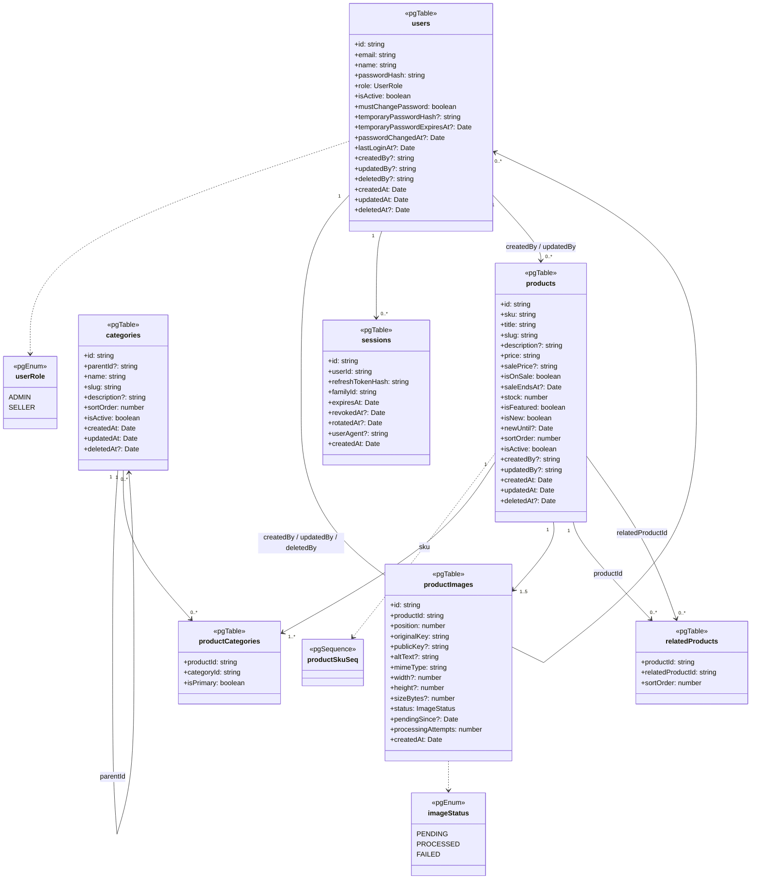

### Tablas del schema

El schema declara las siete tablas del modelo de datos, con los mismos nombres de columnas y tipos definidos en el diagrama entidad-relación:

| Tabla               | Contenido                                                                                       |
| :------------------ | :---------------------------------------------------------------------------------------------- |
| `users`             | Usuarios del panel, con sus datos de acceso, rol, estado, claves temporales y auditoría.        |
| `sessions`          | Sesiones iniciadas por cada usuario, identificadas por el hash del refresh token y agrupadas en familias, con su revocación y rotación. |
| `categories`        | Categorías del catálogo, con su jerarquía de categorías y subcategorías.                        |
| `products`          | Productos a la venta, con precios, ofertas, stock, marcas y auditoría.                          |
| `productCategories` | Asignación de categorías a cada producto, con la indicación de la categoría principal.          |
| `relatedProducts`   | Productos similares cargados manualmente para cada producto, hasta 4 y en orden.                |
| `productImages`     | Imágenes de cada producto, con su posición, claves de almacenamiento, estado de procesamiento, fecha de espera e intentos. |

### Relaciones

El diagrama refleja las mismas relaciones y cardinalidades del modelo de datos:

- Un usuario puede crear, modificar o dar de baja a otros usuarios, tener múltiples sesiones y crear o modificar múltiples productos.
- Una categoría puede tener múltiples subcategorías y estar asignada a múltiples productos.
- Un producto tiene al menos una categoría asignada, entre 1 y 5 imágenes, y puede tener múltiples productos similares, así como figurar como similar de otros productos.

### Detalles de implementación

- **Ubicación y alcance**: el schema se encuentra en la carpeta `shared/infrastructure/database/schema` y solo es utilizado por clases de la capa de infraestructura. Ningún componente del dominio o de la aplicación depende de él.

- **Declaración de las tablas**: las tablas se declaran dentro del schema `libreria` mediante `pgSchema('libreria')`. Cada columna indica explícitamente su nombre en formato `snake_case`, tal como figura en la base de datos, mientras que en el código TypeScript se utilizan los nombres en formato `camelCase`. De esta forma, cada lenguaje respeta sus propias convenciones de nombres.

- **Tipo `citext`**: Drizzle no incluye de forma nativa el tipo de texto sin distinción de mayúsculas utilizado para el email de los usuarios, por lo que se define como un tipo personalizado.

- **Tipo `numeric`**: las columnas de precios se representan en TypeScript como texto y no como números, ya que el tipo numérico de JavaScript puede introducir errores de redondeo en valores decimales. Los mappers convierten luego esos valores al value object `Money`, que opera internamente con centavos enteros.

- **Enumeraciones y secuencia**: los roles y los estados de las imágenes se declaran como enumeraciones de PostgreSQL (`userRole`, `imageStatus`), y la secuencia del SKU (`productSkuSeq`) también forma parte del schema.

- **Funciones, triggers e índices especiales**: Drizzle genera automáticamente las migraciones de tablas, columnas, claves, restricciones e índices convencionales y parciales, pero no las extensiones, las funciones, los triggers, el valor por defecto del SKU, el índice de búsqueda por título ni el rol con el que corre la aplicación. Estos elementos se incorporan mediante migraciones SQL escritas manualmente (`drizzle-kit generate --custom`), que forman parte del mismo historial y se aplican en el mismo orden que las demás. Las migraciones se aplican con un script compilado, igual en el entorno local y en producción, y nunca se usa `drizzle-kit push`.

### Relación con el resto del sistema

- **Con la base de datos**: el schema es el reflejo en código del DDL presentado en el diagrama entidad-relación. Las migraciones generadas a partir de él, junto con las migraciones SQL manuales, permiten crear y actualizar la base de datos de forma reproducible en cualquier entorno.

- **Con la capa de infraestructura**: los repositorios, las consultas y los generadores de ambos módulos utilizan el schema para construir sus consultas con verificación de tipos. Si una columna cambia de nombre o de tipo, el error se detecta al compilar y no durante la ejecución.

- **Con el dominio**: los mappers traducen los registros del schema en entidades del dominio y viceversa. Son el único punto en el que ambos modelos se conectan, lo que permite modificar la estructura de las tablas sin afectar las reglas de negocio.

- **Con la evolución del sistema**: la incorporación futura de las tablas de pedidos y pagos se realizará agregando nuevas declaraciones al schema y sus migraciones correspondientes, sin modificar las tablas existentes.

---

## 12. Decisiones de diseño

Esta sección reúne las decisiones de diseño más relevantes del backend que no se desprenden directamente de los diagramas, junto con los motivos que las justifican y las alternativas consideradas. Su objetivo es explicar por qué la solución se construyó de esta manera, especialmente en los aspectos vinculados a la seguridad y a la elección de servicios externos.

### Manejo de la sesión: access token en memoria y refresh token en cookie

La autenticación combina dos tokens con características y formas de almacenamiento diferentes, con el objetivo de reducir el impacto de un eventual robo de credenciales.

**Access token.** Se entrega en el cuerpo de la respuesta, tiene una duración de 15 minutos (configurable entre 1 minuto y 1 hora) y el frontend lo conserva únicamente en memoria, nunca en `localStorage`. Se envía en cada solicitud mediante el encabezado `Authorization: Bearer`. Al no persistirse en el navegador, un script malicioso inyectado en la página no puede leerlo desde el almacenamiento local, y su corta duración limita el tiempo durante el cual podría utilizarse si fuera interceptado.

**Refresh token.** Se entrega en una cookie con la siguiente configuración:

| Atributo   | Valor                    | Propósito                                                                                                                            |
| :--------- | :----------------------- | :----------------------------------------------------------------------------------------------------------------------------------- |
| `HttpOnly` | Activado                 | La cookie no es accesible desde JavaScript, lo que la protege ante ataques de inyección de scripts (XSS).                            |
| `Secure`   | Activado                 | La cookie solo se transmite por conexiones HTTPS.                                                                                    |
| `SameSite` | `Strict`                 | La cookie no se envía en solicitudes originadas en otros sitios, lo que protege ante ataques de falsificación de solicitudes (CSRF). |
| `Path`     | `/api/v1/auth`           | La cookie solo se envía a los endpoints de autenticación y no al resto de la API.                                                    |
| `Domain`   | Sin definir              | La cookie solo se envía al servidor de la API y no a otros subdominios.                                                              |
| Nombre     | `__Secure-refresh_token` | El prefijo `__Secure-` obliga al navegador a rechazar la cookie si no fue establecida mediante HTTPS.                                |
| Duración   | 7 días por defecto       | Configurable entre 1 y 30 días mediante `REFRESH_TOKEN_TTL_DAYS`. Rota en cada uso, con detección de reutilización.                  |

Cuando la renovación de la sesión falla, la respuesta elimina la cookie, de modo que el navegador no siga enviando un token que ya no es válido. El cierre de sesión también la elimina, una vez revocada la sesión.

**Endpoints de renovación y cierre de sesión.** Estos dos endpoints leen la cookie y no requieren el access token. Esto permite, por ejemplo, cerrar la sesión aun cuando el access token ya venció. Como defensa adicional ante ataques CSRF, ambos aplican `OriginGuard`, que rechaza toda solicitud cuyo origen no corresponda al dominio del frontend. El origen se toma del encabezado `Origin` y, si no está presente, del encabezado `Referer`; cuando no llega ninguno de los dos, la solicitud se rechaza, ya que no es posible verificar de dónde proviene.

**CORS.** La API solo acepta solicitudes provenientes del dominio del frontend, declarado de forma explícita, y habilita el envío de credenciales para que el navegador pueda incluir la cookie.

**Dominio compartido.** Dado que la cookie utiliza `SameSite=Strict`, el frontend y la API deben pertenecer al mismo dominio registrado: el sitio en el dominio principal (`libreriamisueno.com.ar`) y la API en un subdominio (`api.libreriamisueno.com.ar`). Por este motivo, el registro del dominio propio es un requisito para la puesta en producción del sistema.

**Recarga de la página.** Como el access token se conserva solo en memoria, se pierde al recargar la página o abrir una nueva pestaña. En ese momento, el frontend solicita automáticamente la renovación de la sesión y obtiene un access token nuevo, sin que el usuario deba volver a iniciar sesión.

**Alternativa descartada.** Se evaluó almacenar ambos tokens en `localStorage`, una opción más simple de implementar y que no requiere un dominio compartido. Se descartó porque cualquier script ejecutado en la página podría leer los tokens y utilizarlos desde otro dispositivo, lo que representa un riesgo mayor para un panel con permisos de administración.

### Cantidad de destacados y novedades

El límite de 5 productos destacados y 5 novedades se aplica a la cantidad que se muestra en la página de inicio y no a la cantidad de productos que pueden marcarse. De esta forma, el usuario puede marcar todos los productos que desee y controlar cuáles se muestran primero mediante su posición, sin necesidad de desmarcar uno para incorporar otro. El detalle de esta regla se describe en la sección 8.

### Precios como texto

Los precios viajan como texto decimal con hasta dos decimales (`"1500.50"`), tanto en las solicitudes como en las respuestas, y en el backend se manejan con `Money`, en centavos enteros. Un número de JavaScript puede perder centavos en el camino; el texto llega exacto a la base de datos, que los guarda como `numeric(12,2)`.

### Tareas programadas

Tres tareas corren dentro de la misma aplicación, con `@nestjs/schedule`:

| Tarea                         | Frecuencia                                  | Qué hace                                                             |
| :---------------------------- | :------------------------------------------ | :------------------------------------------------------------------- |
| `StaleImagesScheduler`        | Cada 5 minutos y una vez al iniciar         | Reprocesa las imágenes pendientes hace 10 minutos o más              |
| `ProductMarksExpiryScheduler` | Todos los días a las 00:00 (hora argentina) | Limpia las ofertas y marcas de novedad vencidas                      |
| `SessionsCleanupScheduler`    | Todos los días a las 03:00 (hora argentina) | Elimina las sesiones vencidas                                        |

Las tres son idempotentes, corren en segundo plano con `BackgroundTasks` —así el cierre de la aplicación espera la corrida en curso— y nunca interrumpen la aplicación ante una falla, que queda registrada en el log. Registran también su resultado: la de ofertas en cada corrida, y las de imágenes y sesiones solo cuando hicieron algo. La tienda y la autenticación no dependen de ellas para ser correctas: una oferta o una sesión vencidas ya se tratan como tales desde su vencimiento, y una imagen pendiente se procesa en cuanto se carga; las tareas cubren lo que quedó a medias y mantienen los datos al día. Se eligió no usar un servicio externo de colas ni de tareas, ya que el volumen es bajo y la aplicación corre en una sola instancia.

### Documentación OpenAPI generada desde el código

La especificación de la API se genera a partir de los DTOs y de los controladores con la librería de Swagger de NestJS, en lugar de escribirse a mano, para que no pueda desactualizarse sin que una prueba lo detecte. Como la capa de aplicación no puede depender de librerías externas, las respuestas se describen con clases propias de la capa de presentación que implementan cada resultado, de modo que el compilador avisa si se separan. En producción no se publica salvo que se habilite, para no exponer la superficie de la API sin una decisión explícita.

### Proveedor de envío de mails: Resend

El sistema envía dos tipos de mail, ambos con la misma estructura: la clave temporal solicitada por el propio usuario mediante "olvidé mi contraseña" y la clave temporal generada cuando un administrador restablece la contraseña de otro usuario. En los dos casos, el volumen esperado es muy bajo.

Se eligió Resend por los siguientes motivos:

- Cuenta con un SDK oficial para Node.js, lo que simplifica su integración con NestJS.
- Su plan gratuito incluye 3.000 mails por mes, con un límite de 100 por día y un dominio propio verificado, capacidad suficiente para el volumen previsto (condiciones consultadas en septiembre de 2026).

Para enviar mails a cualquier destinatario, Resend exige verificar el dominio propio mediante registros DNS (SPF y DKIM), que certifican que los mails se envían con autorización del titular del dominio. Por lo tanto, al igual que la cookie de sesión, este servicio depende del registro previo del dominio `.com.ar`.

Mientras el dominio no esté verificado, y en el entorno local, las credenciales de Resend (`RESEND_API_KEY` y `MAIL_FROM`) pueden omitirse, siempre las dos juntas: en ese caso, los mails se escriben en el log en lugar de enviarse. En producción, ambas son obligatorias y la aplicación no arranca sin ellas.

Gracias a la arquitectura del sistema, el proveedor puede reemplazarse sin modificar la lógica de negocio: basta con desarrollar una nueva implementación del contrato `PasswordResetNotifier` y registrarla en el módulo `identity`.

## 13. Endpoints

Esta sección presenta el listado completo de los endpoints de la API REST, organizados por módulo. Para cada uno se indica el método HTTP, la ruta, el nivel de acceso requerido y el caso de uso que lo resuelve, lo que permite rastrear cada operación desde la API hasta la lógica de negocio que la implementa.

### Convenciones generales

- **Versionado**: todas las rutas se exponen bajo el prefijo `/api/v1`, que se omite en las tablas por legibilidad. Por ejemplo, la ruta `/auth/login` corresponde a `https://api.libreriamisueno.com.ar/api/v1/auth/login`. El versionado permite incorporar cambios futuros en la API sin afectar a los clientes existentes.
- **Rutas públicas y del panel**: las rutas que comienzan con `/admin` corresponden al panel de administración y requieren autenticación. Las demás rutas del catálogo y la búsqueda son públicas.
- **Bajas lógicas**: los endpoints que utilizan el método `DELETE` no eliminan los registros de la base de datos, sino que realizan una baja lógica. Se utiliza este método porque, desde el punto de vista del cliente de la API, el recurso deja de estar disponible. La reactivación se realiza mediante el endpoint `restore` correspondiente.
- **Acceso**: los niveles indicados son _Público_ (sin autenticación), _Autenticado_ (cualquier usuario con sesión iniciada), _ADMIN_ y _ADMIN, SELLER_ (roles habilitados para la operación). Como `RolesGuard` niega el acceso por defecto, los endpoints de nivel _Autenticado_ y _ADMIN, SELLER_ se declaran con `@Roles(ADMIN, SELLER)` o su equivalente `@AnyPanelRole()`.
- **Caché**: las respuestas públicas del catálogo, las categorías y la búsqueda pueden guardarse 60 segundos (`Cache-Control: public, max-age=60`); las que llevan tokens, datos de la cuenta o enlaces firmados se envían con `Cache-Control: no-store`, igual que toda respuesta de error.
- **Identificadores**: un identificador de la ruta que no tiene formato UUID se responde como un recurso inexistente (404), sin consultar la base de datos.

### Documentación de la API

La especificación OpenAPI de todos estos endpoints es el contrato con el frontend. Se genera desde el código: los DTOs de entrada y las clases de respuesta describen los datos, y cada endpoint declara sus estados de error y los `code` que puede devolver en cada uno, con el formato común de error; toda ruta suma además el 500 y, salvo las de salud, el 429. Fuera de producción la aplicación la publica en `/api/docs` (interfaz navegable) y `/api/docs-json`; en producción solo si se habilita con `OPENAPI_ENABLED`. Una copia se mantiene en el repositorio (`docs/openapi.json`) para que el frontend la use sin la API en ejecución, y las pruebas automatizadas fallan si falta una ruta o si la copia quedó desactualizada.

### Autenticación

| Método | Ruta                    | Acceso                                                  | Caso de uso                         |
| :----- | :---------------------- | :------------------------------------------------------ | :---------------------------------- |
| POST   | `/auth/login`           | Público                                                 | `LoginUseCase`                      |
| POST   | `/auth/refresh`         | Cookie de sesión y verificación de origen               | `RefreshSessionUseCase`             |
| POST   | `/auth/logout`          | Cookie de sesión y verificación de origen               | `LogoutUseCase`                     |
| POST   | `/auth/forgot-password` | Público                                                 | `RequestPasswordResetUseCase`       |
| POST   | `/auth/change-password` | Autenticado, incluso con cambio de contraseña pendiente | `ChangePasswordUseCase`             |
| GET    | `/auth/me`              | Autenticado, incluso con cambio de contraseña pendiente | Usuario resuelto por `JwtAuthGuard` |

Los endpoints de cambio de contraseña y de consulta del usuario actual son los únicos habilitados para un usuario que tiene pendiente el cambio de su contraseña temporal; el resto de la API le queda bloqueado hasta que lo complete. El endpoint de cambio de contraseña es, además, el único endpoint de gestión de cuenta disponible para el rol `SELLER`.

### Usuarios

| Método | Ruta                              | Acceso | Caso de uso                |
| :----- | :-------------------------------- | :----- | :------------------------- |
| GET    | `/admin/users`                    | ADMIN  | `ListUsersUseCase`         |
| GET    | `/admin/users/:id`                | ADMIN  | `GetUserUseCase`           |
| POST   | `/admin/users`                    | ADMIN  | `CreateUserUseCase`        |
| PATCH  | `/admin/users/:id`                | ADMIN  | `UpdateUserUseCase`        |
| POST   | `/admin/users/:id/reset-password` | ADMIN  | `ResetUserPasswordUseCase` |
| DELETE | `/admin/users/:id`                | ADMIN  | `DeleteUserUseCase`        |
| POST   | `/admin/users/:id/restore`        | ADMIN  | `RestoreUserUseCase`       |

El endpoint de restablecimiento de contraseña no recibe datos: el sistema genera la clave temporal y la envía por mail al usuario.

### Categorías

| Método | Ruta                            | Acceso        | Caso de uso                  |
| :----- | :------------------------------ | :------------ | :--------------------------- |
| GET    | `/categories`                   | Público       | `ListCategoryTreeUseCase`    |
| GET    | `/admin/categories`             | ADMIN, SELLER | `ListAdminCategoriesUseCase` |
| GET    | `/admin/categories/:id`         | ADMIN, SELLER | `GetAdminCategoryUseCase`    |
| POST   | `/admin/categories`             | ADMIN, SELLER | `CreateCategoryUseCase`      |
| PATCH  | `/admin/categories/:id`         | ADMIN, SELLER | `UpdateCategoryUseCase`      |
| DELETE | `/admin/categories/:id`         | ADMIN, SELLER | `DeleteCategoryUseCase`      |
| POST   | `/admin/categories/:id/restore` | ADMIN, SELLER | `RestoreCategoryUseCase`     |

### Productos

| Método | Ruta                          | Acceso        | Caso de uso                   |
| :----- | :---------------------------- | :------------ | :---------------------------- |
| GET    | `/products`                   | Público       | `SearchCatalogUseCase`        |
| GET    | `/products/featured`          | Público       | `ListFeaturedProductsUseCase` |
| GET    | `/products/new`               | Público       | `ListNewProductsUseCase`      |
| GET    | `/products/:slug`             | Público       | `GetProductDetailUseCase`     |
| GET    | `/admin/products`             | ADMIN, SELLER | `ListAdminProductsUseCase`    |
| GET    | `/admin/products/:id`         | ADMIN, SELLER | `GetAdminProductUseCase`      |
| POST   | `/admin/products`             | ADMIN, SELLER | `CreateProductUseCase`        |
| PATCH  | `/admin/products/:id`         | ADMIN, SELLER | `UpdateProductUseCase`        |
| DELETE | `/admin/products/:id`         | ADMIN, SELLER | `DeleteProductUseCase`        |
| POST   | `/admin/products/:id/restore` | ADMIN, SELLER | `RestoreProductUseCase`       |

El alta de producto recibe los datos y las imágenes en una única solicitud de tipo `multipart/form-data`: los datos como JSON en el campo `data` y las imágenes, con un mínimo de 1 y un máximo de 5, en el campo `images`. Los endpoints públicos identifican al producto por su slug, para generar URL legibles y favorables al posicionamiento en buscadores; los del panel, por su identificador interno.

Parámetros de los listados:

| Endpoint                | Parámetros                                                                                                                                                         |
| :---------------------- | :----------------------------------------------------------------------------------------------------------------------------------------------------------------- |
| `GET /products`         | `q`, `categorySlug`, `isFeatured`, `isNew`, `isOnSale`, `inStock`, `minPrice`, `maxPrice`, `sort` (`RELEVANCE`, `PRICE_ASC`, `PRICE_DESC`, `NEWEST`, `TITLE_ASC`), `page` (hasta 500) y `limit` (hasta 50) |
| `GET /admin/products`   | `q`, `categoryId`, `status`, `isFeatured`, `isOnSale`, `isNew`, `maxStock`, `sortBy` (`TITLE`, `SKU`, `PRICE`, `STOCK`, `CREATED_AT`, `UPDATED_AT`), `sortDir`, `page` y `limit` (hasta 100) |
| `GET /admin/categories` | `q`, `parentId`, `status`, `sortBy` (`NAME`, `SORT_ORDER`, `CREATED_AT`, `UPDATED_AT`), `sortDir`, `page` y `limit` (hasta 100)                                     |
| `GET /admin/users`      | `q`, `role`, `status`, `sortDir`, `page` y `limit` (hasta 100)                                                                                                       |
| `GET /search`           | `q` (de 2 a 100 caracteres) y `limit` (por grupo, de 1 a 10)                                                                                                         |

Las marcas aceptan solo `true` o `false`; sin `status`, los listados del panel muestran los registros vigentes. Cualquier otro parámetro, o un valor fuera de rango, responde 400.

### Imágenes de producto

| Método | Ruta                                               | Acceso        | Caso de uso                          |
| :----- | :------------------------------------------------- | :------------ | :----------------------------------- |
| GET    | `/admin/products/:productId/images`                | ADMIN, SELLER | `ListProductImagesUseCase`           |
| POST   | `/admin/products/:productId/images`                | ADMIN, SELLER | `AddProductImageUseCase`             |
| PATCH  | `/admin/products/:productId/images/order`          | ADMIN, SELLER | `ReorderProductImagesUseCase`        |
| PATCH  | `/admin/products/:productId/images/:imageId`       | ADMIN, SELLER | `UpdateProductImageUseCase`          |
| PUT    | `/admin/products/:productId/images/:imageId/file`  | ADMIN, SELLER | `ReplaceProductImageFileUseCase`     |
| POST   | `/admin/products/:productId/images/:imageId/retry` | ADMIN, SELLER | `RetryProductImageProcessingUseCase` |
| DELETE | `/admin/products/:productId/images/:imageId`       | ADMIN, SELLER | `DeleteProductImageUseCase`          |

Los endpoints de alta y reemplazo de imagen reciben el archivo mediante `multipart/form-data`. El reemplazo utiliza el método `PUT` porque sustituye por completo el archivo de la imagen, mientras que la edición utiliza `PATCH` porque modifica solo algunos de sus datos, como el texto alternativo.

### Búsqueda

| Método | Ruta      | Acceso  | Caso de uso           |
| :----- | :-------- | :------ | :-------------------- |
| GET    | `/search` | Público | `GlobalSearchUseCase` |

### Salud

| Método | Ruta            | Acceso  | Qué responde                                   |
| :----- | :-------------- | :------ | :--------------------------------------------- |
| GET    | `/health`       | Público | Que la aplicación está en ejecución            |
| GET    | `/health/ready` | Público | Que la base de datos responde (`DatabaseHealthCheck`), o 503 si no |

### Límites de solicitudes

Toda la API aplica un límite general de solicitudes por dirección IP, como protección ante usos abusivos. Los endpoints más expuestos a ataques de fuerza bruta tienen, además, límites específicos más estrictos:

| Endpoint                               | Límite                                                     |
| :------------------------------------- | :--------------------------------------------------------- |
| Toda la API                            | 100 solicitudes por minuto por IP, sumando todas las rutas |
| `POST /auth/login`                     | 5 solicitudes por minuto por IP                            |
| `POST /auth/forgot-password`           | 3 solicitudes cada 15 minutos por IP                       |
| `POST /auth/change-password`           | 5 solicitudes por minuto por IP                            |
| `POST /admin/users/:id/reset-password` | 10 solicitudes cada 15 minutos por IP                      |
| `POST /auth/refresh`                   | Límite general de la API                                   |
| `GET /health` y `/health/ready`        | Sin límite                                                 |

Los límites del inicio de sesión y del cambio de contraseña dificultan los intentos de adivinar contraseñas —en el segundo caso, con un access token robado—, y el de recuperación de contraseña evita el envío masivo de mails, que además consumiría el cupo diario del proveedor de correo. Los límites específicos se cuentan por dirección IP y ruta, antes de verificar el access token, por lo que en el cambio de contraseña también cuentan los intentos sin un token válido desde esa dirección; se acepta así, ya que contar por usuario obligaría a confiar en un token todavía no verificado. Los límites específicos se suman al general: cada solicitud a esos endpoints cuenta también para el límite de toda la API. Los endpoints de salud quedan excluidos para que los controles de la plataforma y del monitoreo nunca se bloqueen.

Como la API se ejecuta detrás del proxy de la plataforma de despliegue, la dirección IP del cliente se obtiene del encabezado `X-Forwarded-For`, confiando únicamente en la cantidad de proxies configurada. De esta forma, un cliente no puede elegir su propia dirección para evadir los límites.

---

## 14. Reglas de negocio y dónde se aplican

Esta sección reúne las principales reglas de negocio del sistema e indica en qué capa se aplica cada una. Su objetivo es mostrar de forma consolidada la estrategia de validación adoptada: las reglas más importantes no dependen de un único punto de control, sino que se verifican en varias capas de forma complementaria.

Cada capa cumple un rol distinto:

- **Presentación**: rechaza de forma temprana las solicitudes inválidas o no autorizadas, antes de ejecutar cualquier lógica. Mejora la experiencia de uso, ya que devuelve errores claros y específicos.
- **Aplicación y dominio**: es la fuente principal de las reglas de negocio. Aquí se decide si una operación es válida, con independencia de cómo se haya invocado.
- **Base de datos**: actúa como última barrera. Garantiza la integridad de los datos aun ante un error en la aplicación o una modificación realizada directamente sobre la base.

Cuando una capa no interviene en una regla, se indica como _No aplica_. Los nombres de restricciones, índices y funciones corresponden a los definidos en el schema `libreria`.

### Usuarios y autenticación

| Regla                                                                                                     | Presentación                                                                                                          | Aplicación / Dominio                                                    | Base de datos                                           |
| :-------------------------------------------------------------------------------------------------------- | :-------------------------------------------------------------------------------------------------------------------- | :---------------------------------------------------------------------- | :------------------------------------------------------ |
| Solo el rol ADMIN gestiona usuarios                                                                       | `RolesGuard` y restricción de `UsersController` al rol ADMIN                                                          | No aplica                                                               | No aplica                                               |
| El rol SELLER solo puede cambiar su propia contraseña                                                     | Los endpoints de usuarios están restringidos al rol ADMIN; el cambio de contraseña es el único disponible para SELLER | `ChangePasswordUseCase` opera solo sobre el usuario autenticado         | No aplica                                               |
| Email único entre usuarios vigentes                                                                       | El DTO solo exige un texto no vacío; el formato lo valida `Email`                                                     | `Email`, `CreateUserUseCase`, `UpdateUserUseCase`, `RestoreUserUseCase` | `chk_users_email_format` y `uq_users_email_not_deleted` |
| Contraseña de entre 8 y 128 caracteres                                                                    | El DTO solo exige un texto no vacío y de largo acotado                                                                | `Password`                                                              | No aplica                                               |
| Cambio obligatorio de contraseña tras recibir una clave temporal                                          | `MustChangePasswordGuard`                                                                                             | `User.assignTemporaryPassword` y `User.consumeTemporaryPassword`        | No aplica                                               |
| La clave temporal por olvido no invalida la contraseña actual                                             | No aplica                                                                                                             | `User.issueTemporaryPassword` y `LoginUseCase`                          | `chk_users_temporary_password_pair`                     |
| La clave temporal es de un solo uso y vence a los 30 minutos                                              | No aplica                                                                                                             | `TemporaryPassword` y `User.consumeTemporaryPassword`                   | No aplica                                               |
| Un administrador no puede darse de baja, desactivarse, cambiar su propio rol ni restablecer su contraseña | No aplica                                                                                                             | `UserAdministrationPolicy`                                              | No aplica                                               |
| Siempre debe existir al menos un administrador activo                                                     | No aplica                                                                                                             | `UserAdministrationPolicy`                                              | Trigger con la función `prevent_last_admin_removal`     |
| El restablecimiento de contraseña por un administrador genera la clave y la envía por mail                | Endpoint sin datos de entrada                                                                                         | `ResetUserPasswordUseCase`                                              | Trigger con la función `revoke_user_sessions`           |
| Las sesiones se revocan al cambiar la contraseña, el rol o el estado, o ante una baja                     | No aplica                                                                                                             | `SessionIssuer` crea la nueva sesión después de guardar el cambio       | Trigger con la función `revoke_user_sessions`           |
| Refresh token rotativo con detección de reutilización                                                     | Cookie `HttpOnly` y `OriginGuard`                                                                                     | `RefreshSessionUseCase`                                                 | `uq_sessions_refresh_token_hash`                        |
| Límite de solicitudes en los endpoints sensibles                                                          | `RateLimitGuard` y `@StrictRateLimit`                                                                                 | No aplica                                                               | No aplica                                               |
| Una sesión rotada está revocada; las vencidas se eliminan a diario                                        | No aplica                                                                                                             | `Session.rotate` y `PurgeExpiredSessionsUseCase`                        | `chk_sessions_rotated_is_revoked`                       |

### Categorías

| Regla                                                                      | Presentación           | Aplicación / Dominio                                                        | Base de datos                                                                                   |
| :------------------------------------------------------------------------- | :--------------------- | :-------------------------------------------------------------------------- | :---------------------------------------------------------------------------------------------- |
| Nombre único entre categorías vigentes                                     | No aplica              | `CreateCategoryUseCase`, `UpdateCategoryUseCase` y `RestoreCategoryUseCase` | `uq_categories_name_not_deleted`                                                                |
| Slug inmutable                                                             | Los DTOs no lo aceptan | `Category` no ofrece un método para modificarlo                             | Trigger con la función `prevent_immutable_update('slug')`                                       |
| Sin ciclos en la jerarquía de categorías                                   | No aplica              | `Category.moveTo`, a partir de los ancestros de la nueva categoría padre    | `chk_categories_not_own_parent`, que cubre solo el caso de una categoría como padre de sí misma |
| No se puede dar de baja una categoría con subcategorías vigentes           | No aplica              | `CategoryDeletionPolicy`                                                    | No aplica                                                                                       |
| No se puede dar de baja la única categoría vigente de un producto vigente  | No aplica              | `CategoryDeletionPolicy`, con el bloqueo de la jerarquía                    | No aplica                                                                                       |
| No se puede reactivar una categoría cuya categoría padre está dada de baja | No aplica              | `Category.restore`                                                          | No aplica                                                                                       |

### Productos e imágenes

| Regla                                                                                             | Presentación                                                                              | Aplicación / Dominio                                                     | Base de datos                                                                                                                  |
| :------------------------------------------------------------------------------------------------ | :---------------------------------------------------------------------------------------- | :----------------------------------------------------------------------- | :----------------------------------------------------------------------------------------------------------------------------- |
| SKU generado por el sistema e inmutable                                                           | Los DTOs no lo aceptan                                                                    | `SkuGenerator`; `Product` no ofrece un método para modificarlo           | Secuencia `product_sku_seq`, `chk_products_sku_format` y trigger con la función `prevent_immutable_update('sku')`              |
| Slug inmutable                                                                                    | Los DTOs de edición no lo aceptan                                                         | `Product` no ofrece un método para modificarlo                           | Trigger con la función `prevent_immutable_update('slug')`                                                                      |
| Los slugs `featured` y `new` están reservados                                                     | No aplica                                                                                 | `productSlugStore` los toma como ocupados                                | `chk_products_slug_not_reserved`                                                                                               |
| Precio positivo y stock no negativo                                                               | Formato decimal y entero en el DTO                                                        | `Money`, `Product.changePrice` y `Product.setStock`                      | `chk_products_price_positive` y `chk_products_stock_non_negative`                                                              |
| Precio de oferta menor al precio regular                                                          | Formato decimal en el DTO                                                                 | `Product.startSale` y `Product.changePrice`                              | `chk_products_sale_price_range` y `chk_products_on_sale_requires_sale_price`                                                   |
| Al menos una categoría y exactamente una categoría principal                                      | Validación del DTO                                                                        | `CategoryAssignment.checked` y `Product.assignCategories`                | Constraint trigger diferido con la función `check_product_has_category` e índice único parcial `uq_product_categories_primary` |
| Un producto no puede ser similar de sí mismo                                                      | No aplica                                                                                 | `Product.assertValidRelatedIds` y `Product.setRelatedProducts`           | `chk_related_products_not_self`                                                                                                |
| Hasta 4 productos similares, sin repetir                                                          | `ArrayUnique` y `ArrayMaxSize` en los DTOs de alta y edición                              | `Product.assertValidRelatedIds`, que usa `Product.setRelatedProducts`    | `pk_related_products`, `chk_related_products_sort_order_range` y `uq_related_products_sort_order`                              |
| Al menos una imagen por producto                                                                  | `ProductFormInterceptor` admite hasta 5 archivos en el alta                              | `ProductImagePolicy.assertCanAdd` y `ProductImagePolicy.assertCanRemove` | Constraint trigger diferido con la función `check_product_has_image`                                                           |
| Máximo 5 imágenes por producto                                                                    | `ProductFormInterceptor`                                                                  | `ProductImagePolicy.assertCanAdd` y `ProductImagePolicy.assertRoomForOne`, con el producto bloqueado | `chk_product_images_position_range` y restricción única diferible `uq_product_images_position`                     |
| Solo se admiten imágenes JPEG, PNG y WebP de hasta 10 MB                                          | Los interceptores de formularios cortan la lectura a los 10 MB                            | `checkedImageType`, que reconoce el formato real por los primeros bytes  | `chk_product_images_mime_type`                                                                                                 |
| Una imagen procesada debe tener su versión pública                                                | No aplica                                                                                 | `ProductImage.markProcessed`                                             | `chk_product_images_processed_has_public_key`                                                                                  |
| Solo una imagen pendiente tiene fecha de espera; tras 3 intentos sin terminar, queda con error    | No aplica                                                                                 | `ProductImage` y `ProcessProductImageUseCase`                            | `chk_product_images_pending_since`, trigger con la función `set_image_pending_since` y `chk_product_images_processing_attempts` |
| Solo se muestran en la tienda los productos activos, vigentes y con al menos una imagen con versión pública | No aplica                                                                       | `DrizzleCatalogQueries`                                                  | Índices parciales de productos visibles, destacados y novedades                                                                |
| No se puede reactivar un producto sin categorías vigentes                                         | No aplica                                                                                 | `RestoreProductUseCase`                                                  | No aplica                                                                                                                      |

### Bajas lógicas

| Regla                                                                                  | Presentación                                                                                     | Aplicación / Dominio                             | Base de datos                                                                                     |
| :------------------------------------------------------------------------------------- | :----------------------------------------------------------------------------------------------- | :----------------------------------------------- | :------------------------------------------------------------------------------------------------ |
| Todas las bajas son lógicas y pueden revertirse, para usuarios, categorías y productos | No existen endpoints de eliminación definitiva; los endpoints `restore` permiten la reactivación | Métodos `softDelete` y `restore` de cada entidad | Columna `deleted_at` en cada tabla y restricciones de unicidad limitadas a los registros vigentes |
