# Diagramas de secuencia · Librería Mi Sueño

## Introducción

Este documento reúne los diagramas de secuencia de los flujos más importantes del backend. Cada diagrama sigue el recorrido real de una operación a través de las capas del sistema: el controlador y los guards de la presentación, el caso de uso de la aplicación, el dominio y la infraestructura (base de datos, almacenamiento de archivos y envío de correos).

Los flujos están agrupados por módulo:

| Grupo | Diagramas |
| --- | --- |
| Transversal | 1. Recorrido de una petición |
| Identidad: sesiones | 2. Inicio de sesión · 3. Renovación de la sesión · 4. Cierre de sesión |
| Identidad: contraseñas | 5. Cambio de contraseña propia · 6. Olvido de contraseña · 7. Reseteo de contraseña por un administrador |
| Identidad: usuarios | 8. Alta de usuario · 9. Baja de usuario · 10. Limpieza de sesiones vencidas |
| Catálogo: productos | 11. Alta de producto con imágenes · 12. Edición de producto · 13. Baja y reactivación de producto |
| Catálogo: imágenes | 14. Procesado de una imagen · 15. Reprocesado de imágenes demoradas · 16. Reemplazo del archivo de una imagen · 17. Eliminación de una imagen |
| Catálogo: categorías | 18. Baja de categoría |
| Catálogo: tienda pública | 19. Listado y búsqueda en el catálogo · 20. Ficha de producto · 21. Búsqueda global |
| Catálogo: tareas programadas | 22. Limpieza de ofertas y novedades vencidas |

## Convenciones

- Las flechas continuas son llamadas y las punteadas, respuestas.
- `Cliente` es el frontend (tienda o panel) y `API` agrupa al controlador de NestJS de cada ruta.
- `BD` es PostgreSQL (Supabase en local). `Storage` es Supabase Storage, con un bucket privado para los originales y uno público para las versiones que muestra la tienda.
- `Transacción` indica que lo que está dentro corre en una única transacción de base de datos. Los bloqueos de fila (`FOR UPDATE`) se hacen dentro de ella.
- Los errores se devuelven siempre con la misma forma (`statusCode`, `code`, `message`, `details`, `path`, `timestamp`) y los mensajes que ve el usuario están en español. En los diagramas se nombra el `code` de cada error.
- Las contraseñas y los tokens nunca viajan ni se guardan en claro: la base guarda solo hashes. El access token vive en memoria del navegador y el refresh token, en una cookie `HttpOnly`.

---

## 1. Recorrido de una petición

Todas las rutas pasan por la misma cadena de guards, registrados globalmente en este orden. El límite de frecuencia va primero para que una petición bloqueada nunca llegue a la base de datos. Las rutas marcadas como públicas se saltan la autenticación.

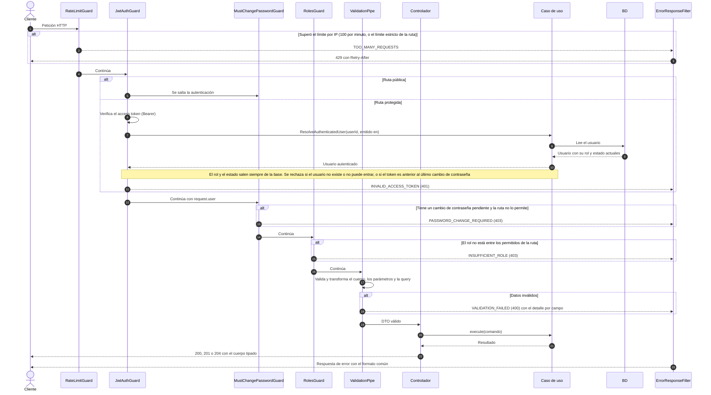

---

## Identidad: sesiones

### 2. Inicio de sesión

Todos los fallos devuelven el mismo error y cada intento hace exactamente dos comprobaciones de contraseña (la actual y la temporal, o un señuelo si no hay), de modo que ni la respuesta ni el tiempo revelan si la cuenta existe o tiene una clave temporal pendiente. El hash, que es lento, se calcula antes de abrir la transacción para no retener una conexión.

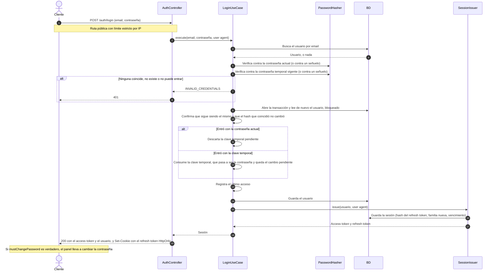

### 3. Renovación de la sesión (rotación del refresh token)

Cada refresh token sirve una sola vez. Si se vuelve a presentar uno ya rotado puede haber sido robado, y se revocan todas las sesiones del usuario. El resultado se confirma dentro de la transacción, así la revocación queda guardada aunque después se rechace la petición.

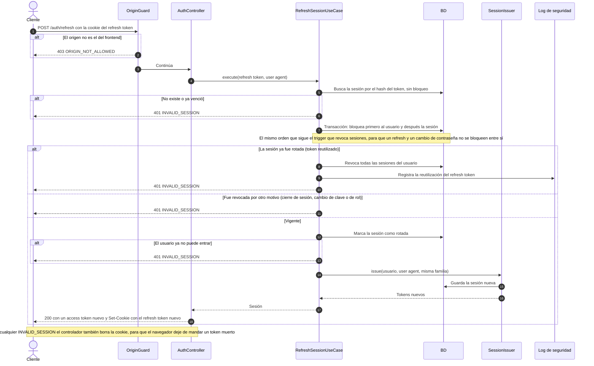

### 4. Cierre de sesión

El cierre nunca falla por el token: si falta o no se conoce, no hay nada que cerrar. Cierra la sesión y toda su familia, incluidas las que nacieron de rotarla, y deja intactas las sesiones de otros dispositivos.

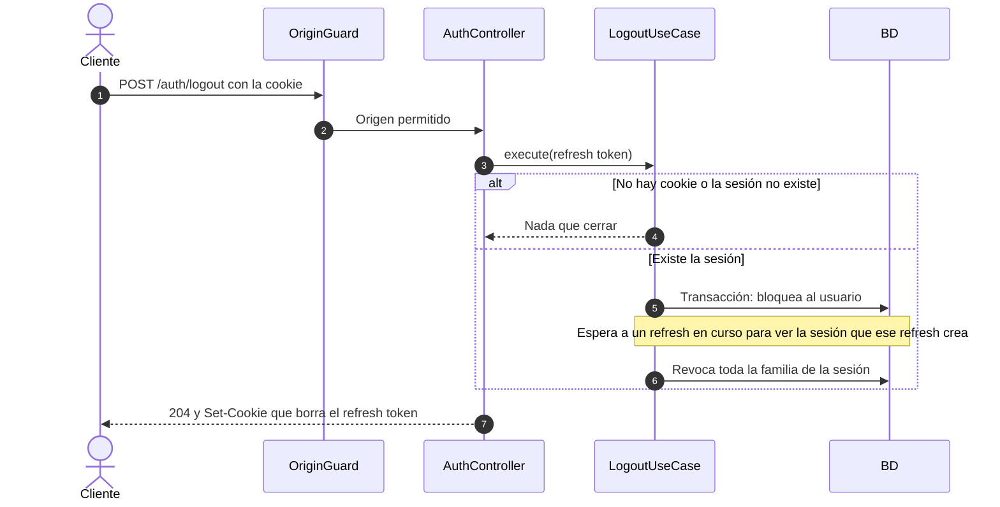

---

## Identidad: contraseñas

### 5. Cambio de contraseña propia

Sirve también para salir del estado de cambio pendiente (clave temporal o reseteo). Cambiar la contraseña revoca todas las sesiones en la base de datos, por eso se inicia una nueva para el dispositivo que hizo el cambio.

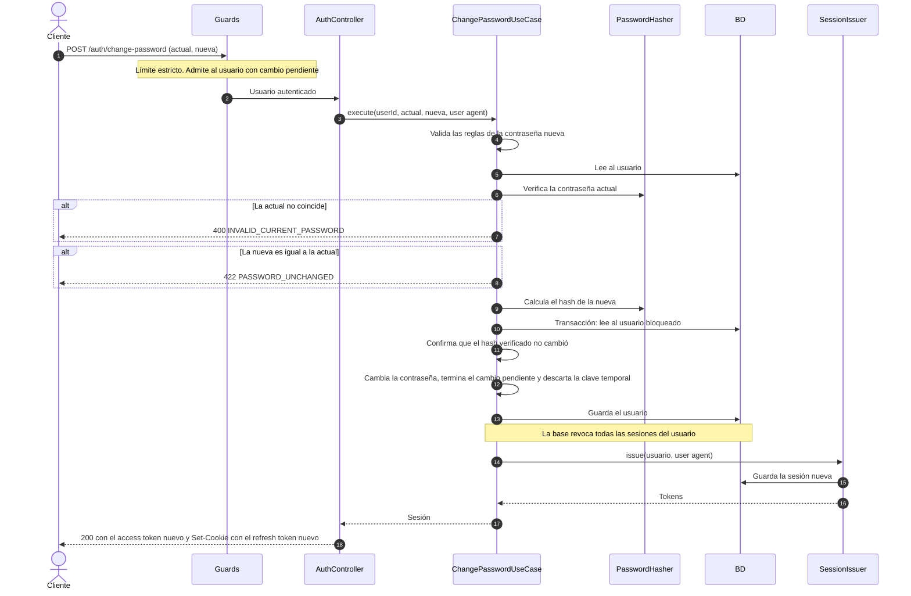

### 6. Olvido de contraseña

La respuesta es siempre 204, exista o no la cuenta, y no espera al trabajo real: buscar la cuenta, calcular el hash y enviar el correo corren en segundo plano, para que el tiempo de respuesta no delate si el email existe. La clave temporal convive con la actual hasta que se usa o vence.

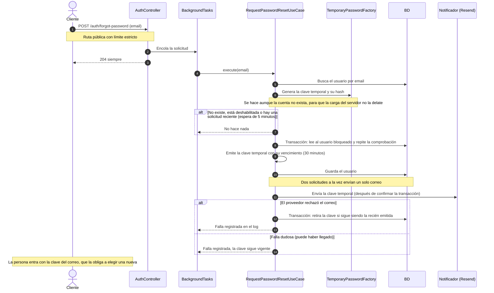

### 7. Reseteo de contraseña por un administrador

Un administrador genera una clave temporal para otro usuario. Acá el correo se envía con la transacción abierta: si falla, no cambia nada, el usuario conserva su contraseña y sus sesiones, y el administrador puede reintentar.

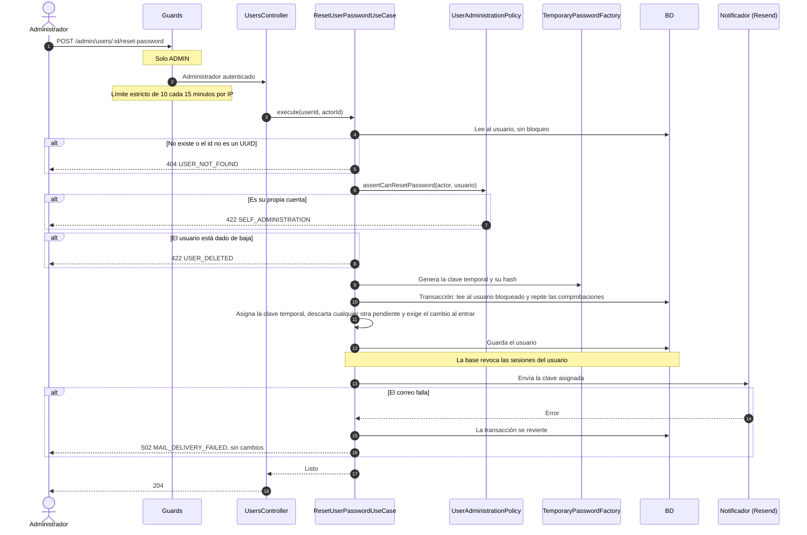

---

## Identidad: usuarios

### 8. Alta de usuario

El administrador define la contraseña inicial y se la entrega al usuario: no se envía ningún correo. El usuario nace con el cambio de contraseña pendiente.

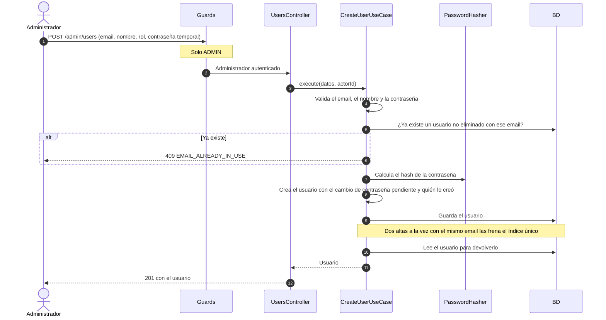

### 9. Baja de usuario

La baja es lógica: se guardan la fecha y el autor y la cuenta deja de funcionar. Ningún administrador puede darse de baja a sí mismo y el sistema nunca se queda sin un administrador activo. Dar de baja a quien ya lo está no cambia nada. La edición de rol o estado (`PATCH /admin/users/:id`) aplica las mismas reglas.

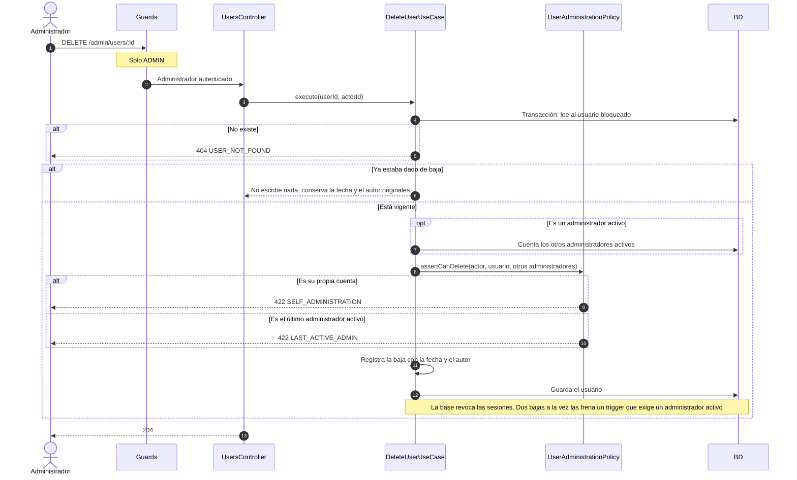

### 10. Limpieza de sesiones vencidas

Una sesión vencida ya se rechaza al presentarse, así que esta tarea solo mantiene chica la tabla. Las sesiones revocadas pero todavía vigentes se conservan, para seguir detectando la reutilización de un token robado.

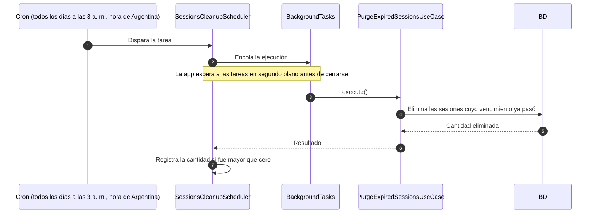

---

## Catálogo: productos

### 11. Alta de producto con imágenes

Es el flujo más delicado del sistema porque combina la base de datos con el almacenamiento de archivos. Se valida todo antes de subir nada, los originales se suben **antes** de la transacción para no mantenerla abierta durante llamadas de red, y si algo falla entre la primera subida y la confirmación se borran los archivos ya subidos. Las imágenes quedan pendientes y se procesan de forma asíncrona después de confirmar.

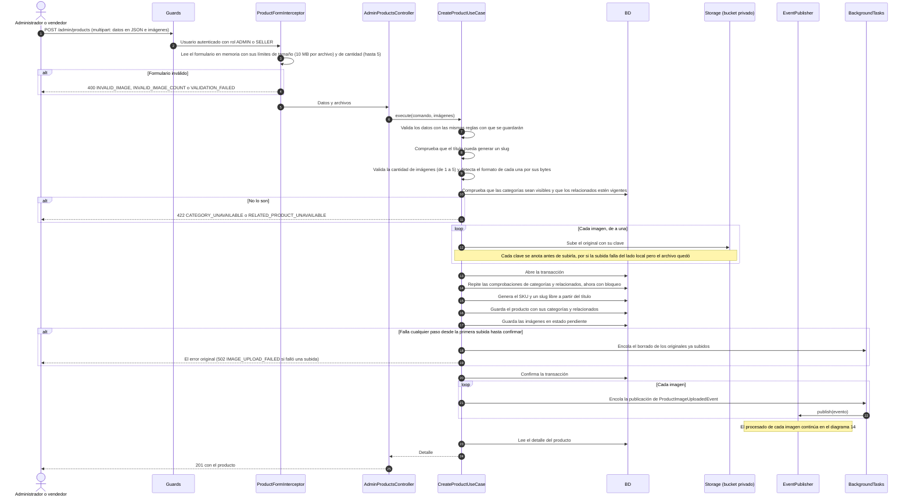

### 12. Edición de producto

Los datos se validan antes de abrir la transacción. El slug y el SKU nunca cambian, ni siquiera con el título. Los productos se bloquean en orden de id para que dos ediciones que relacionan a dos productos entre sí esperen en lugar de trabarse. Una edición que no cambia nada no guarda nada.

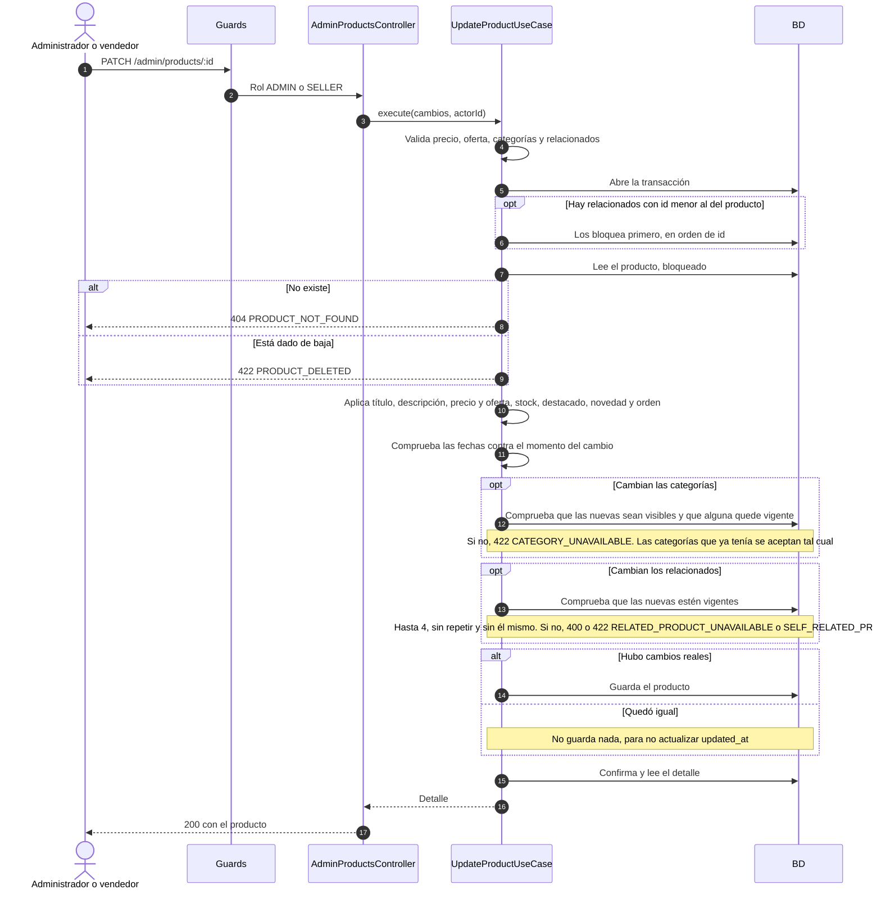

### 13. Baja y reactivación de producto

La baja es lógica: las imágenes, los archivos y los relacionados quedan como están, de modo que reactivar el producto lo devuelve completo. La reactivación exige que al menos una de sus categorías siga vigente.

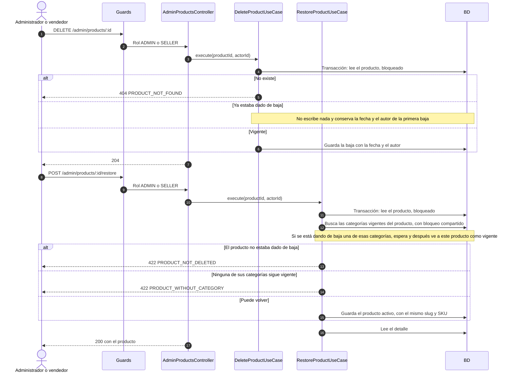

---

## Catálogo: imágenes

### 14. Procesado de una imagen

Se dispara con el evento publicado al confirmar el alta, la adición, el reemplazo o el reintento de una imagen. Cada intento se cuenta **antes** de empezar, así uno que nunca termina (por ejemplo, porque se cae el proceso) igual cuenta y, pasado el máximo, la imagen queda en estado fallido. El trabajo sobre los archivos corre fuera de la transacción y el resultado solo se aplica si la imagen sigue siendo la misma pendiente, de modo que correrlo dos veces o junto con una baja o un reemplazo nunca deja un estado incorrecto.

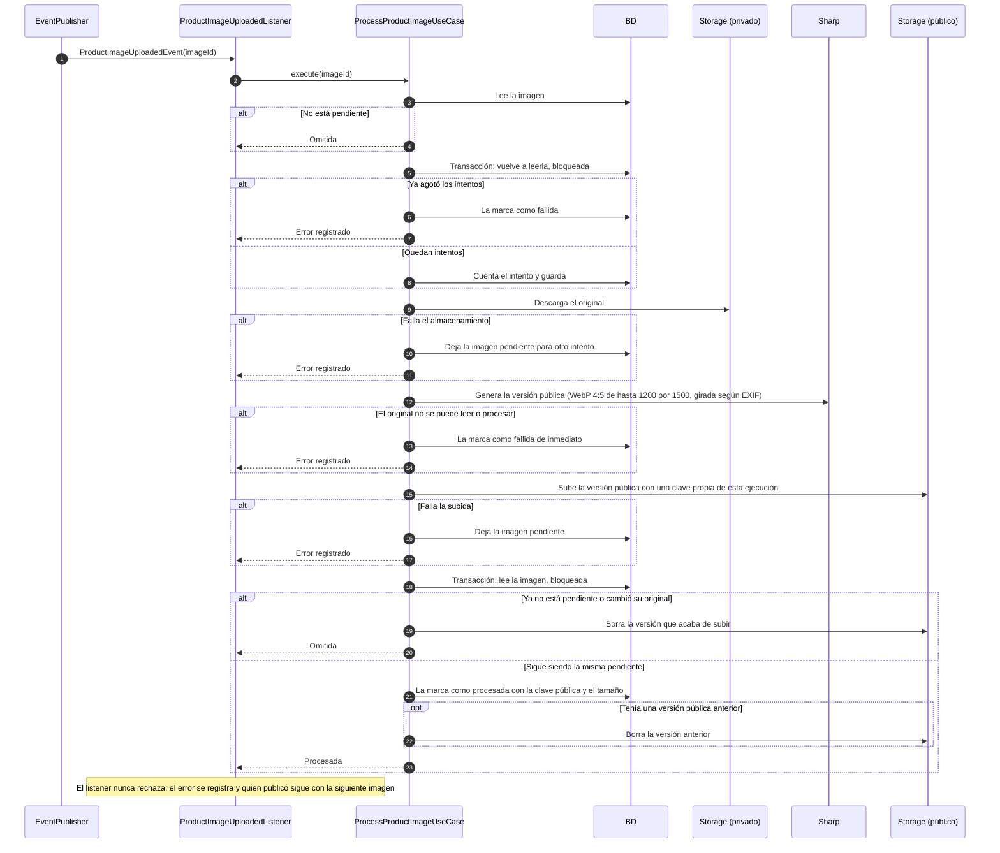

### 15. Reprocesado de imágenes demoradas

Una tarea programada recupera las imágenes que se quedaron pendientes más de lo normal, por ejemplo porque un reinicio cortó su procesado. Procesa de a una, empezando por la más antigua y con un lote chico por corrida, para que Sharp nunca decodifique varias a la vez.

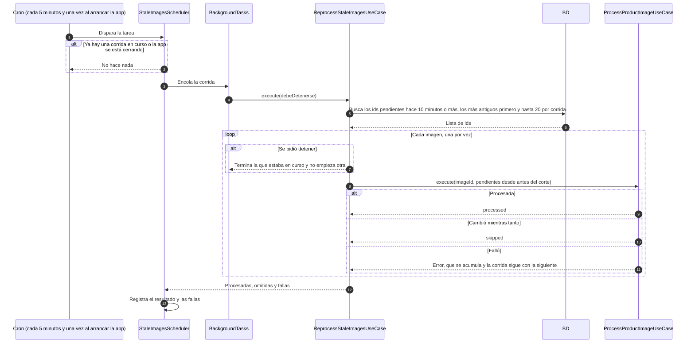

### 16. Reemplazo del archivo de una imagen

El archivo nuevo se sube con una clave propia (nunca se sobrescribe un archivo) y la versión pública anterior se sigue mostrando hasta que termina el procesado del nuevo original. Agregar una imagen (`POST /admin/products/:id/images`) sigue el mismo esquema: se valida y se sube antes de la transacción, dentro de ella se bloquean el producto y las imágenes para que dos altas simultáneas no superen el límite de 5, y al confirmar se publica el evento de procesado.

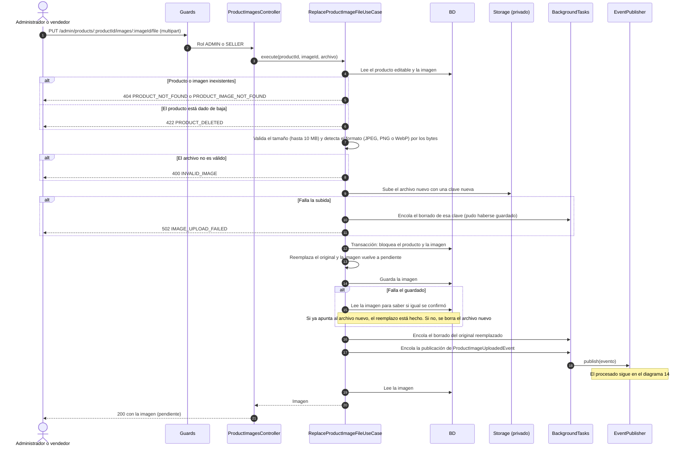

### 17. Eliminación de una imagen

Un producto nunca queda sin imágenes. Los archivos se borran recién después de confirmar la transacción, así una eliminación que no ocurre conserva los suyos. Los que el almacenamiento no pudo borrar se devuelven para registrarlos y limpiarlos a mano.

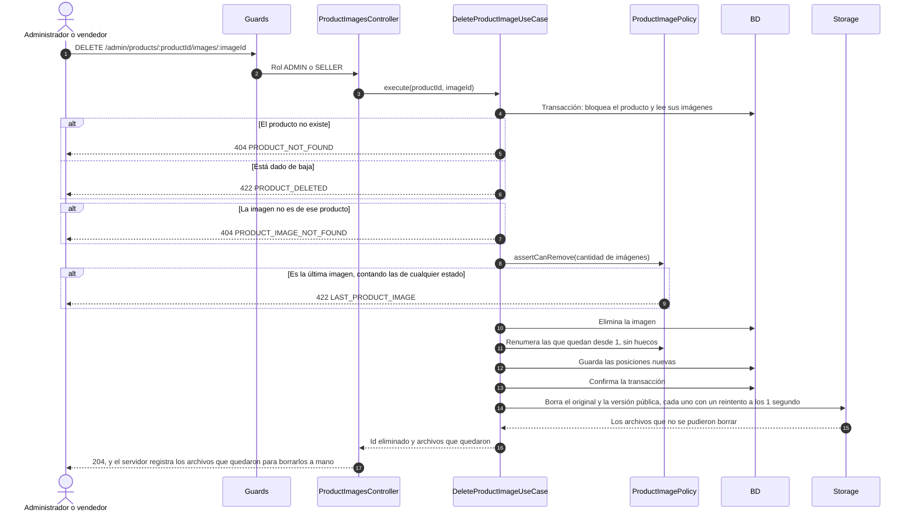

---

## Catálogo: categorías

### 18. Baja de categoría

Dos bajas a la vez podrían dejar a un producto sin su última categoría vigente, así que se ejecutan de a una, bloqueando toda la jerarquía. Crear, mover o reactivar una subcategoría bloquea a su padre, por lo que ninguna aparece entre el conteo y la baja.

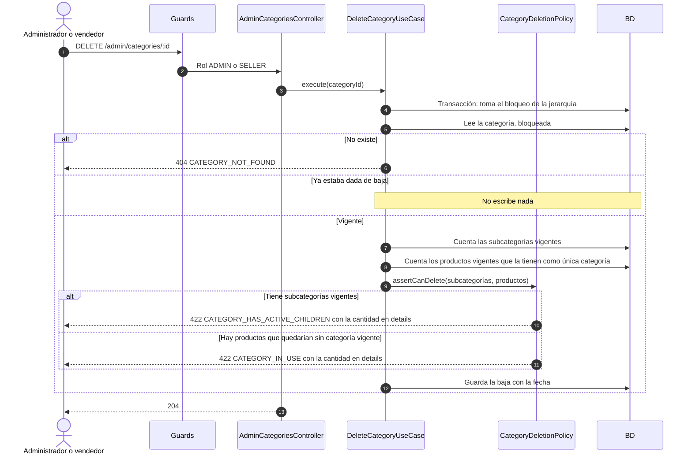

---

## Catálogo: tienda pública

Las rutas de la tienda son públicas y de solo lectura. Solo muestran los productos y categorías visibles, es decir vigentes, activos y con una categoría que la tienda muestra. Una oferta o una novedad vencida deja de mostrarse en su fecha de fin aunque el dato siga guardado.

### 19. Listado y búsqueda en el catálogo

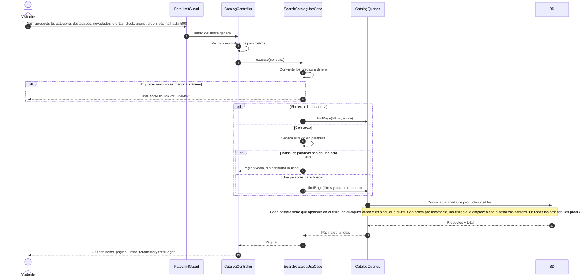

### 20. Ficha de producto

La ficha muestra primero los productos relacionados elegidos a mano y, si no alcanzan el límite, los completa con otros de la misma categoría principal, siempre que la tienda la muestre.

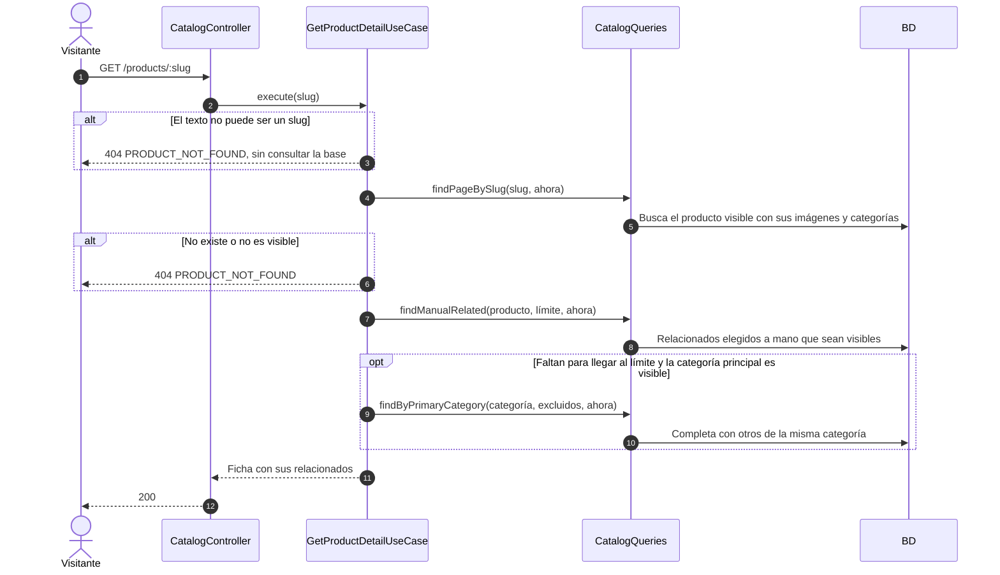

### 21. Búsqueda global

Es la búsqueda del encabezado de la tienda: devuelve productos por título y categorías por nombre en una sola respuesta, con pocos resultados de cada tipo.

```mermaid
sequenceDiagram
    autonumber
    actor C as Visitante
    participant API as SearchController
    participant UC as GlobalSearchUseCase
    participant CQ as CatalogQueries
    participant KQ as CategoryQueries
    participant BD as BD

    C->>API: GET /search?q=...&limit=5
    API->>API: Valida el largo del texto y el límite
    API->>UC: execute(q, limit)
    UC->>UC: Separa el texto en palabras
    alt Sin palabras para buscar
        UC-->>API: Productos y categorías vacíos
    else Hay palabras
        par Productos
            UC->>CQ: searchCards(palabras, texto, límite, ahora)
            CQ->>BD: Productos visibles cuyo título tiene todas las palabras
        and Categorías
            UC->>KQ: searchVisible(palabras, texto, límite)
            KQ->>BD: Categorías visibles cuyo nombre tiene todas las palabras
        end
        Note over CQ,KQ: En ambos, los que empiezan con el texto buscado van primero
        UC-->>API: Productos y categorías
    end
    API-->>C: 200
```

---

## Catálogo: tareas programadas

### 22. Limpieza de ofertas y novedades vencidas

La tienda ya deja de mostrar una oferta o una novedad en su fecha de fin. Esta tarea hace que el dato guardado, y lo que ve el panel, coincida con eso. Es idempotente: lo que ya se limpió no se encuentra de nuevo.

```mermaid
sequenceDiagram
    autonumber
    participant CR as Cron (todos los días a medianoche, hora de Argentina)
    participant SCH as ProductMarksExpiryScheduler
    participant BG as BackgroundTasks
    participant UC as ExpireProductMarksUseCase
    participant BD as BD

    CR->>SCH: Dispara la tarea
    SCH->>BG: Encola la ejecución
    BG->>UC: execute()
    UC->>BD: Quita el precio de oferta y la marca de oferta de los productos cuya oferta ya terminó
    UC->>BD: Quita la marca de novedad de los productos cuya fecha de novedad ya pasó
    BD-->>UC: Cantidad de ofertas y novedades limpiadas
    UC-->>SCH: Resultado
    SCH->>SCH: Registra el resultado
```
